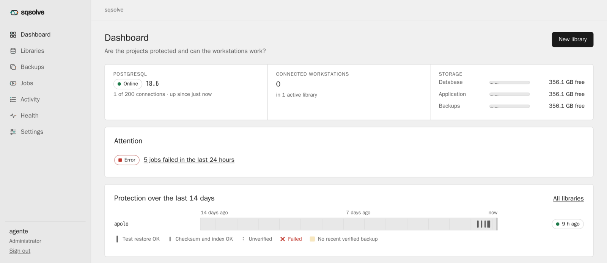
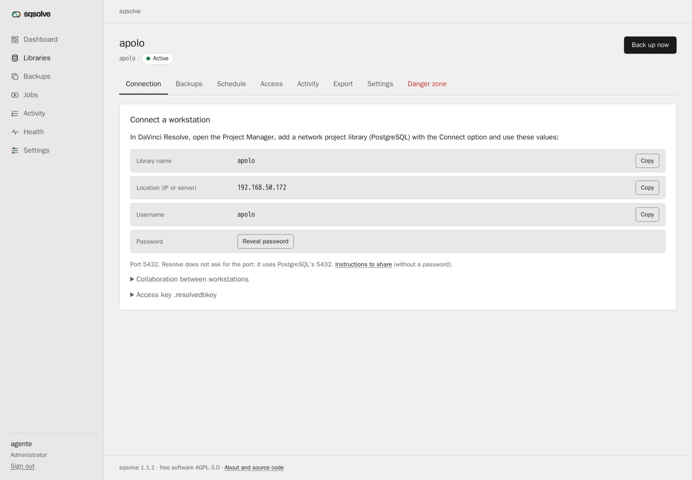
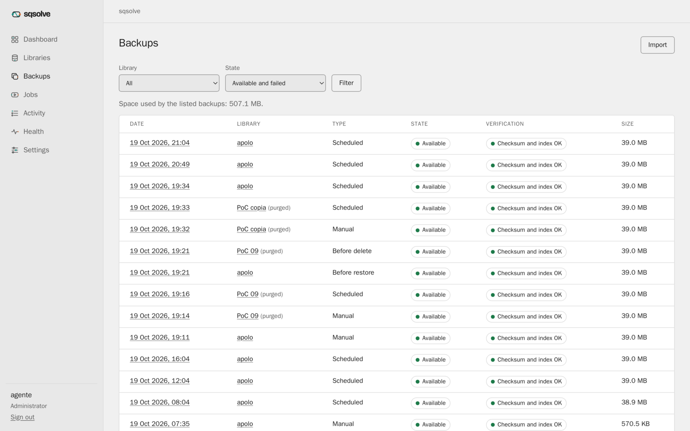

<p align="center">
  <picture>
    <source media="(prefers-color-scheme: dark)" srcset="docs/brand/logo-dark.svg">
    
  </picture>
</p>

<p align="center">
  <strong>Free, self-hosted project library server for DaVinci Resolve.</strong><br>
  One YAML file, a web panel, and backups that verify themselves.
</p>

<p align="center">
  <a href="https://github.com/donutinit/sqsolve/actions/workflows/ci.yml"></a>
  <a href="https://github.com/donutinit/sqsolve/releases"></a>
  <a href="https://github.com/donutinit/sqsolve/pkgs/container/sqsolve"></a>
  <a href="LICENSE"></a>
</p>

DaVinci Resolve keeps shared projects in a PostgreSQL "project library". Setting one up is easy;
keeping it with backups that actually restore, per-person access and a place to see that all is
well is not. sqsolve is that server, packaged in two containers and run from the browser, for an
editor with a NAS at home or a studio of two to ten workstations. The name joins **SQ**L
(PostgreSQL) and Re**solve**.

## What you get

| | |
|---|---|
| **Isolated libraries** | Each library gets its own PostgreSQL user: one client never sees another's projects |
| **Connection without guessing** | Ready-to-copy connection data for every workstation and, if you want, one password per person that you can revoke alone |
| **Backups that work** | Consistent `pg_dump` with SHA-256 and a manifest, verified when done, and a weekly test restore |
| **Activity-based schedule** | A backup every 15 minutes while someone works, none when the library is quiet |
| **Restore without fear** | As a new library, or in place with an automatic backup first and seven days to revert |
| **See it at a glance** | The protection timeline: every library is a track and every backup a marker with its verification level |
| **Recover anywhere** | Backups and a recovery kit are enough to rebuild the whole installation on another server |
| **Offline, no account** | Works without Internet, no telemetry, AGPL-3.0, builds from source |

<p align="center">
  
</p>

## Five minutes to a running server

1. Create three folders: `db` and `app` on SSD, `backups` on another disk.
2. Copy [`deploy/compose.yaml`](deploy/compose.yaml), change the three paths and your time zone.
3. `docker compose up -d` (on TrueNAS: Apps, "Install via YAML").
4. `docker compose logs sqsolve` prints the installation code.
5. Open `https://<server-ip>:9432`, paste the code, create your user and download the recovery kit.

Then create a library, press **Create** in Resolve's Project Manager with the data the panel
shows, and the library is active with its first backup taken. Every detail, from TrueNAS datasets
to troubleshooting, is in the [user guide](docs/manual/user-guide.md).

<p align="center">
  
</p>

## How it is built

```
 Resolve workstations ──TCP 5432──▶ postgres   (official PostgreSQL 18 image)
                                        ▲ internal socket
 Browser ───────────────HTTPS 9432──▶ sqsolve    (panel, API, backups, jobs)
                                        │
             volumes: db (SSD) · app (SSD) · backups (another disk)
```

A single Go binary on top of the official PostgreSQL image, so `pg_dump` and `pg_restore` always
match the server. It runs unprivileged with a read-only file system, talks to PostgreSQL only
through an internal socket, and never writes into a library's tables: Resolve's databases are a
black box ([ADR 0007](docs/adr/0007-black-box.md)). The web panel is server-rendered HTML with a
few hundred lines of its own JavaScript and no third-party assets.

<p align="center">
  
</p>

## Status

**1.2.2** ([changes](CHANGELOG.md)). Version 1.0 was tested against PostgreSQL 18 and DaVinci
Resolve Studio 21.1.1 on Linux: creating libraries from Resolve, TLS, verified backups, restore as
a copy and in place with Resolve open, and full recovery of the installation from the backups and
the kit ([acceptance record](docs/acceptance/1.0.md), [proofs of concept](docs/poc)). Version
1.2.2 was deployed on the test installation, and its replace and revert were checked by hand with
Resolve 21.1.1 on Linux: they work, and a project left open must be closed first
([acceptance record](docs/acceptance/1.2.2.md)). Every version passes the automated tests (unit
and integration tests against PostgreSQL 18, failure scenarios, the image smoke test); other
changes after 1.0 that depend on Resolve, such as maintenance through `NOLOGIN`, have not been
tested with Resolve yet. Not yet tested: Resolve on macOS and Windows, collaboration between two
workstations, exchanging files with Resolve's own Backup and Restore, and per-person
credentials. If you depend on any of those, try them with a test library before putting client
projects on it.

## Documentation

- [User guide](docs/manual/user-guide.md): install, first start, libraries, backups, restore,
  access, API, console, updating, disaster recovery, troubleshooting.
- [Error codes](docs/manual/errors.md) and [runbooks](docs/runbooks) with expected output.
- [Master plan](docs/README.md): architecture, requirements, decisions (ADR), tests, roadmap.
- [What the plan asked for and what exists](PLAN.md).
- [Brand](docs/brand/README.md): logo, colors, typography and icons.
- [CHANGELOG](CHANGELOG.md), [CONTRIBUTING](CONTRIBUTING.md), [SECURITY](SECURITY.md).

## License

Code: AGPL-3.0-only. Documentation and brand: CC BY-SA 4.0 ([ADR 0001](docs/adr/0001-license.md)).

DaVinci Resolve and Blackmagic Design are trademarks of Blackmagic Design Pty. Ltd. sqsolve is an
independent project, not affiliated with or endorsed by Blackmagic Design.
