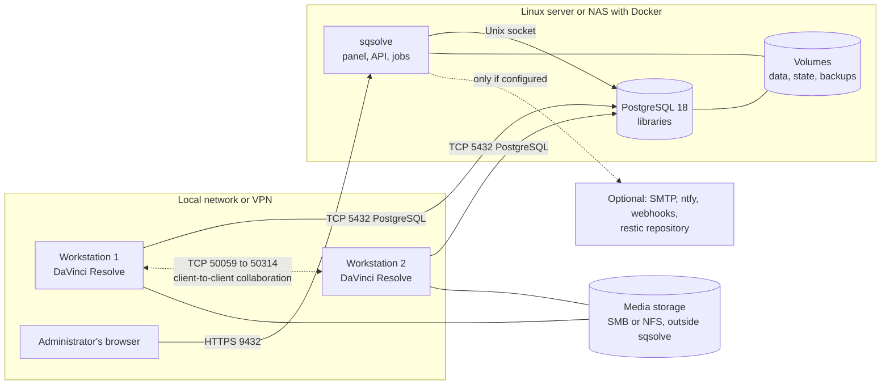
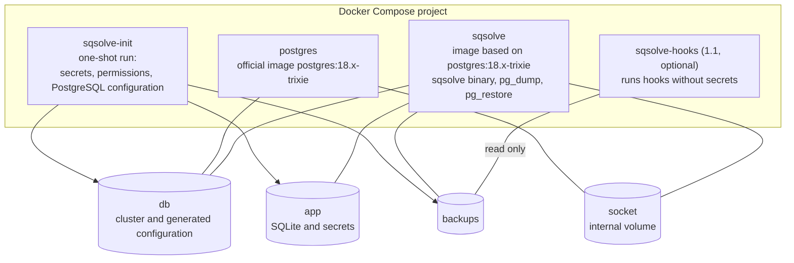
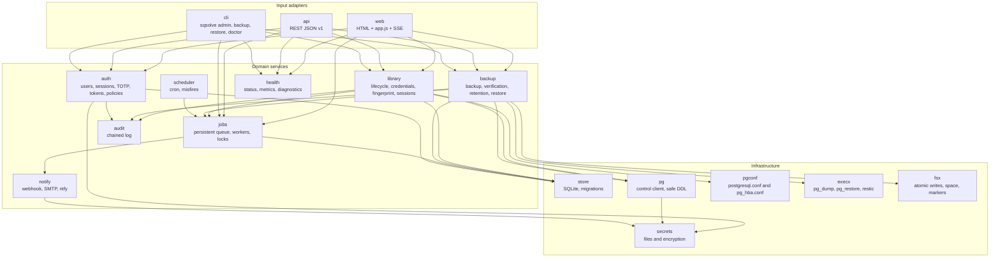

# 05. Architecture

## 1. Principles

1. **Control plane separate from the data plane.** sqsolve (control plane) keeps its state in
   SQLite and keeps working even when PostgreSQL (data plane) is down, which is precisely when
   it is needed most to diagnose and restore.
2. **Libraries as a black box** (ADR 0007). sqsolve manages databases, roles, connections and
   backups; it never interprets Resolve tables. That way it does not break when Resolve changes
   its schema. The only exception is the limited, off-by-default read of ADR 0019 to export
   `.drp` and `.drx`, which turns itself off if the schema changes.
3. **Never destroy without a copy.** Deleting, restoring or rotating leaves a way back.
4. **Every long operation is a persistent job** with recorded steps, resumable or cleanable
   after a power cut.
5. **Least privilege at every boundary:** containers without root, control role without
   superuser, roles per library, hooks without secrets.
6. **No runtime dependencies outside the host.** No mandatory Internet.
7. **Few moving parts.** Two permanent containers and one init container. No orchestrator, no
   external queues, no additional server-based databases.

## 2. Context



Ports published by the host: **5432** (PostgreSQL, mandatory, PoC-08 confirms whether it can
change) and **9432** (HTTPS panel, configurable). Port 50059 is not published (ADR 0012).

## 3. Containers



| Container | Responsibility | User | Network |
|---|---|---|---|
| `sqsolve-init` | Create missing secrets, generate `postgresql.conf`, `pg_hba.conf` and certificates, fix permissions on the three volumes. Exits and does not run again until the next `up` | root (this task only, no network) | none |
| `postgres` | Serve the libraries | `postgres` (UID 999 of the image) | `lan` (5432 published) |
| `sqsolve` | Panel, API, scheduler, jobs, backups, audit log | Configurable UID and GID, 1000 by default | `lan` (9432 published); reaches PostgreSQL over the socket |
| `sqsolve-hooks` | Run the administrator's hooks | Own UID without access to secrets | `hooks` (configurable) |

Volume details and the reference Compose file are in `12-deployment.md`.

## 4. sqsolve components



Dependency rules: adapters only talk to services; services know nothing about HTTP; the
infrastructure knows nothing about the domain. Authorization is evaluated in a single layer
(`auth` exposes `Authorize(actor, action, resource)`), used alike by the web, the API and the
CLI.

## 5. Concurrency model

- One Go process. HTTP server with `http.Server` and explicit timeouts.
- `jobs` keeps a pool of workers (2 by default). "Heavy" jobs (backup, verification, restore)
  take a global semaphore with capacity 1 by default, configurable.
- Lock per library: two jobs that write to the same library (restore, delete, maintenance)
  never run at the same time. A backup and a verification of the same library can coexist with
  other read-only ones.
- Jobs receive a `context.Context`; cancelling closes the context and `execx` sends SIGTERM to
  the process group of the child it launched and SIGKILL to that whole group once the child
  exits or after 10 s, always before reaping the child, so the group id cannot name anyone
  else's processes.
- SQLite in WAL mode with a single serialized write connection and a read pool.
- Progress events are published on an in-memory bus and reach the browser over SSE.

## 6. Main flows

### 6.1 Library creation (strategy E1, initialization window)

```mermaid
sequenceDiagram
  actor A as Administrator
  participant S as sqsolve
  participant P as PostgreSQL
  actor R as Resolve (workstation)
  A->>S: New library "Client X" (slug client_x)
  S->>P: CREATE ROLE client_x LOGIN CREATEDB PASSWORD (SCRAM)
  S->>S: pg_hba: allow client_x into database client_x and into the maintenance database if PoC-01 requires it
  S->>P: pg_reload_conf()
  S-->>A: Details for "Create" in Resolve; state "awaiting initialization"
  R->>P: Create client_x (Resolve creates the database and its schema)
  loop every 5 s for up to 60 min
    S->>P: does database client_x exist with owner client_x and tables?
  end
  S->>P: ALTER ROLE client_x NOCREATEDB
  S->>P: Ownership adjustments and GRANT according to PoC-01
  S->>S: Schema fingerprint, default backup policy, first backup
  S-->>A: State "active"
```

If the window expires without initialization, sqsolve removes `CREATEDB`, leaves the library in
"initialization expired" and allows reopening the window. Strategies E0 (pre-created database)
and E2 (from a local template) are in `07-libraries-and-postgresql.md` §5.

### 6.2 Scheduled backup

```mermaid
sequenceDiagram
  participant C as scheduler
  participant J as jobs
  participant B as backup
  participant P as PostgreSQL
  participant F as Backups volume
  C->>J: Enqueue backup(client_x) on schedule
  J->>B: Run with a read lock on client_x
  B->>F: Check volume marker and free space
  B->>P: BEGIN REPEATABLE READ; pg_export_snapshot()
  B->>P: pg_dump --snapshot=ID --format=custom to a .partial file
  B->>P: Exact row counts per table on the same snapshot; COMMIT
  B->>F: fsync, rename .partial to .backup, write manifest
  B->>B: Level 1 verification (SHA-256 and pg_restore --list)
  B->>J: Succeeded; catalog updated
  J->>J: Event backup.succeeded, notifications, retention if due
```

### 6.3 Restore by swap

State diagram and steps in `11-backups-and-automation.md` §7. Summary: restore into
`<slug>__restore_<id>`, verify against the manifest, lock and disconnect the active one, rename
the active one to `<slug>__prev_<timestamp>`, rename the restored one to `<slug>`, reopen. Each
step is recorded before it runs so that it can be completed or reverted after a power cut.

### 6.4 Startup and recovery

1. Read the environment configuration and check the volumes (markers, permissions, space).
2. Open SQLite; copy with `VACUUM INTO` and migrate if there are pending migrations.
3. Connect to PostgreSQL over the socket (with retries; the panel starts even if it fails and
   says so).
4. Reconcile: running jobs become "interrupted"; delete orphaned `.partial` files; drop
   `sqsolve_verify_*` and `__restore_*` databases without a live job; complete or revert
   half-done swaps according to their journal; remove `CREATEDB` from expired windows;
   regenerate `pg_hba.conf` from the catalog and reload. A journal that cannot be settled
   stays pending and is tried again at every start; until then its library is left as it is and
   nothing its journal names is dropped (docs 11 §7.3, §8).
5. Start the scheduler (with the misfire policy) and the HTTP server.

## 7. Configuration

| Layer | Where | Examples |
|---|---|---|
| Startup | Environment variables (`SQSOLVE_*`) | Volume paths, port, time zone, UID, log level |
| Secrets | Files in `app/secrets` and `db/sqsolve/superuser_password` (ADR 0018) | Master key, control role, superuser |
| Runtime settings | SQLite `settings` table, editable in the interface | Advertised address, default policies, notification channels |
| PostgreSQL | Files generated in `db/sqsolve` | `postgresql.conf`, `pg_hba.conf`, certificates |

There is no configuration file of its own: fewer formats and a single source of truth for each
thing. The full list of variables is in `12-deployment.md` §4.

## 8. Errors

- Each domain error has a stable code `SQS-<area><number>` (for example `SQS-B012`,
  "insufficient space on the backups volume"), a message for the person, a technical cause and
  a link to the documentation.
- Catalog in `internal/errs/catalog.go` and in `docs/manual/errors.md`, generated from the same
  table so they never drift apart.
- The API returns RFC 9457 (`application/problem+json`) with the code in `type`.
- Areas: `A` authentication, `L` libraries, `B` backups, `R` restore, `J` jobs, `P` PostgreSQL,
  `S` storage, `N` notifications, `C` configuration, `E` experimental export, `X` internal.

## 9. Recorded decisions

See `adr/README.md`. The ones that shape this architecture: 0002 (topology), 0003 (Go), 0004
(interface), 0005 (SQLite), 0007 (black box), 0008 (roles), 0009 and 0010 (backups and
restore), 0016 (base image), 0019 (experimental export, narrows 0007).
