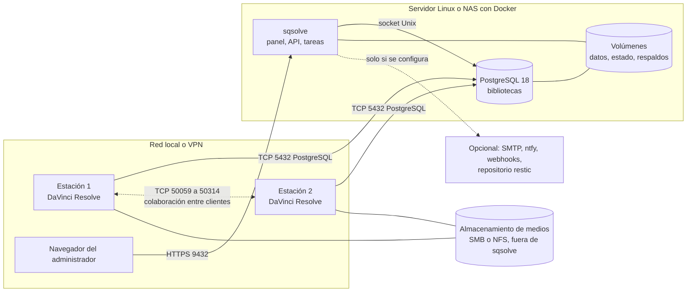
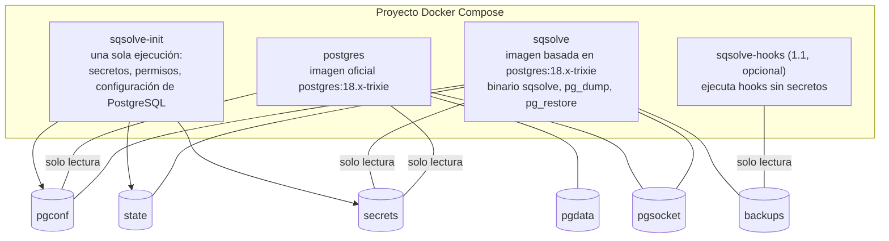
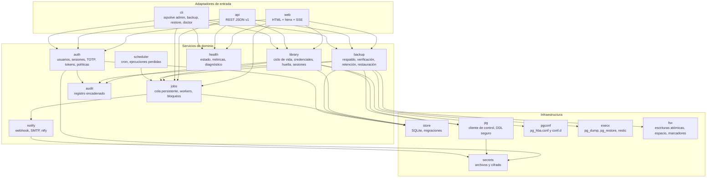

# 05. Arquitectura

## 1. Principios

1. **Plano de control separado del plano de datos.** sqsolve (plano de control) guarda su estado
   en SQLite y sigue funcionando aunque PostgreSQL (plano de datos) esté caído, que es justo
   cuando más se necesita para diagnosticar y restaurar.
2. **Bibliotecas como caja negra** (ADR 0007). sqsolve administra bases, roles, conexiones y
   respaldos; nunca interpreta tablas de Resolve. Así no se rompe cuando Resolve cambia su
   esquema.
3. **Nunca destruir sin copia.** Borrar, restaurar o rotar dejan un camino de vuelta.
4. **Toda operación larga es una tarea persistente** con pasos registrados, reanudable o
   limpiable tras un corte.
5. **Mínimo privilegio en cada frontera:** contenedores sin root, rol de control sin
   superusuario, roles por biblioteca, hooks sin secretos.
6. **Sin dependencias en tiempo de ejecución fuera del host.** Nada de Internet obligatorio.
7. **Pocas piezas.** Dos contenedores permanentes y uno de inicialización. Sin orquestador, sin
   colas externas, sin bases adicionales con servidor.

## 2. Contexto



Puertos publicados por el host: **5432** (PostgreSQL, obligatorio, PoC-08 confirma si puede
cambiar) y **9432** (panel HTTPS, configurable). El puerto 50059 no se publica (ADR 0012).

## 3. Contenedores



| Contenedor | Responsabilidad | Usuario | Red |
|---|---|---|---|
| `sqsolve-init` | Crear secretos que falten, generar `postgresql.conf`, `pg_hba.conf` y certificados, ajustar permisos de volúmenes. Termina y no vuelve a correr hasta el siguiente `up` | root (solo esta tarea, sin red) | ninguna |
| `postgres` | Servir las bibliotecas | `postgres` (UID 999 de la imagen) | `lan` (5432 publicado) |
| `sqsolve` | Panel, API, programador, tareas, respaldos, auditoría | UID y GID configurables, 1000 por defecto | `lan` (9432 publicado); llega a PostgreSQL por socket |
| `sqsolve-hooks` | Ejecutar hooks del administrador | UID propio sin acceso a secretos | `hooks` (configurable) |

Detalle de volúmenes y del Compose de referencia en `12-despliegue.md`.

## 4. Componentes de sqsolve



Reglas de dependencia: los adaptadores solo hablan con servicios; los servicios no conocen HTTP;
la infraestructura no conoce el dominio. La autorización se evalúa en una sola capa (`auth`
expone `Authorize(actor, action, resource)`), que usan por igual la web, la API y la CLI.

## 5. Modelo de concurrencia

- Un proceso Go. Servidor HTTP con `http.Server` y tiempos de espera explícitos.
- `jobs` mantiene un grupo de workers (2 por defecto). Las tareas "pesadas" (respaldo,
  verificación, restauración) ocupan un semáforo global de capacidad 1 por defecto, configurable.
- Bloqueo por biblioteca: nunca corren a la vez dos tareas que escriben sobre la misma biblioteca
  (restauración, eliminación, mantenimiento). Un respaldo y una verificación de la misma
  biblioteca sí pueden coexistir con otras de solo lectura.
- Las tareas reciben un `context.Context`; cancelar cierra el contexto y `execx` envía SIGTERM
  y, tras 10 s, SIGKILL solo al proceso hijo que lanzó (grupo de procesos propio).
- SQLite en modo WAL con una sola conexión de escritura serializada y un grupo de lectura.
- Los eventos de progreso se publican en un bus en memoria y llegan al navegador por SSE.

## 6. Flujos principales

### 6.1 Creación de biblioteca (estrategia E1, ventana de inicialización)

```mermaid
sequenceDiagram
  actor A as Administrador
  participant S as sqsolve
  participant P as PostgreSQL
  actor R as Resolve (estación)
  A->>S: Nueva biblioteca "Cliente X" (slug cliente_x)
  S->>P: CREATE ROLE cliente_x LOGIN CREATEDB PASSWORD (SCRAM)
  S->>S: pg_hba: permitir cliente_x a base cliente_x y a la base de mantenimiento si PoC-01 lo exige
  S->>P: pg_reload_conf()
  S-->>A: Datos para "Create" en Resolve; estado "esperando inicialización"
  R->>P: Create cliente_x (Resolve crea la base y su esquema)
  loop cada 5 s hasta 60 min
    S->>P: ¿existe la base cliente_x con dueño cliente_x y tablas?
  end
  S->>P: ALTER ROLE cliente_x NOCREATEDB
  S->>P: Ajustes de propiedad y GRANT según PoC-01
  S->>S: Huella de esquema, política de respaldo por defecto, primer respaldo
  S-->>A: Estado "activa"
```

Si la ventana vence sin inicialización, sqsolve quita `CREATEDB`, deja la biblioteca en
"inicialización vencida" y permite reabrir la ventana. Las estrategias E0 (base precreada) y E2
(desde plantilla local) están en `07-bibliotecas-y-postgresql.md` §5.

### 6.2 Respaldo programado

```mermaid
sequenceDiagram
  participant C as scheduler
  participant J as jobs
  participant B as backup
  participant P as PostgreSQL
  participant F as Volumen de respaldos
  C->>J: Encolar backup(cliente_x) por programación
  J->>B: Ejecutar con bloqueo de lectura de cliente_x
  B->>F: Verificar marcador de volumen y espacio libre
  B->>P: BEGIN REPEATABLE READ; pg_export_snapshot()
  B->>P: pg_dump --snapshot=ID --format=custom a archivo .partial
  B->>P: Conteos exactos por tabla en la misma instantánea; COMMIT
  B->>F: fsync, renombrar .partial a .backup, escribir manifiesto
  B->>B: Verificación nivel 1 (SHA-256 y pg_restore --list)
  B->>J: Correcto; catálogo actualizado
  J->>J: Evento backup.succeeded, notificaciones, retención si toca
```

### 6.3 Restauración por intercambio

Diagrama de estados y pasos en `11-respaldos-y-automatizacion.md` §7. Resumen: restaurar en
`<slug>__restore_<id>`, verificar contra el manifiesto, bloquear y desconectar la activa,
renombrar la activa a `<slug>__prev_<marca>`, renombrar la restaurada a `<slug>`, reabrir. Cada
paso se registra antes de ejecutarse para poder completarlo o revertirlo tras un corte.

### 6.4 Arranque y recuperación

1. Leer configuración de entorno y comprobar volúmenes (marcadores, permisos, espacio).
2. Abrir SQLite; copiar con `VACUUM INTO` y migrar si hay migraciones pendientes.
3. Conectar a PostgreSQL por socket (con reintentos; el panel arranca aunque falle y lo indica).
4. Reconciliar: tareas en curso pasan a "interrumpida"; borrar `.partial` huérfanos; borrar
   bases `sqsolve_verify_*` y `__restore_*` sin tarea viva; completar o revertir intercambios a
   medias según su diario; quitar `CREATEDB` de ventanas vencidas; regenerar `pg_hba.conf` desde
   el catálogo y recargar.
5. Arrancar programador (con la política de ejecuciones perdidas) y servidor HTTP.

## 7. Configuración

| Capa | Dónde | Ejemplos |
|---|---|---|
| Arranque | Variables de entorno (`SQSOLVE_*`) | Rutas de volúmenes, puerto, zona horaria, UID, nivel de log |
| Secretos | Archivos en `/run/sqsolve/secrets` | Superusuario, rol de control, clave maestra |
| Ajustes de ejecución | Tabla `settings` de SQLite, editables en la interfaz | Dirección anunciada, políticas por defecto, canales de aviso |
| PostgreSQL | Archivos generados en `pgconf` | `postgresql.conf`, `pg_hba.conf`, certificados |

No hay archivo de configuración propio: menos formatos y una sola fuente de verdad para cada
cosa. La lista completa de variables está en `12-despliegue.md` §4.

## 8. Errores

- Cada error de dominio tiene un código estable `SQS-<área><número>` (por ejemplo `SQS-B012`,
  "espacio insuficiente en el volumen de respaldos"), un mensaje para la persona, una causa
  técnica y un enlace a la documentación.
- Catálogo en `internal/errs/catalog.go` y en `docs/manual/errores.md`, generados de una misma
  tabla para que no se desincronicen.
- La API devuelve RFC 9457 (`application/problem+json`) con el código en `type`.
- Áreas: `A` autenticación, `L` bibliotecas, `B` respaldos, `R` restauración, `J` tareas,
  `P` PostgreSQL, `S` almacenamiento, `N` notificaciones, `C` configuración, `X` interno.

## 9. Decisiones registradas

Ver `adr/README.md`. Las que dan forma a esta arquitectura: 0002 (topología), 0003 (Go),
0004 (interfaz), 0005 (SQLite), 0007 (caja negra), 0008 (roles), 0009 y 0010 (respaldos y
restauración), 0016 (imagen base).
