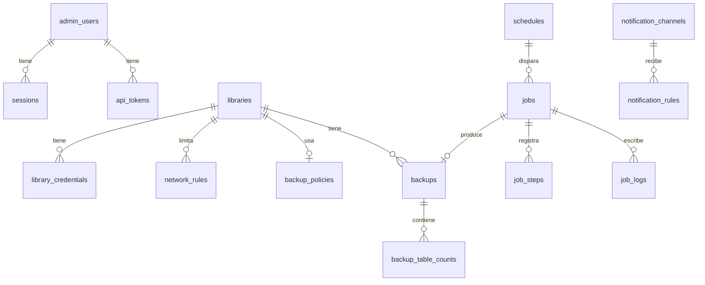

# 07. Bibliotecas y PostgreSQL

## 1. Modelo conceptual

Una **biblioteca de sqsolve** es la suma de:

- una base de datos de PostgreSQL (el contenido es de Resolve y es opaco para sqsolve);
- un rol propietario de PostgreSQL con el que Resolve se conecta;
- en 1.1, roles miembros por persona;
- reglas de red, políticas de respaldo y retención;
- metadatos en SQLite: nombre visible, estado, huella, versión declarada, notas.

## 2. Nombres e identificadores

| Elemento | Regla | Ejemplo |
|---|---|---|
| Slug de biblioteca | `^[a-z][a-z0-9_]{2,39}$`; no empieza con `pg_`, `sqsolve`, `template`, `postgres`; no contiene `__` | `cliente_x` |
| Base de datos activa | Igual al slug | `cliente_x` |
| Rol propietario | Igual al slug (es el "usuario" que se escribe en Resolve) | `cliente_x` |
| Rol miembro (1.1) | `<slug>__<persona>`, persona `^[a-z][a-z0-9]{1,19}$` | `cliente_x__ana` |
| Base restaurándose | `<slug>__restore_<id8>` | `cliente_x__restore_7f3a91c2` |
| Estado previo tras intercambio | `<slug>__prev_<AAAAMMDDhhmm>` | `cliente_x__prev_202610181930` |
| Papelera | `<slug>__trash_<AAAAMMDD>` | `cliente_x__trash_20261018` |
| Verificación | `sqsolve_verify_<id8>` | `sqsolve_verify_0c11ad3e` |
| Nombre visible | UTF-8, 1 a 80 caracteres, sin caracteres de control | `Cliente X, temporada 2` |

Todos los nombres caben en 63 bytes (límite de identificadores de PostgreSQL). Los validadores
viven en `internal/pg/ident.go`, tienen pruebas de fuzzing y se aplican antes de
`pgx.Identifier{...}.Sanitize()`; ninguno de los dos se usa solo.

El doble guion bajo está prohibido en slugs para que ningún nombre auxiliar pueda chocar con un
slug válido.

## 3. Roles de PostgreSQL

| Rol | Atributos | Membresías y permisos | Acceso |
|---|---|---|---|
| `postgres` | Superusuario (creado por la imagen) | Todos | Solo socket local, SCRAM. Uso: arranque, migraciones de privilegios y procedimientos de emergencia auditados |
| `sqsolve_admin` | `LOGIN NOSUPERUSER CREATEDB CREATEROLE NOREPLICATION NOBYPASSRLS` | `pg_monitor`, `pg_signal_backend`, `pg_read_all_data`; `EXECUTE` sobre `pg_reload_conf()` (VIABLE-PENDIENTE: si no se puede conceder, la recarga usa el superusuario) | Solo socket local, SCRAM |
| `<slug>` | `LOGIN NOSUPERUSER NOCREATEDB NOCREATEROLE NOREPLICATION NOBYPASSRLS`, `CONNECTION LIMIT` configurable; `CREATEDB` solo durante la ventana de inicialización | `CONNECT, TEMP` sobre su base; dueño del esquema `public` y de los objetos de Resolve | Red, SCRAM, solo hacia su base (y la de mantenimiento si PoC-01 lo exige) |
| `<slug>__<persona>` (1.1) | `LOGIN`, resto igual a `<slug>` | Miembro de `<slug>`; `ALTER ROLE ... IN DATABASE <slug> SET role = '<slug>'` para que todo objeto nuevo quede a nombre del propietario (VIABLE-PENDIENTE, PoC-01 paso 5) | Red, SCRAM, solo hacia la base de su biblioteca |

Por qué no superusuario para el trabajo diario: un superusuario puede ejecutar `COPY ... TO
PROGRAM`, es decir, comandos en el contenedor de PostgreSQL. Si una falla de sqsolve permitiera
inyectar SQL, con `sqsolve_admin` el daño se limita a bases y roles, no al sistema.

Desde PostgreSQL 16, `sqsolve_admin` solo puede modificar los roles que creó (tiene `ADMIN
OPTION` sobre ellos) y solo puede conceder `CREATEDB` porque lo tiene [01 §12]. Al crear un rol de
biblioteca, sqsolve ejecuta además `GRANT <slug> TO sqsolve_admin WITH INHERIT TRUE, SET TRUE`.

Implementado y probado contra PostgreSQL 18: la base sigue siendo propiedad del rol de la
biblioteca (como la deja Resolve al crearla) y `sqsolve_admin`, por herencia, actúa como dueño
para renombrarla, bloquearla, borrarla o respaldarla; tiene además `CREATEDB` propio, que exige
el renombre. Así no hace falta cambiar el dueño de la base y el plan B de PoC-01 se vuelve el
camino normal. `pg_hba.conf` rechaza a `sqsolve_admin` por red aunque sea miembro de los roles de
biblioteca, porque los roles se listan por nombre.

Información que PostgreSQL no permite ocultar: cualquier rol conectado puede leer
`pg_database` y ver los nombres de todas las bases. Se documenta; no se ofrece "biblioteca
secreta".

## 4. Ciclo de vida

```mermaid
stateDiagram-v2
  [*] --> provisioning: crear
  provisioning --> awaiting_init: rol y reglas listas (E1)
  provisioning --> active: base creada desde plantilla (E2) o precreada (E0)
  awaiting_init --> active: Resolve inicializó la base
  awaiting_init --> init_expired: vence la ventana
  init_expired --> awaiting_init: reabrir ventana
  active --> maintenance: bloquear conexiones
  maintenance --> active: desbloquear
  active --> restoring: restauración por intercambio
  restoring --> active: correcto o revertido
  active --> trashed: eliminar (respaldo final verificado)
  maintenance --> trashed: eliminar
  trashed --> active: recuperar de la papelera
  trashed --> purged: vence la retención de papelera
  purged --> [*]
```



| Estado | Conexiones de Resolve | Respaldos programados | Visible en la lista |
|---|---|---|---|
| `provisioning` | No | No | Sí, con progreso |
| `awaiting_init` | Solo para inicializar | No | Sí |
| `init_expired` | No | No | Sí, con acción |
| `active` | Sí | Sí | Sí |
| `maintenance` | No (`ALLOW_CONNECTIONS false`) | Sí | Sí |
| `restoring` | No durante el intercambio | Pausados | Sí, con progreso |
| `trashed` | No | No | En "Papelera" |
| `purged` | No | No | Solo en auditoría |

## 5. Estrategias de creación

La elección final depende de PoC-01. sqsolve implementa E1 siempre, E0 si PoC-01 demuestra que
Resolve inicializa una base vacía con "Connect", y E2 como optimización.

### E1. Ventana de inicialización (base)

1. Crear el rol `<slug>` con `CREATEDB` y contraseña aleatoria.
2. Agregar las líneas de `pg_hba.conf` del rol y recargar.
3. Mostrar los datos para "Create" en Resolve (nombre de la biblioteca, IP o nombre del
   servidor, usuario, contraseña) y el estado "esperando inicialización".
4. Vigilar cada 5 s: la base `<slug>` existe, su dueño es `<slug>` y tiene tablas en `public`.
5. Al detectarla y ver estable el número de tablas en tres revisiones seguidas: `ALTER ROLE
   <slug> NOCREATEDB`; `REVOKE ALL ON DATABASE <slug> FROM PUBLIC`; `GRANT CONNECT, TEMP ... TO
   <slug>`. La base conserva su dueño.
6. Huella de esquema, política de respaldo por defecto y primer respaldo (tarea encadenada).
7. Ventana máxima configurable, 60 min por defecto; al vencer se quita `CREATEDB`.

Riesgo acotado: durante la ventana, el rol podría crear otras bases. Se mitiga con la duración
corta, el `pg_hba.conf` que solo le permite conectarse a su base y a la de mantenimiento, y una
comprobación al cerrar la ventana que lista bases nuevas con ese dueño y las reporta.

### E0. Base precreada

`CREATE DATABASE <slug> OWNER ... TEMPLATE template0 ENCODING 'UTF8'` y "Connect" desde Resolve.
Solo si PoC-01 demuestra que Resolve inicializa el esquema en ese caso.

### E2. Desde plantilla local

Tras la primera biblioteca inicializada con una versión de Resolve, el administrador puede
"guardar como plantilla" una biblioteca recién creada y sin proyectos. sqsolve guarda un
respaldo de ella en `state/templates/<versión-resolve>-<huella8>.backup`. Crear desde plantilla
es una restauración (`pg_restore --no-owner --no-privileges --role=<slug>`) en una base nueva.

- Las plantillas nunca se distribuyen con sqsolve: se generan en cada instalación con el Resolve
  del usuario. El esquema es obra de Blackmagic.
- PoC-04 paso 3 confirma que dos bibliotecas con el mismo origen pueden convivir. Si no pueden,
  E2 queda DESCARTADO.

### Adopción de bases existentes (S)

Para bases creadas fuera de sqsolve en el mismo servidor (por ejemplo, migradas a mano): el
administrador elige la base; sqsolve crea el rol `<slug>`, ejecuta `REASSIGN OWNED` hacia ese
rol dentro de la base (con el superusuario por socket, auditado), aplica permisos y la registra.

## 6. Credenciales

- Contraseñas generadas con `crypto/rand`: 24 caracteres del alfabeto
  `ABCDEFGHJKLMNPQRSTUVWXYZabcdefghijkmnopqrstuvwxyz23456789` (unos 140 bits). Sin símbolos,
  para evitar problemas de escape en Resolve y en XML hasta que PoC-05 diga otra cosa.
- Se guardan cifradas (ADR 0014) para poder mostrarlas de nuevo; en PostgreSQL solo existe su
  verificador SCRAM.
- Rotar: nueva contraseña con `ALTER ROLE ... PASSWORD`; las sesiones abiertas siguen; las
  estaciones deben actualizarla al reconectar. La interfaz muestra qué estaciones estaban
  conectadas para avisarles.
- Revocar una credencial de persona (1.1): `ALTER ROLE ... NOLOGIN`, cerrar sus sesiones, quitar
  su línea de `pg_hba.conf`, marcar `revoked_at`. Se borra el rol tras 30 días.
- Nunca se reutiliza un nombre de rol revocado durante ese plazo.

## 7. Sesiones activas

Consulta (con `pg_monitor`):

```sql
SELECT pid, usename, client_addr, application_name, backend_start, state, state_change
FROM pg_stat_activity
WHERE datname = $1 AND backend_type = 'client backend';
```

Cerrar una sesión: `pg_terminate_backend(pid)` tras confirmar, solo si `usename` es un rol de esa
biblioteca. Auditado con el usuario, la IP y la aplicación de la sesión cerrada.

## 8. Mantenimiento y reglas de conexión

| Acción | SQL |
|---|---|
| Bloquear conexiones | `ALTER DATABASE <slug> ALLOW_CONNECTIONS false` y, si se pide, terminar sesiones |
| Desbloquear | `ALTER DATABASE <slug> ALLOW_CONNECTIONS true` |
| Límite de conexiones | `ALTER DATABASE <slug> CONNECTION LIMIT n` (y `ALTER ROLE` equivalente) |
| Optimizar | `vacuumdb --analyze --dbname=<slug>` (equivale a "Optimize" sin reindexar); `REINDEX DATABASE CONCURRENTLY` solo bajo demanda |

## 9. Huella de esquema

Objetivo: detectar que Resolve cambió la estructura de una biblioteca (actualización de versión)
sin leer datos de proyectos.

```sql
SELECT c.relname, a.attname, format_type(a.atttypid, a.atttypmod), a.attnum
FROM pg_class c
JOIN pg_namespace n ON n.oid = c.relnamespace
JOIN pg_attribute a ON a.attrelid = c.oid
WHERE n.nspname = 'public' AND c.relkind IN ('r', 'p') AND a.attnum > 0 AND NOT a.attisdropped
ORDER BY 1, 4;
```

La huella es el SHA-256 de las filas serializadas como `tabla|columna|tipo` separadas por salto de
línea. Se guarda con el número de tablas. Se recalcula cada 5 min, en cada respaldo y al
terminar una restauración. Un cambio genera el evento `library.schema_changed` con la huella
anterior y la nueva.

Registro de huellas conocidas: `internal/compat/fingerprints.json` asocia huellas a versiones de
Resolve, alimentado por las PoC y por reportes de usuarios (solo el hash y la versión; nunca el
esquema). Una huella desconocida no impide nada: se muestra "versión no identificada".

## 10. Configuración de PostgreSQL

`sqsolve-init` genera los archivos en el volumen `pgconf` antes de que arranque PostgreSQL, y
sqsolve los regenera después. PostgreSQL arranca con:

```
postgres -c config_file=/etc/sqsolve/pg/postgresql.conf
```

Contenido base de `postgresql.conf` (los valores entre `<>` los calcula sqsolve):

| Parámetro | Valor | Motivo |
|---|---|---|
| `data_directory` | `/var/lib/postgresql/18/docker` | Ruta de la imagen oficial 18 |
| `hba_file` | `/etc/sqsolve/pg/pg_hba.conf` | Generado por sqsolve |
| `listen_addresses` | `'*'` | Dentro del contenedor; el host decide qué se publica |
| `port` | `5432` | Resolve |
| `unix_socket_directories` | `'/var/run/postgresql'` | Volumen `pgsocket` compartido con sqsolve |
| `max_connections` | `200` (ajustar tras PoC-01 paso 6) | Varias conexiones por estación |
| `password_encryption` | `scram-sha-256` | RNF-SEG-02 |
| `ssl` | `on` con `ssl_cert_file` y `ssl_key_file` en `db/sqsolve/tls` | Cifrado oportunista (PoC-06) |
| `shared_buffers` | `<25 % de la memoria asignada, máximo 2 GB>` | Bases medianas |
| `log_connections`, `log_disconnections` | `on` | Auditoría de acceso |
| `log_line_prefix` | `'%m [%p] %u@%d %r '` | Correlación |
| `log_lock_waits` | `on` | Diagnóstico de bloqueos durante respaldos |
| `tcp_keepalives_idle`, `_interval`, `_count` | `60`, `10`, `6` | Limpiar sesiones de laptops que se durmieron |
| `idle_session_timeout` | sin valor | Resolve mantiene conexiones largas |

Inicialización del clúster (solo la primera vez, por la imagen oficial):
`POSTGRES_INITDB_ARGS="--encoding=UTF8 --locale-provider=builtin --builtin-locale=C.UTF-8"`
(sujeto a PoC-01 paso 7). Razón: la colación `builtin` no depende de la glibc del contenedor, así
que actualizar la imagen base no puede corromper índices de texto. PostgreSQL 18 activa además
las sumas de verificación de páginas por defecto.

`pg_hba.conf` generado (orden importa, la primera coincidencia gana):

```
# Generado por sqsolve. Los cambios a mano se pierden.
local   all            postgres                      scram-sha-256
local   all            sqsolve_admin                 scram-sha-256
local   all            all                           reject
# Ningún rol administrativo entra por red, aunque sea miembro de un rol de biblioteca:
host    all            postgres,sqsolve_admin  0.0.0.0/0  reject
host    all            postgres,sqsolve_admin  ::/0       reject
# Por biblioteca y por cada CIDR permitido (0.0.0.0/0 y ::/0 si no hay reglas).
# Roles listados por nombre, nunca con "+rol", para no admitir miembros por accidente:
host    cliente_x      cliente_x,cliente_x__ana  192.168.1.0/24 scram-sha-256
# Base de mantenimiento, solo si PoC-01 demuestra que Resolve la necesita:
host    postgres       cliente_x      192.168.1.0/24 scram-sha-256
host    all            all            0.0.0.0/0      reject
host    all            all            ::/0           reject
```

`hostssl` sustituye a `host` si PoC-06 confirma que Resolve usa TLS y el administrador activa
"exigir TLS". Antes de recargar, sqsolve valida el archivo leyendo `pg_hba_file_rules` y no
recarga si hay errores; la versión anterior se conserva como `pg_hba.conf.prev`.

## 11. Esquema de SQLite del plano de control

Archivo `state/sqsolve.db`, modo WAL, `foreign_keys = on`. Identificadores ULID en texto. Fechas
en UTC con formato RFC 3339.



| Tabla | Columnas principales |
|---|---|
| `admin_users` | `id`, `username` único, `display_name`, `password_hash`, `role` (`admin`, `operator`, `viewer`, `collaborator`), `totp_secret_enc`, `totp_enabled`, `locale`, `created_at`, `last_login_at`, `disabled_at` |
| `sessions` | `id_hash` (SHA-256 del token), `user_id`, `created_at`, `expires_at`, `last_seen_at`, `reauth_at`, `ip`, `user_agent` |
| `api_tokens` | `id`, `user_id`, `name`, `token_hash`, `scopes` (JSON), `created_at`, `expires_at`, `last_used_at`, `revoked_at` |
| `libraries` | `id`, `slug` único, `display_name`, `state`, `db_name`, `owner_role`, `creation_strategy`, `init_window_expires_at`, `resolve_version_declared`, `schema_fingerprint`, `schema_table_count`, `fingerprint_checked_at`, `connection_limit`, `notes`, `created_at`, `updated_at`, `trashed_at`, `purge_after` |
| `library_credentials` | `id`, `library_id`, `kind` (`owner`, `member`), `pg_role` único, `person_label`, `password_enc`, `created_at`, `rotated_at`, `revoked_at`, `last_seen_at`, `last_seen_ip` |
| `network_rules` | `id`, `library_id`, `cidr`, `description`, `created_at` |
| `backup_policies` | `library_id`, `enabled`, `schedule_cron`, `timezone`, `keep_last`, `keep_daily`, `keep_weekly`, `keep_monthly`, `min_verified`, `verify_l2_cron`, `compression` |
| `backups` | `id`, `library_id`, `job_id`, `kind` (`manual`, `scheduled`, `pre_restore`, `pre_delete`, `pre_upgrade`, `imported`), `status` (`running`, `ok`, `failed`, `interrupted`, `expired`, `deleted`), `verify_level`, `verify_status`, `verified_at`, `file_path`, `size_bytes`, `sha256`, `pg_server_version`, `pg_dump_version`, `archive_version`, `schema_fingerprint`, `resolve_version_declared`, `pinned`, `started_at`, `finished_at`, `expires_reason` |
| `backup_table_counts` | `backup_id`, `table_name`, `row_count` |
| `jobs` | `id`, `type`, `library_id`, `params` (JSON), `state` (`queued`, `running`, `succeeded`, `failed`, `cancelled`, `interrupted`), `priority`, `scheduled_for`, `started_at`, `finished_at`, `progress` (0 a 100), `current_step`, `error_code`, `error_detail`, `created_by`, `schedule_id`, `attempt` |
| `job_steps` | `job_id`, `seq`, `name`, `state`, `started_at`, `finished_at`, `data` (JSON: diario para recuperar, por ejemplo nombres antes y después del renombre) |
| `job_logs` | `job_id`, `seq`, `ts`, `level`, `message` (sin secretos) |
| `schedules` | `id`, `kind` (`backup`, `verify`, `retention`, `maintenance`, `system`), `target_id`, `cron`, `timezone`, `enabled`, `misfire_window_minutes`, `next_run_at`, `last_run_at`, `last_job_id` |
| `notification_channels` | `id`, `kind` (`webhook`, `smtp`, `ntfy`), `name`, `config_enc`, `enabled`, `last_ok_at`, `last_error` |
| `notification_rules` | `id`, `channel_id`, `event_pattern`, `min_severity` |
| `events` | `id`, `ts`, `type`, `severity`, `library_id`, `job_id`, `message`, `data` (JSON) |
| `audit_log` | `seq`, `ts`, `actor_type`, `actor_id`, `actor_ip`, `action`, `target_type`, `target_id`, `outcome`, `details` (JSON), `prev_hash`, `hash` |
| `settings` | `key`, `value` (JSON), `updated_at`, `updated_by` |
| `schema_migrations` | `version`, `applied_at`, `checksum` |

Migraciones: archivos SQL numerados embebidos (`internal/store/migrations/NNNN_nombre.sql`),
solo hacia adelante, cada una en una transacción, con suma registrada. Antes de aplicar, copia
`VACUUM INTO state/backups/sqsolve-<versión>-<marca>.db`.

## 12. Modo servidor externo (2.0)

sqsolve administra un PostgreSQL 16 o superior que ya existe (por ejemplo, el de otro servidor
del estudio). Requisitos: rol con los atributos de `sqsolve_admin` creado por el administrador,
conexión TLS verificada y que el administrador gestione `pg_hba.conf` (sqsolve genera las líneas
y las muestra para copiar). Sin socket local, las reglas de red y las recargas pasan a ser
manuales.
