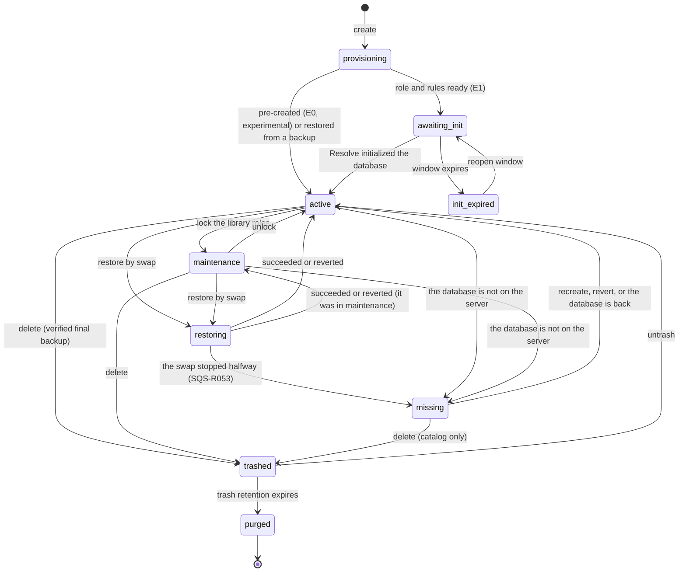
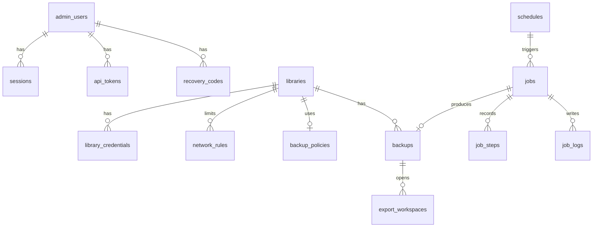

# 07. Libraries and PostgreSQL

## 1. Conceptual model

A **sqsolve library** is the sum of:

- a PostgreSQL database (the content belongs to Resolve and is opaque to sqsolve);
- a PostgreSQL owner role that Resolve connects with;
- optional per-person member roles (not validated with Resolve: PoC-01 step 5 was not run);
- network rules, backup policies and retention;
- metadata in SQLite: display name, state, fingerprint, declared version, notes.

The content remains opaque; the only read of Resolve tables is the bounded one of ADR 0019 to
export `.drp` and `.drx` (`22-project-and-grade-export.md`).

## 2. Names and identifiers

| Element | Rule | Example |
|---|---|---|
| Library slug | `^[a-z][a-z0-9_]{2,39}$`; does not start with `pg_`, `sqsolve`, `template`, `postgres`; does not contain `__` | `client_x` |
| Active database | Same as the slug | `client_x` |
| Owner role | Same as the slug (it is the "user" typed in Resolve) | `client_x` |
| Member role | `<slug>__<person>`, person `^[a-z][a-z0-9]{1,19}$` | `client_x__ana` |
| Database being restored | `<slug>__restore_<id8>` | `client_x__restore_7f3a91c2` |
| Previous state after swap | `<slug>__prev_<YYYYMMDDhhmm>` (UTC) | `client_x__prev_202610181930` |
| Trash | `<slug>__trash_<YYYYMMDDhhmmss>` (UTC) | `client_x__trash_20261018193000` |
| Verification | `sqsolve_verify_<id8>` | `sqsolve_verify_0c11ad3e` |
| Export from a backup | `sqsolve_export_<id8>` | `sqsolve_export_5b2e90d4` |
| Display name | UTF-8, 1 to 80 characters, no control characters | `Client X, season 2` |

`<id8>` is the last 8 characters of the job or workspace ULID, in lowercase. All names fit in
63 bytes (the PostgreSQL identifier limit). The validators live in
`internal/pg/ident.go`, have fuzz tests and are applied before `pgx.Identifier{...}.Sanitize()`;
neither of the two is used alone.

The double underscore is forbidden in slugs so that no auxiliary name can collide with a valid
slug.

## 3. PostgreSQL roles

| Role | Attributes | Memberships and permissions | Access |
|---|---|---|---|
| `postgres` | Superuser (created by the image) | All | Local socket only, SCRAM. Use: at every start `pg.Bootstrap` creates or repairs `sqsolve_admin` with it, and the doctor checks (`sqsolve doctor` and the Health page) test that it can connect; sqsolve uses it for nothing else |
| `sqsolve_admin` | `LOGIN NOSUPERUSER CREATEDB CREATEROLE NOREPLICATION NOBYPASSRLS` | `pg_monitor`, `pg_signal_backend`, `pg_read_all_data`, `pg_use_reserved_connections` (§10); `EXECUTE` on `pg_reload_conf()` and `pg_hba_file_rules()` and `SELECT` on the `pg_hba_file_rules` view, granted by `pg.Bootstrap` at every start; member of every library role | Local socket only, SCRAM |
| `<slug>` | `LOGIN NOSUPERUSER NOCREATEDB NOCREATEROLE NOREPLICATION NOBYPASSRLS INHERIT`, configurable `CONNECTION LIMIT`; `CREATEDB` only during the initialization window | `CONNECT, TEMP` on its database; owner of the `public` schema and of the Resolve objects | Network, SCRAM, only to its database (and the `postgres` maintenance database while the setting that allows it is on, the default) |
| `<slug>__<person>` | `LOGIN`, the rest same as `<slug>` | Member of `<slug>`; `ALTER ROLE ... IN DATABASE <slug> SET role = '<slug>'` so every new object ends up owned by the owner (implemented; not validated with Resolve, PoC-01 step 5 was not run) | Network, SCRAM, only to its library's database |

Why not a superuser for daily work: a superuser can run `COPY ... TO PROGRAM`, that is, commands
in the PostgreSQL container. If a sqsolve flaw allowed SQL injection, with `sqsolve_admin` the
damage is limited to databases and roles, not the system.

Since PostgreSQL 16, `sqsolve_admin` can only modify the roles it created (it has `ADMIN OPTION`
on them) and can only grant `CREATEDB` because it has it [01 §12]. When creating a library role,
sqsolve additionally runs `GRANT <slug> TO sqsolve_admin WITH INHERIT TRUE, SET TRUE`, in the same
transaction as the `CREATE ROLE`: if the grant fails, no role is left behind to block the next
attempt with `SQS-L006` or `SQS-L033`.

Implemented and tested against PostgreSQL 18: the database remains owned by the library's role
(as Resolve leaves it when creating it) and `sqsolve_admin`, by inheritance, acts as owner to
rename, lock, drop or back it up; it also has its own `CREATEDB`, which the rename requires. This
way there is no need to change the database owner (PoC-01 step 1 confirmed that Resolve 21.1.1
leaves the library role as owner).
`pg_hba.conf` rejects `sqsolve_admin` over the network even if it is a member of the library
roles, because roles are listed by name.

Information PostgreSQL does not allow hiding: any connected role can read `pg_database` and see
the names of all databases. This is documented; no "secret library" is offered.

## 4. Lifecycle



| State | Resolve connections | Scheduled backups | Visible in the list |
|---|---|---|---|
| `provisioning` | No | No | Yes, with progress |
| `awaiting_init` | Only to initialize | No | Yes |
| `init_expired` | No | No | Yes, with action |
| `active` | Yes | Yes | Yes |
| `maintenance` | No new ones: every library role is `NOLOGIN`; open sessions go on unless closed (ADR 0024). The database keeps accepting `sqsolve_admin` | Yes | Yes |
| `restoring` | No during the swap | Paused | Yes, with progress |
| `missing` | No (no database under its name) | No | Yes, with actions |
| `trashed` | No | No | In "Trash" |
| `purged` | No | No | Only in the audit log |

Each state promises an access and sqsolve applies it in one place (ADR 0024): `LOGIN` for the
roles with an active credential in `active`, `awaiting_init`, `init_expired` and `missing`;
`NOLOGIN` in `maintenance`; the live database always accepts connections (only `pg_hba.conf`
and `LOGIN` decide who gets in). Revoked credentials never get `LOGIN` back. Every lock that
fails before its point of no return is undone with it, and reconciliation applies it to every
library at each start, so a cut never leaves a library shown as Active but locked.

Every job re-validates at run time what its request checked (state, existence of the
databases, ownership of the identifier) and fails without touching anything if it no longer
holds: a Retry of an old job, a double click or a database that came back cannot drop or rename
a database the job did not create. A library in `missing` whose database appears again with its
owner (a volume mounted again) returns to `active` at the next reconciliation, once sqsolve has
connected to it and seen tables (or the library never had any); an empty or unreadable database
with its name is neither adopted nor dropped, and an invalid one counts as missing (docs 11
§7.7).

## 5. Creation strategies

sqsolve creates a library with E1 (the default and the only strategy validated with Resolve,
PoC-01 step 1) or with E0, which the panel offers for testing only because Resolve 21.1.1 does
not initialize an empty database (PoC-01 step 2). A library can also be created by restoring a
backup as a new library (docs 11 §7). E2 and the adoption of existing databases are not
implemented; both are roadmap directions (`20-roadmap.md`).

### E1. Initialization window (base)

1. Create the role `<slug>` with `CREATEDB` and a random password.
2. Add the role's `pg_hba.conf` lines and reload.
3. Show the data for "Create" in Resolve (library name, server IP or name, user, password) and
   the state "awaiting initialization".
4. Watch every 5 s: the database `<slug>` exists, its owner is `<slug>` and it has tables in
   `public`.
5. Once detected and the table count is stable across three consecutive checks: `ALTER ROLE
   <slug> NOCREATEDB`; `REVOKE ALL ON DATABASE <slug> FROM PUBLIC`; `GRANT CONNECT, TEMP ... TO
   <slug>`. The database keeps its owner.
6. Schema fingerprint, default backup policy and first backup (chained job).
7. Maximum window configurable from 5 min to 24 h, 60 min by default; when it expires `CREATEDB`
   is removed and the library goes to `init_expired`, from where the window can be reopened.

Bounded risk: during the window, the role could create other databases. It is mitigated by the
short duration, by the `pg_hba.conf` that only lets it connect to its database and the
maintenance one, and by a check when the window closes that lists new databases with that owner
and reports them.

### E0. Pre-created database

`CREATE DATABASE <slug> OWNER <slug> TEMPLATE template0 ENCODING 'UTF8'`, `REVOKE ALL ... FROM
PUBLIC`, `GRANT CONNECT, TEMP ... TO <slug>`, and "Connect" from Resolve. The library becomes
`active` at once. Resolve 21.1.1 marks such a database as incompatible and does not use it
(PoC-01 step 2), so the panel says the option does not work with Resolve 21.1 and is for
testing only.

### E2 and adoption

sqsolve does not create libraries from a local template (E2) and does not adopt databases
created outside it on the same server: such databases appear in Health as "Databases outside
the catalog" and are not backed up. Both are roadmap directions (`20-roadmap.md`).

## 6. Credentials

- Passwords generated with `crypto/rand`: 24 characters from the alphabet
  `ABCDEFGHJKLMNPQRSTUVWXYZabcdefghijkmnopqrstuvwxyz23456789` (about 140 bits). No symbols, to
  avoid escaping problems in Resolve and in XML.
- They are stored encrypted (ADR 0014) so they can be shown again; in PostgreSQL only their SCRAM
  verifier exists.
- Rotate: new password with `ALTER ROLE ... PASSWORD`; open sessions continue; workstations must
  update it when they reconnect. The library page lists the active sessions (role, address,
  application), so the workstations to notify can be identified. If the new password cannot be
  saved in SQLite after the `ALTER ROLE`, sqsolve puts the previous one back in PostgreSQL
  (`SQS-L070`), so the panel never shows a password that does not work; if that also fails (for
  example, the stored password cannot be decrypted), `SQS-L071` asks to rotate again. Both are
  recorded in the audit log as failed rotations. When the `ALTER ROLE ... PASSWORD` itself fails,
  its PostgreSQL error is returned with the verifier redacted, which drops the wrapped error chain
  (`19-risks.md` §5 K-08).
- Add a per-person credential (not validated with Resolve, PoC-01 step 5): the role is created
  together with its membership of `sqsolve_admin` in one transaction (§3); a later failure (owner
  membership, default role, the SQLite row or `CONNECT`) drops the role and the row (`SQS-L072`),
  so the same person can be added again. A library in maintenance gets the new role as
  `NOLOGIN`. Afterwards `pg_hba.conf` is rewritten to include the role; that rewrite has no audit
  entry of its own (`19-risks.md` §5 K-07).
- Revoke a per-person credential: `ALTER ROLE ... NOLOGIN`, close its sessions, set `revoked_at`
  and rewrite `pg_hba.conf` without its role. If `revoked_at` cannot be recorded, `SQS-L080` asks
  to revoke again, because the next start would give the role its login back. The role is not
  dropped: it stays `NOLOGIN` until the library is purged.
- A revoked role name is not reused: while the role exists, adding the same person again fails
  with `SQS-L033`.

## 7. Active sessions

Query (with `pg_monitor`):

```sql
SELECT a.pid, COALESCE(a.usename, ''), COALESCE(host(a.client_addr), 'local'),
       COALESCE(a.application_name, ''), a.backend_start, COALESCE(a.state, ''), a.state_change,
       COALESCE(s.ssl, false), COALESCE(s.version, '')
FROM pg_stat_activity a LEFT JOIN pg_stat_ssl s USING (pid)
WHERE a.datname = $1 AND a.backend_type = 'client backend' AND a.pid <> pg_backend_pid()
ORDER BY a.backend_start;
```

Terminate a session: `pg_terminate_backend(pid)` after confirmation, only if `usename` is a role
of that library (`SQS-L016` otherwise). Audited as `library.session_terminate` with the `pid`.

Terminate every session of a database (maintenance, delete, restore): all client sessions except
sqsolve's own and those of superusers. PostgreSQL does not let `sqsolve_admin` end a superuser
session (`42501`), so those sessions are left alone and counted (`TerminateAllSessions` returns
how many were ended and how many belong to a superuser) and the caller can report them.

Activity mark (ADR 0022), to know whether a library changed since its last backup without reading
its tables:

```sql
SELECT datname, tup_inserted + tup_updated + tup_deleted, COALESCE(stats_reset::text, '')
FROM pg_stat_database WHERE datname IS NOT NULL;
```

Two equal marks mean that no row was written between one and the other. `stats_reset` is part of
the mark so that a statistics reset is never read as "no changes".

## 8. Maintenance and connection rules

| Action | SQL |
|---|---|
| Maintenance on (ADR 0024) | `ALTER ROLE <role> NOLOGIN` for the owner and every active member, `ALTER DATABASE <slug> ALLOW_CONNECTIONS true` and, if requested, terminate the sessions of those roles only |
| Maintenance off | `ALTER ROLE <role> LOGIN` for the roles with an active credential (revoked ones stay `NOLOGIN`; a person added during maintenance was created `NOLOGIN` and gets `LOGIN` here) |
| Temporary lock before a rename (delete, restore by swap, revert) | `ALTER DATABASE <slug> ALLOW_CONNECTIONS false` and terminate sessions; undone if anything fails before the rename |
| Connection limit | `ALTER ROLE <role> CONNECTION LIMIT n` on the owner and on every member role; the database stays at `CONNECTION LIMIT -1` |
| Optimize | `vacuumdb --analyze --skip-locked` on every library in `active` or `maintenance` (the weekly `system.vacuum` job, or Settings, Maintenance, on demand); sqsolve does not reindex |

The connection limit of a library counts workstation sessions only. It is set on each library
role (the owner `<slug>` and every `<slug>__<person>`, also members added later), so `n` is the
maximum of sessions **per role**: with per-person credentials, each person can open up to `n`.
It is never set on the database, because a database limit also counts the sessions of
`sqsolve_admin`: a backup opens two (the snapshot connection and `pg_dump`), and a busy library
could no longer be backed up. Libraries whose limit an older version put on the database are
migrated at startup (reconciliation): the limit moves to the roles and the database goes back
to `-1`; the same pass puts the limit back on roles recreated without it by an older version.
"Recreate from the last backup" creates the roles it recreates with the library's limit.

## 9. Schema fingerprint

Goal: detect that Resolve changed a library's structure (version upgrade) without reading
project data.

```sql
SELECT c.relname, a.attname, format_type(a.atttypid, a.atttypmod)
FROM pg_class c
JOIN pg_namespace n ON n.oid = c.relnamespace
JOIN pg_attribute a ON a.attrelid = c.oid
WHERE n.nspname = 'public' AND c.relkind IN ('r', 'p') AND a.attnum > 0 AND NOT a.attisdropped
ORDER BY c.relname, a.attnum;
```

The fingerprint is `sha256:` followed by the hex SHA-256 of the rows serialized as
`table|column|type`, each followed by a newline; a database without tables has an empty
fingerprint. It is stored together with the table count. It is recomputed every 5 min for the
libraries in `active` and `maintenance`, on every backup and when a restore finishes. A change
produces the event `library.schema_changed` with the previous and new fingerprint.

Registry of known fingerprints: `internal/compat/fingerprints.json` maps fingerprints to Resolve
versions and also states which exports were verified with that version (`verified`, see `22`
§6), fed by the PoCs, the verification kit and user reports (only the hash, the version and what
was verified; never the schema). An unknown fingerprint prevents nothing: "unidentified version"
is shown.

## 10. PostgreSQL configuration

The configuration lives in the `sqsolve` folder of the db volume
(`/var/lib/postgresql/sqsolve`, `db/sqsolve` on the host). `sqsolve-init` rewrites
`postgresql.conf` at every start of the stack, before PostgreSQL starts, and writes `pg_hba.conf`
(with no library lines) and an empty `pg_ident.conf` only when they are missing; afterwards
sqsolve regenerates `pg_hba.conf` whenever libraries, credentials or the access settings change.
PostgreSQL starts with:

```
postgres -c config_file=/var/lib/postgresql/sqsolve/postgresql.conf
```

Base contents of `postgresql.conf` (values between `<>` are computed by `sqsolve-init`; the
`SQSOLVE_PG_*` variables of the compose file adjust them):

| Parameter | Value | Reason |
|---|---|---|
| `data_directory` | `/var/lib/postgresql/18/docker` (`SQSOLVE_PG_DATA_DIR`) | Path of the official 18 image |
| `hba_file`, `ident_file` | `/var/lib/postgresql/sqsolve/pg_hba.conf`, `.../pg_ident.conf` | Generated by sqsolve; `pg_ident.conf` stays empty |
| `listen_addresses` | `'*'` (`SQSOLVE_PG_LISTEN`) | Inside the container; the host decides what is published |
| `port` | `5432` (`SQSOLVE_PG_PORT`) | Resolve |
| `unix_socket_directories` | `'/var/run/postgresql'` (`SQSOLVE_PG_SOCKET_DIR`), `unix_socket_permissions = 0777` | `sqsolve-run` volume shared with sqsolve; `pg_hba.conf` admits only `postgres` and `sqsolve_admin` there |
| `max_connections` | `200` (`SQSOLVE_PG_MAX_CONNECTIONS`, 20 to 5000) | Several connections per workstation: 1 idle, up to 6 in bursts (PoC-01 step 6) |
| `superuser_reserved_connections` | `5` | Emergency access as `postgres` |
| `reserved_connections` | `3` | Slots only for roles with `pg_use_reserved_connections` (`sqsolve_admin`), so busy workstations cannot starve backups |
| `password_encryption` | `scram-sha-256` | RNF-SEG-02 |
| `ssl` | `on` with `ssl_cert_file` and `ssl_key_file` in `db/sqsolve/tls` (`server.crt`, `server.key`), `ssl_min_protocol_version = 'TLSv1.2'` | Opportunistic encryption (PoC-06) |
| `shared_buffers` | `<25 % of SQSOLVE_PG_MEMORY_MB (default 2048), between 32 MB and 2 GB>` | Medium-sized databases |
| `log_connections`, `log_disconnections` | `on` | Access audit |
| `log_line_prefix` | `'%m [%p] %u@%d %r '` | Correlation |
| `log_lock_waits` | `on` | Lock diagnostics during backups |
| `tcp_keepalives_idle`, `_interval`, `_count` | `60`, `10`, `6` | Clean up sessions from laptops that went to sleep |
| `idle_session_timeout` | unset | Resolve keeps long-lived connections |

It also sets fixed values: `effective_cache_size` at 75 % of `SQSOLVE_PG_MEMORY_MB`,
`maintenance_work_mem = 128MB`, `work_mem = 8MB`, `wal_level = replica`, `max_wal_size = 2GB`,
`checkpoint_timeout = 10min`, logs to stderr without the logging collector, `UTC` for
`timezone` and `log_timezone`, `C.UTF-8` for `lc_messages`, `lc_monetary`, `lc_numeric` and
`lc_time`, and `pg_catalog.simple` as `default_text_search_config`.

Cluster initialization (first time only, by the official image):
`POSTGRES_INITDB_ARGS="--encoding=UTF8 --locale-provider=builtin --builtin-locale=C.UTF-8"`. How
Resolve sorts accented names with this collation is To be confirmed (PoC-01 step 7 was
inconclusive). Reason: the `builtin` collation does not depend on the container's
glibc, so upgrading the base image cannot corrupt text indexes. PostgreSQL 18 also enables page
checksums by default.

**Reserved connections.** Library roles can use `max_connections` minus 8 slots (192 with the
default 200); the last 3 before the superuser's 5 are only for `sqsolve_admin`, which
`pg.Bootstrap` grants `pg_use_reserved_connections` at every start. A workstation that finds only
those slots free gets "remaining connection slots are reserved for roles with privileges of the
pg_use_reserved_connections role". Existing installations: `sqsolve-init` rewrites
`postgresql.conf` at every start of the stack, but `reserved_connections`, like
`max_connections`, only takes effect when PostgreSQL restarts. If only the sqsolve image is
updated and the `postgres` container keeps running, the old value stays in force (PostgreSQL logs
that the parameter cannot be changed without restarting the server at each reload) until the
whole app is restarted.

**Admin connections.** Every connection sqsolve opens through pgx (the `sqsolve_admin` pool, the
per-database connections of backups, verification and export, and the superuser connections of
`pg.Bootstrap` and the doctor checks) starts with `lock_timeout = 60s`, the same wait as `pg_dump
--lock-wait-timeout`, and `statement_timeout = 30min`. A row count, an `ALTER` or a `DROP
DATABASE` behind a lock that Resolve or anyone else holds fails with `SQS-P050` instead of
waiting forever and holding the heavy job slot; a statement cancelled by the time limit reports
`SQS-P051`. `pg_dump` and `pg_restore` are separate processes and keep their own options. The
export session also sets its own `statement_timeout` of 60 s (docs 22 §9).

**Database list.** PostgreSQL marks a database invalid (`datconnlimit = -2`) while a
`DROP DATABASE` runs, and leaves it so when the drop is interrupted; such a database can only be
dropped, but it keeps its name and whatever files are left. `Databases` lists every database
except templates and marks those as `Invalid`, without measuring their size (shown as "not
measured" in Health, with an "Invalid" badge); a valid database whose files are already gone
reports size 0 instead of failing the whole list. `Database(name)`, which decides the state of a
library, reads that one row and treats an invalid database as missing; an error is never taken as
"does not exist": reconciliation leaves a library as it is when the check fails. Who drops invalid
databases: at every start, reconciliation drops the invalid auxiliary ones (`sqsolve_verify_*`,
`sqsolve_export_*`, `*__restore_*`) like any other leftover of those kinds; any other invalid
database (a library, `__prev`, `__trash` or one created by hand) is never dropped automatically
and an administrator drops it with `DROP DATABASE` as the superuser after checking Health. A name
held by an invalid database is still taken: creating a library or restoring as new with that
identifier fails with `SQS-L005`.

Generated `pg_hba.conf` (order matters, first match wins; fields are separated by tabs):

```
# Generated by sqsolve. Manual changes are lost.
# TYPE  DATABASE  USER  ADDRESS  METHOD
local   all       postgres                 scram-sha-256
local   all       sqsolve_admin            scram-sha-256
local   all       all                      reject
host    all       postgres,sqsolve_admin   all              reject
# library client_x
host    client_x  client_x,client_x__ana   192.168.1.0/24   scram-sha-256
host    postgres  client_x,client_x__ana   192.168.1.0/24   scram-sha-256
host    all       all                      all              reject
```

- No administrative role enters over the network, even if it is a member of a library role; a
  library line that names `postgres` or `sqsolve_admin` is refused (`SQS-P040`).
- One line per library and per allowed CIDR, with `all` as the address when the library has no
  rules. Only libraries in `awaiting_init`, `active`, `maintenance` and `restoring` get lines, with
  the owner and every member whose credential is not revoked. Roles are listed by name, never
  with `+role`, so members are not admitted by accident.
- The `postgres` line of each library exists while Settings allows library users to enter the
  maintenance database (on by default); whether Resolve needs that database was not tested.

With "TLS only" in Settings, the library lines use `hostssl` instead of `host` (PoC-06: Resolve
21.1.1 on Linux connects with it; other platforms were not tested). sqsolve writes the file
keeping the previous version as `pg_hba.conf.prev` and, before reloading, validates it by reading
`pg_hba_file_rules`; if there are errors it puts `.prev` back and does not reload (`SQS-P042`). A
change counts as applied only after a successful reload; how a failed one is retried is in docs
08 §7.

## 11. Control plane SQLite schema

File `app/sqsolve.db`, WAL mode, `foreign_keys = on`, `synchronous = FULL`, 10 s busy timeout.
ULID identifiers as text. Dates in UTC in RFC 3339 format with microseconds.



| Table | Main columns |
|---|---|
| `admin_users` | `id`, `username` unique (case-insensitive), `display_name`, `password_hash`, `role` (`admin`, `operator`, `viewer`), `totp_secret_enc`, `totp_enabled`, `totp_last_counter`, `created_at`, `password_changed_at`, `last_login_at`, `disabled_at`, `failed_logins`, `locked_at` |
| `recovery_codes` | `user_id`, `code_hash`, `used_at` |
| `sessions` | `id_hash` (SHA-256 of the token), `user_id`, `created_at`, `expires_at`, `last_seen_at`, `reauth_at`, `mfa_pending`, `ip`, `user_agent` |
| `api_tokens` | `id`, `user_id`, `name`, `token_hash` unique, `scopes` (JSON), `created_at`, `expires_at`, `last_used_at`, `revoked_at` |
| `libraries` | `id`, `slug` (unique among libraries that are not purged), `display_name`, `state`, `db_name`, `owner_role`, `creation_strategy` (`resolve`, `precreate`, `restore`), `init_window_expires_at`, `init_table_count`, `resolve_version`, `schema_fingerprint`, `schema_table_count`, `fingerprint_checked_at`, `connection_limit`, `notes`, `trash_db_name`, `prev_db_name`, `prev_expires_at`, `prev_backup_id`, `created_at`, `updated_at`, `trashed_at`, `purge_after`, `purged_at` |
| `library_credentials` | `id`, `library_id`, `kind` (`owner`, `member`), `pg_role`, `person_label`, `password_enc`, `created_at`, `rotated_at`, `revoked_at` |
| `network_rules` | `id`, `library_id`, `cidr`, `description`, `created_at` |
| `backup_policies` | `library_id`, `enabled`, `mode` (`cron`, `activity`), `schedule_cron`, `check_minutes`, `timezone`, `keep_last`, `keep_daily`, `keep_weekly`, `keep_monthly`, `min_verified`, `last_check_at`, `last_check_same`, `updated_at` |
| `backups` | `id`, `library_id`, `job_id`, `kind` (`manual`, `scheduled`, `pre_restore`, `pre_delete`, `pre_upgrade`, `imported`), `status` (`running`, `ok`, `failed`, `interrupted`, `deleted`), `verify_level`, `verify_status` (`none`, `l1_ok`, `l2_ok`, `partial`, `failed`), `verified_at`, `verify_detail`, `file_path`, `size_bytes`, `sha256`, `pg_server_version`, `pg_dump_version`, `archive_version`, `compression`, `schema_fingerprint`, `table_count`, `counts_exact`, `resolve_version`, `pinned`, `source_db`, `activity_mark`, `started_at`, `finished_at`, `error`, `expired_reason`, `deleted_at` |
| `export_workspaces` | `id`, `backup_id`, `db_name` (`sqsolve_export_<id8>`), `job_id`, `state` (`preparing`, `ready`, `failed`, `closed`), `error`, `created_at`, `expires_at` |
| `jobs` | `id`, `type`, `library_id`, `params` (JSON), `state` (`queued`, `running`, `succeeded`, `failed`, `cancelled`, `interrupted`), `priority`, `scheduled_for`, `created_at`, `started_at`, `finished_at`, `progress` (0 to 100), `current_step`, `error_code`, `error_detail`, `created_by_type`, `created_by_id`, `created_by_name`, `schedule_id`, `attempt`, `result` (JSON), `reconcile_pending`, `audit` (the audit entry of the action that queued it, JSON) |
| `job_steps` | `job_id`, `seq`, `name`, `state`, `started_at`, `finished_at`, `data` (JSON: journal for recovery, for example names before and after the rename) |
| `job_logs` | `job_id`, `seq`, `ts`, `level`, `message` (no secrets) |
| `schedules` | `id`, `kind` (`backup`, `verify` or a `system.*` job), `target_id`, `cron`, `timezone`, `enabled`, `misfire_window_minutes`, `next_run_at`, `last_run_at`, `last_job_id`, `created_at`; unique `(kind, target_id)` |
| `notification_channels` | `id`, `kind` (`webhook`, `ntfy`, `smtp`), `name`, `config_enc`, `enabled`, `min_severity`, `event_pattern`, `last_ok_at`, `last_error`, `created_at` |
| `events` | `id`, `ts`, `type`, `severity`, `library_id`, `job_id`, `message`, `data` (JSON) |
| `audit_log` | `seq`, `ts`, `actor_type`, `actor_id`, `actor_name`, `actor_ip`, `action`, `target_type`, `target_id`, `outcome`, `details` (JSON), `prev_hash`, `hash` |
| `settings` | `key`, `value` (JSON), `updated_at`, `updated_by` |
| `schema_migrations` | `version`, `name`, `checksum`, `applied_at` |

Migrations: numbered embedded SQL files (`internal/store/migrations/NNNN_name.sql`), forward
only, each in a transaction, with a recorded checksum; a migration that changed after being
applied stops the start (`SQS-X011`), and so does a database with a migration newer than the
binary (`SQS-X012`). Before applying pending migrations to an existing database, a copy is made
with `VACUUM INTO app/state-backups/sqsolve-before-<NNNN>-<stamp>.db`, named after the first
pending migration (a migration that fails on every start is not copied again); only the newest
5 copies are kept.

## 12. External server mode

sqsolve only manages the PostgreSQL of its own Compose stack, through the local socket: it
generates that server's `postgresql.conf` and `pg_hba.conf` and reloads it. It does not manage an
existing PostgreSQL on another server. An external server mode is a long-term roadmap direction
(`20-roadmap.md`).
