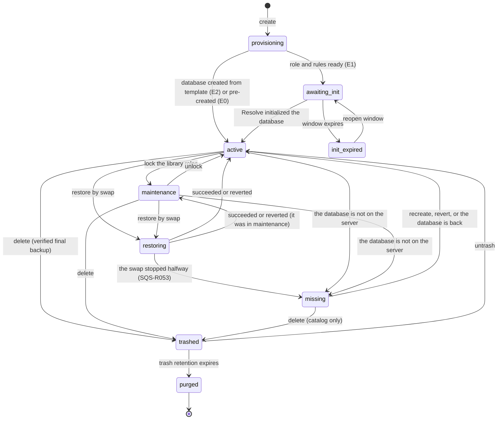
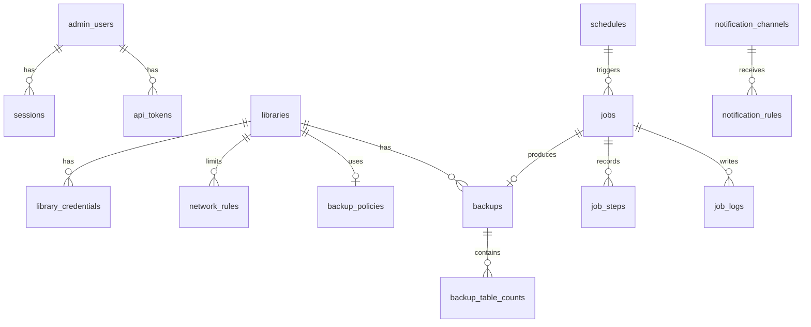

# 07. Libraries and PostgreSQL

## 1. Conceptual model

A **sqsolve library** is the sum of:

- a PostgreSQL database (the content belongs to Resolve and is opaque to sqsolve);
- a PostgreSQL owner role that Resolve connects with;
- in 1.1, per-person member roles;
- network rules, backup policies and retention;
- metadata in SQLite: display name, state, fingerprint, declared version, notes.

The content remains opaque; the only read of Resolve tables is the bounded one of ADR 0019 to
export `.drp` and `.drx` (`22-project-and-grade-export.md`).

## 2. Names and identifiers

| Element | Rule | Example |
|---|---|---|
| Library slug | `^[a-z][a-z0-9_]{2,39}$`; does not start with `pg_`, `sqsolve`, `template`, `postgres`; does not contain `__` | `client_x` |
| Active database | Same as the slug | `client_x` |
| Owner role | Same as the slug (it is the "user" typed in Resolve) | `client_x` |
| Member role (1.1) | `<slug>__<person>`, person `^[a-z][a-z0-9]{1,19}$` | `client_x__ana` |
| Database being restored | `<slug>__restore_<id8>` | `client_x__restore_7f3a91c2` |
| Previous state after swap | `<slug>__prev_<YYYYMMDDhhmm>` | `client_x__prev_202610181930` |
| Trash | `<slug>__trash_<YYYYMMDD>` | `client_x__trash_20261018` |
| Verification | `sqsolve_verify_<id8>` | `sqsolve_verify_0c11ad3e` |
| Display name | UTF-8, 1 to 80 characters, no control characters | `Client X, season 2` |

All names fit in 63 bytes (the PostgreSQL identifier limit). The validators live in
`internal/pg/ident.go`, have fuzz tests and are applied before `pgx.Identifier{...}.Sanitize()`;
neither of the two is used alone.

The double underscore is forbidden in slugs so that no auxiliary name can collide with a valid
slug.

## 3. PostgreSQL roles

| Role | Attributes | Memberships and permissions | Access |
|---|---|---|---|
| `postgres` | Superuser (created by the image) | All | Local socket only, SCRAM. Use: startup, privilege migrations and audited emergency procedures |
| `sqsolve_admin` | `LOGIN NOSUPERUSER CREATEDB CREATEROLE NOREPLICATION NOBYPASSRLS` | `pg_monitor`, `pg_signal_backend`, `pg_read_all_data`, `pg_use_reserved_connections` (§10); `EXECUTE` on `pg_reload_conf()` (FEASIBLE-PENDING: if it cannot be granted, the reload uses the superuser) | Local socket only, SCRAM |
| `<slug>` | `LOGIN NOSUPERUSER NOCREATEDB NOCREATEROLE NOREPLICATION NOBYPASSRLS`, configurable `CONNECTION LIMIT`; `CREATEDB` only during the initialization window | `CONNECT, TEMP` on its database; owner of the `public` schema and of the Resolve objects | Network, SCRAM, only to its database (and the maintenance one if PoC-01 requires it) |
| `<slug>__<person>` (1.1) | `LOGIN`, the rest same as `<slug>` | Member of `<slug>`; `ALTER ROLE ... IN DATABASE <slug> SET role = '<slug>'` so every new object ends up owned by the owner (FEASIBLE-PENDING, PoC-01 step 5) | Network, SCRAM, only to its library's database |

Why not a superuser for daily work: a superuser can run `COPY ... TO PROGRAM`, that is, commands
in the PostgreSQL container. If a sqsolve flaw allowed SQL injection, with `sqsolve_admin` the
damage is limited to databases and roles, not the system.

Since PostgreSQL 16, `sqsolve_admin` can only modify the roles it created (it has `ADMIN OPTION`
on them) and can only grant `CREATEDB` because it has it [01 §12]. When creating a library role,
sqsolve additionally runs `GRANT <slug> TO sqsolve_admin WITH INHERIT TRUE, SET TRUE`, in the same
transaction as the `CREATE ROLE`: if the grant fails, no role is left behind to block the next
attempt with `SQS-L006` or `SQS-L033`.

Implemented and tested against PostgreSQL 18: the database remains owned by the library's role
(as Resolve leaves it when creating it) and `sqsolve_admin`, by inheritance, acts as owner to
rename, lock, drop or back it up; it also has its own `CREATEDB`, which the rename requires. This
way there is no need to change the database owner and PoC-01's plan B becomes the normal path.
`pg_hba.conf` rejects `sqsolve_admin` over the network even if it is a member of the library
roles, because roles are listed by name.

Information PostgreSQL does not allow hiding: any connected role can read `pg_database` and see
the names of all databases. This is documented; no "secret library" is offered.

## 4. Lifecycle



| State | Resolve connections | Scheduled backups | Visible in the list |
|---|---|---|---|
| `provisioning` | No | No | Yes, with progress |
| `awaiting_init` | Only to initialize | No | Yes |
| `init_expired` | No | No | Yes, with action |
| `active` | Yes | Yes | Yes |
| `maintenance` | No new ones: every library role is `NOLOGIN`; open sessions go on unless closed (ADR 0024). The database keeps accepting `sqsolve_admin` | Yes | Yes |
| `restoring` | No during the swap | Paused | Yes, with progress |
| `missing` | No (no database under its name) | No | Yes, with actions |
| `trashed` | No | No | In "Trash" |
| `purged` | No | No | Only in the audit log |

Each state promises an access and sqsolve applies it in one place (ADR 0024): `LOGIN` for the
roles with an active credential in `active`, `awaiting_init`, `init_expired` and `missing`;
`NOLOGIN` in `maintenance`; the live database always accepts connections (only `pg_hba.conf`
and `LOGIN` decide who gets in). Revoked credentials never get `LOGIN` back. Every lock that
fails before its point of no return is undone with it, and reconciliation applies it to every
library at each start, so a cut never leaves a library shown as Active but locked.

Every job re-validates at run time what its request checked (state, existence of the
databases, ownership of the identifier) and fails without touching anything if it no longer
holds: a Retry of an old job, a double click or a database that came back cannot drop or rename
a database the job did not create. A library in `missing` whose database appears again with its
owner (a volume mounted again) returns to `active` at the next reconciliation, once sqsolve has
connected to it and seen tables (or the library never had any); an empty or unreadable database
with its name is neither adopted nor dropped, and an invalid one counts as missing (docs 11
§7.7).

## 5. Creation strategies

The final choice depends on PoC-01. sqsolve always implements E1, E0 if PoC-01 shows that Resolve
initializes an empty database with "Connect", and E2 as an optimization.

### E1. Initialization window (base)

1. Create the role `<slug>` with `CREATEDB` and a random password.
2. Add the role's `pg_hba.conf` lines and reload.
3. Show the data for "Create" in Resolve (library name, server IP or name, user, password) and
   the state "awaiting initialization".
4. Watch every 5 s: the database `<slug>` exists, its owner is `<slug>` and it has tables in
   `public`.
5. Once detected and the table count is stable across three consecutive checks: `ALTER ROLE
   <slug> NOCREATEDB`; `REVOKE ALL ON DATABASE <slug> FROM PUBLIC`; `GRANT CONNECT, TEMP ... TO
   <slug>`. The database keeps its owner.
6. Schema fingerprint, default backup policy and first backup (chained job).
7. Maximum window configurable, 60 min by default; when it expires `CREATEDB` is removed.

Bounded risk: during the window, the role could create other databases. It is mitigated by the
short duration, by the `pg_hba.conf` that only lets it connect to its database and the
maintenance one, and by a check when the window closes that lists new databases with that owner
and reports them.

### E0. Pre-created database

`CREATE DATABASE <slug> OWNER ... TEMPLATE template0 ENCODING 'UTF8'` and "Connect" from
Resolve. Only if PoC-01 shows that Resolve initializes the schema in that case.

### E2. From a local template

After the first library initialized with a Resolve version, the administrator can "save as
template" a freshly created library with no projects. sqsolve stores a backup of it at
`state/templates/<resolve-version>-<fingerprint8>.backup`. Creating from a template is a restore
(`pg_restore --no-owner --no-privileges --role=<slug>`) into a new database.

- Templates are never distributed with sqsolve: they are generated on each installation with the
  user's Resolve. The schema is Blackmagic's work.
- PoC-04 step 3 confirms that two libraries with the same origin can coexist. If they cannot, E2
  is DISCARDED.

### Adopting existing databases (S)

For databases created outside sqsolve on the same server (for example, migrated by hand): the
administrator picks the database; sqsolve creates the role `<slug>`, runs `REASSIGN OWNED` to
that role inside the database (with the superuser over the socket, audited), applies permissions
and registers it.

## 6. Credentials

- Passwords generated with `crypto/rand`: 24 characters from the alphabet
  `ABCDEFGHJKLMNPQRSTUVWXYZabcdefghijkmnopqrstuvwxyz23456789` (about 140 bits). No symbols, to
  avoid escaping problems in Resolve and in XML until PoC-05 says otherwise.
- They are stored encrypted (ADR 0014) so they can be shown again; in PostgreSQL only their SCRAM
  verifier exists.
- Rotate: new password with `ALTER ROLE ... PASSWORD`; open sessions continue; workstations must
  update it when they reconnect. The UI shows which workstations were connected so they can be
  notified. If the new password cannot be saved in SQLite after the `ALTER ROLE`, sqsolve puts the
  previous one back in PostgreSQL (`SQS-L070`), so the panel never shows a password that does not
  work; if that also fails (for example, the stored password cannot be decrypted), `SQS-L071`
  asks to rotate again. Both are recorded in the audit log as failed rotations.
- Add a per-person credential (1.1): the role is created together with its membership of
  `sqsolve_admin` in one transaction (§3); a later failure (owner membership, default role, the
  SQLite row or `CONNECT`) drops the role and the row (`SQS-L072`), so the same person can be
  added again.
- Revoke a per-person credential (1.1): `ALTER ROLE ... NOLOGIN`, close its sessions, remove its
  `pg_hba.conf` line, set `revoked_at`. The role is dropped after 30 days.
- A revoked role name is never reused during that period.

## 7. Active sessions

Query (with `pg_monitor`):

```sql
SELECT pid, usename, client_addr, application_name, backend_start, state, state_change
FROM pg_stat_activity
WHERE datname = $1 AND backend_type = 'client backend';
```

Terminate a session: `pg_terminate_backend(pid)` after confirmation, only if `usename` is a role
of that library. Audited with the user, IP and application of the terminated session.

Terminate every session of a database (maintenance, delete, restore): all client sessions except
sqsolve's own and those of superusers. PostgreSQL does not let `sqsolve_admin` end a superuser
session (`42501`), and that refusal used to abort the whole statement; now those sessions are
left alone and counted (`TerminateAllSessions` returns how many were ended and how many belong to
a superuser) so the caller can report them.

Activity mark (ADR 0022), to know whether a library changed since its last backup without reading
its tables:

```sql
SELECT datname, tup_inserted + tup_updated + tup_deleted, COALESCE(stats_reset::text, '')
FROM pg_stat_database WHERE datname IS NOT NULL;
```

Two equal marks mean that no row was written between one and the other. `stats_reset` is part of
the mark so that a statistics reset is never read as "no changes".

## 8. Maintenance and connection rules

| Action | SQL |
|---|---|
| Maintenance on (ADR 0024) | `ALTER ROLE <role> NOLOGIN` for the owner and every active member, `ALTER DATABASE <slug> ALLOW_CONNECTIONS true` and, if requested, terminate the sessions of those roles only |
| Maintenance off | `ALTER ROLE <role> LOGIN` for the roles with an active credential (revoked ones stay `NOLOGIN`; a person added during maintenance was created `NOLOGIN` and gets `LOGIN` here) |
| Temporary lock before a rename (delete, restore by swap, revert) | `ALTER DATABASE <slug> ALLOW_CONNECTIONS false` and terminate sessions; undone if anything fails before the rename |
| Connection limit | `ALTER ROLE <role> CONNECTION LIMIT n` on the owner and on every member role; the database stays at `CONNECTION LIMIT -1` |
| Optimize | `vacuumdb --analyze --dbname=<slug>` (equivalent to "Optimize" without reindexing); `REINDEX DATABASE CONCURRENTLY` only on demand |

The connection limit of a library counts workstation sessions only. It is set on each library
role (the owner `<slug>` and every `<slug>__<person>`, also members added later), so `n` is the
maximum of sessions **per role**: with per-person credentials, each person can open up to `n`.
It is never set on the database, because a database limit also counts the sessions of
`sqsolve_admin`: a backup opens two (the snapshot connection and `pg_dump`), and a busy library
could no longer be backed up. Libraries whose limit an older version put on the database are
migrated at startup (reconciliation): the limit moves to the roles and the database goes back
to `-1`; the same pass puts the limit back on roles recreated without it by an older version.
"Recreate from the last backup" creates the roles it recreates with the library's limit.

## 9. Schema fingerprint

Goal: detect that Resolve changed a library's structure (version upgrade) without reading
project data.

```sql
SELECT c.relname, a.attname, format_type(a.atttypid, a.atttypmod), a.attnum
FROM pg_class c
JOIN pg_namespace n ON n.oid = c.relnamespace
JOIN pg_attribute a ON a.attrelid = c.oid
WHERE n.nspname = 'public' AND c.relkind IN ('r', 'p') AND a.attnum > 0 AND NOT a.attisdropped
ORDER BY 1, 4;
```

The fingerprint is the SHA-256 of the rows serialized as `table|column|type` separated by
newlines. It is stored together with the table count. It is recomputed every 5 min, on every
backup and when a restore finishes. A change produces the event `library.schema_changed` with
the previous and new fingerprint.

Registry of known fingerprints: `internal/compat/fingerprints.json` maps fingerprints to Resolve
versions and also states which exports were verified with that version (`verified`, see `22`
§6), fed by the PoCs, the verification kit and user reports (only the hash, the version and what
was verified; never the schema). An unknown fingerprint prevents nothing: "unidentified version"
is shown.

## 10. PostgreSQL configuration

`sqsolve-init` generates the files in the `pgconf` volume before PostgreSQL starts, and sqsolve
regenerates them afterwards. PostgreSQL starts with:

```
postgres -c config_file=/etc/sqsolve/pg/postgresql.conf
```

Base contents of `postgresql.conf` (values between `<>` are computed by sqsolve):

| Parameter | Value | Reason |
|---|---|---|
| `data_directory` | `/var/lib/postgresql/18/docker` | Path of the official 18 image |
| `hba_file` | `/etc/sqsolve/pg/pg_hba.conf` | Generated by sqsolve |
| `listen_addresses` | `'*'` | Inside the container; the host decides what is published |
| `port` | `5432` | Resolve |
| `unix_socket_directories` | `'/var/run/postgresql'` | `pgsocket` volume shared with sqsolve |
| `max_connections` | `200` (adjust after PoC-01 step 6) | Several connections per workstation |
| `superuser_reserved_connections` | `5` | Emergency access as `postgres` |
| `reserved_connections` | `3` | Slots only for roles with `pg_use_reserved_connections` (`sqsolve_admin`), so busy workstations cannot starve backups |
| `password_encryption` | `scram-sha-256` | RNF-SEG-02 |
| `ssl` | `on` with `ssl_cert_file` and `ssl_key_file` in `db/sqsolve/tls` | Opportunistic encryption (PoC-06) |
| `shared_buffers` | `<25 % of allocated memory, maximum 2 GB>` | Medium-sized databases |
| `log_connections`, `log_disconnections` | `on` | Access audit |
| `log_line_prefix` | `'%m [%p] %u@%d %r '` | Correlation |
| `log_lock_waits` | `on` | Lock diagnostics during backups |
| `tcp_keepalives_idle`, `_interval`, `_count` | `60`, `10`, `6` | Clean up sessions from laptops that went to sleep |
| `idle_session_timeout` | unset | Resolve keeps long-lived connections |

Cluster initialization (first time only, by the official image):
`POSTGRES_INITDB_ARGS="--encoding=UTF8 --locale-provider=builtin --builtin-locale=C.UTF-8"`
(subject to PoC-01 step 7). Reason: the `builtin` collation does not depend on the container's
glibc, so upgrading the base image cannot corrupt text indexes. PostgreSQL 18 also enables page
checksums by default.

**Reserved connections.** Library roles can use `max_connections` minus 8 slots (192 with the
default 200); the last 3 before the superuser's 5 are only for `sqsolve_admin`, which
`pg.Bootstrap` grants `pg_use_reserved_connections` at every start. A workstation that finds only
those slots free gets "remaining connection slots are reserved for roles with privileges of the
pg_use_reserved_connections role". Existing installations: `sqsolve-init` rewrites
`postgresql.conf` at every start of the stack, but `reserved_connections`, like
`max_connections`, only takes effect when PostgreSQL restarts. If only the sqsolve image is
updated and the `postgres` container keeps running, the old value stays in force (PostgreSQL logs
that the parameter cannot be changed without restarting the server at each reload) until the
whole app is restarted.

**Admin connections.** Every connection sqsolve opens through pgx (the `sqsolve_admin` pool, the
per-database connections of backups, verification and export, and the audited superuser
connections) starts with `lock_timeout = 60s`, the same wait as `pg_dump --lock-wait-timeout`, and
`statement_timeout = 30min`. A row count, an `ALTER` or a `DROP DATABASE` behind a lock that
Resolve or anyone else holds fails with `SQS-P050` instead of waiting forever and holding the
heavy job slot; a statement cancelled by the time limit reports `SQS-P051`. `pg_dump` and
`pg_restore` are separate processes and keep their own options. The export session also sets its
own `statement_timeout` of 60 s (docs 22 §9).

**Database list.** PostgreSQL marks a database invalid (`datconnlimit = -2`) while a
`DROP DATABASE` runs, and leaves it so when the drop is interrupted; such a database can only be
dropped, but it keeps its name and whatever files are left. `Databases` lists every database
except templates and marks those as `Invalid`, without measuring their size (shown as "not
measured" in Health, with an "Invalid" badge); a valid database whose files are already gone
reports size 0 instead of failing the whole list. `Database(name)`, which decides the state of a
library, reads that one row and treats an invalid database as missing; an error is never taken as
"does not exist": reconciliation leaves a library as it is when the check fails. Who drops invalid
databases: at every start, reconciliation drops the invalid auxiliary ones (`sqsolve_verify_*`,
`sqsolve_export_*`, `*__restore_*`) like any other leftover of those kinds; any other invalid
database (a library, `__prev`, `__trash` or one created by hand) is never dropped automatically
and an administrator drops it with `DROP DATABASE` as the superuser after checking Health. A name
held by an invalid database is still taken: creating a library or restoring as new with that
identifier fails with `SQS-L005`.

Generated `pg_hba.conf` (order matters, first match wins):

```
# Generated by sqsolve. Manual changes are lost.
local   all            postgres                      scram-sha-256
local   all            sqsolve_admin                 scram-sha-256
local   all            all                           reject
# No administrative role enters over the network, even if it is a member of a library role:
host    all            postgres,sqsolve_admin  0.0.0.0/0  reject
host    all            postgres,sqsolve_admin  ::/0       reject
# Per library and per allowed CIDR (0.0.0.0/0 and ::/0 if there are no rules).
# Roles listed by name, never with "+role", so members are not admitted by accident:
host    client_x      client_x,client_x__ana  192.168.1.0/24 scram-sha-256
# Maintenance database, only if PoC-01 shows Resolve needs it:
host    postgres       client_x      192.168.1.0/24 scram-sha-256
host    all            all            0.0.0.0/0      reject
host    all            all            ::/0           reject
```

`hostssl` replaces `host` if PoC-06 confirms that Resolve uses TLS and the administrator enables
"require TLS". Before reloading, sqsolve validates the file by reading `pg_hba_file_rules` and
does not reload if there are errors; the previous version is kept as `pg_hba.conf.prev`. A change
counts as applied only after a successful reload; how a failed one is retried is in docs 08 §7.

## 11. Control plane SQLite schema

File `app/sqsolve.db`, WAL mode, `foreign_keys = on`. ULID identifiers as text. Dates in UTC in
RFC 3339 format.



| Table | Main columns |
|---|---|
| `admin_users` | `id`, `username` unique, `display_name`, `password_hash`, `role` (`admin`, `operator`, `viewer`, `collaborator`), `totp_secret_enc`, `totp_enabled`, `locale`, `created_at`, `last_login_at`, `disabled_at` |
| `sessions` | `id_hash` (SHA-256 of the token), `user_id`, `created_at`, `expires_at`, `last_seen_at`, `reauth_at`, `ip`, `user_agent` |
| `api_tokens` | `id`, `user_id`, `name`, `token_hash`, `scopes` (JSON), `created_at`, `expires_at`, `last_used_at`, `revoked_at` |
| `libraries` | `id`, `slug` unique, `display_name`, `state`, `db_name`, `owner_role`, `creation_strategy`, `init_window_expires_at`, `resolve_version_declared`, `schema_fingerprint`, `schema_table_count`, `fingerprint_checked_at`, `connection_limit`, `notes`, `created_at`, `updated_at`, `trashed_at`, `purge_after` |
| `library_credentials` | `id`, `library_id`, `kind` (`owner`, `member`), `pg_role` unique, `person_label`, `password_enc`, `created_at`, `rotated_at`, `revoked_at`, `last_seen_at`, `last_seen_ip` |
| `network_rules` | `id`, `library_id`, `cidr`, `description`, `created_at` |
| `backup_policies` | `library_id`, `enabled`, `schedule_cron`, `timezone`, `keep_last`, `keep_daily`, `keep_weekly`, `keep_monthly`, `min_verified`, `verify_l2_cron`, `compression` |
| `backups` | `id`, `library_id`, `job_id`, `kind` (`manual`, `scheduled`, `pre_restore`, `pre_delete`, `pre_upgrade`, `imported`), `status` (`running`, `ok`, `failed`, `interrupted`, `expired`, `deleted`), `verify_level`, `verify_status`, `verified_at`, `file_path`, `size_bytes`, `sha256`, `pg_server_version`, `pg_dump_version`, `archive_version`, `schema_fingerprint`, `resolve_version_declared`, `pinned`, `started_at`, `finished_at`, `expires_reason` |
| `backup_table_counts` | `backup_id`, `table_name`, `row_count` |
| `jobs` | `id`, `type`, `library_id`, `params` (JSON), `state` (`queued`, `running`, `succeeded`, `failed`, `cancelled`, `interrupted`), `priority`, `scheduled_for`, `started_at`, `finished_at`, `progress` (0 to 100), `current_step`, `error_code`, `error_detail`, `created_by`, `schedule_id`, `attempt` |
| `job_steps` | `job_id`, `seq`, `name`, `state`, `started_at`, `finished_at`, `data` (JSON: journal for recovery, for example names before and after the rename) |
| `job_logs` | `job_id`, `seq`, `ts`, `level`, `message` (no secrets) |
| `schedules` | `id`, `kind` (`backup`, `verify`, `retention`, `maintenance`, `system`), `target_id`, `cron`, `timezone`, `enabled`, `misfire_window_minutes`, `next_run_at`, `last_run_at`, `last_job_id` |
| `notification_channels` | `id`, `kind` (`webhook`, `smtp`, `ntfy`), `name`, `config_enc`, `enabled`, `last_ok_at`, `last_error` |
| `notification_rules` | `id`, `channel_id`, `event_pattern`, `min_severity` |
| `events` | `id`, `ts`, `type`, `severity`, `library_id`, `job_id`, `message`, `data` (JSON) |
| `audit_log` | `seq`, `ts`, `actor_type`, `actor_id`, `actor_ip`, `action`, `target_type`, `target_id`, `outcome`, `details` (JSON), `prev_hash`, `hash` |
| `settings` | `key`, `value` (JSON), `updated_at`, `updated_by` |
| `schema_migrations` | `version`, `applied_at`, `checksum` |

Migrations: numbered embedded SQL files (`internal/store/migrations/NNNN_name.sql`), forward
only, each in a transaction, with a recorded checksum. Before applying, a copy is made with
`VACUUM INTO app/state-backups/sqsolve-before-<migration>-<stamp>.db`: one per pending migration
(a migration that fails on every start is not copied again) and only the newest 5 are kept.

## 12. External server mode (2.0)

sqsolve manages an existing PostgreSQL 16 or later (for example, the one on another studio
server). Requirements: a role with the attributes of `sqsolve_admin` created by the
administrator, a verified TLS connection, and the administrator managing `pg_hba.conf` (sqsolve
generates the lines and shows them to copy). Without a local socket, network rules and reloads
become manual.
