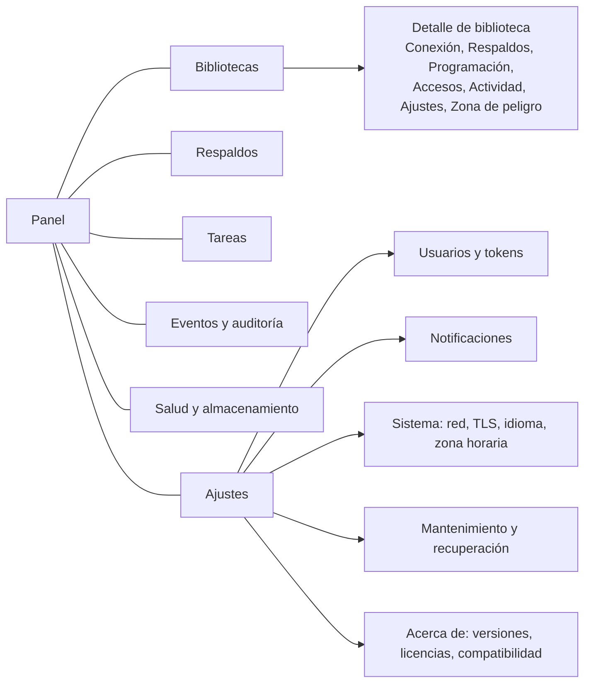

# 09. Interfaz web

## 1. Dirección visual

Decisión (revisada con las guías de interfaz de Apple el 2026-10-18): **el entorno de una sala
de color.**

- **Grises estrictamente neutros** (R = G = B) en superficies y texto. El panel puede estar
  abierto junto a un monitor de referencia; un gris teñido sesga la percepción del colorista.
- **El color solo aparece cuando un estado significa algo:** correcto (verde), aviso (ámbar),
  error (rojo), en curso (azul). No hay color de marca; la acción principal es un botón
  invertido (texto sobre fondo claro en oscuro, al revés en claro). Cada estado lleva además
  texto y una forma distinta (círculo, rombo, cuadrado, contorno), nunca solo color.
- **El tema sigue al sistema** (`prefers-color-scheme`); no hay interruptor propio. Con
  `prefers-contrast: more` los textos secundarios pasan al color principal.
- **Elemento distintivo: la línea de tiempo de protección.** Cada biblioteca es una pista,
  como en una línea de tiempo de edición. Cada respaldo es un marcador: alto y sólido si pasó la
  restauración de prueba, medio si pasó suma e índice, punteado si no se verificó, una cruz roja
  si falló. Una franja ámbar marca el tiempo sin respaldo verificado reciente. La línea fina de
  la derecha es "ahora". Aparece en el panel (14 días), en la lista de bibliotecas y en la
  pestaña de respaldos (30 días), siempre con leyenda y descripción accesible.
- **Tipografía del sistema** para la interfaz y monoespaciada para valores técnicos
  (identificadores, IP, hashes, nombres de pista); cifras tabulares en todo el panel.
- La marca es la misma pista en miniatura (tres marcadores sobre un carril); no hay logotipo
  repetido.

Contraste medido (WCAG 2.x):

| Par | Oscuro | Claro |
|---|---|---|
| Texto sobre tarjeta | #ececec / #242424: 13.1:1 | #1a1a1a / #ffffff: 17.4:1 |
| Secundario sobre tarjeta | #a8a8a8 / #242424: 6.5:1 | #5c5c5c / #ffffff: 6.7:1 |
| Error como texto | #f0645a / #242424: 4.9:1 | #c0352b / #ffffff: 5.6:1 |
| Botón de peligro | blanco / #c4342c: 5.4:1 | blanco / #b8312a: 6.0:1 |
| Borde de controles | #6b6b6b / #161616: 3.4:1 | #8c8c8c / #ffffff: 3.4:1 |

Antes de esta revisión el acento ámbar medía 3.9:1 como enlace en tema claro y 1.07:1 frente al
amarillo de aviso: un botón principal y una advertencia se veían iguales. Por eso se quitó.

## 2. Navegación

Escritorio: barra lateral fija con las 7 secciones. Móvil (menos de 768 px): barra superior con
menú desplegable y acciones primarias al pie. Una barra de estado global muestra tareas en curso
y alertas abiertas en todas las páginas.

## 3. Pantallas

### 3.1 Asistente inicial

Cinco pasos, con barra de progreso y posibilidad de volver:

1. **Código de instalación** (impreso en el registro del contenedor) e idioma.
2. **Cuenta de administrador** (usuario, contraseña con medidor, TOTP opcional con QR generado en
   el servidor).
3. **Red**: dirección que verán las estaciones (sqsolve sugiere las IP del contenedor y del host
   que detecta, y permite un nombre DNS), zona horaria.
4. **Respaldos por defecto**: preset (diario 02:00, cada 4 h en horario laboral, personalizado) y
   retención (por defecto: últimos 10, 14 diarios, 8 semanales, 12 mensuales).
5. **Kit de recuperación**: descarga obligatoria y casilla "lo guardé fuera de este servidor".
   Muestra la huella SHA-256 del certificado del panel.

### 3.2 Panel

Cuatro bloques: **estado del servidor** (PostgreSQL, versión, conexiones totales, espacio de
datos y de respaldos con barras), **atención requerida** (respaldos fallidos, verificaciones
fallidas, bibliotecas sin respaldo verificado en más de 48 h, espacio bajo, certificados por
vencer), **bibliotecas** (las 5 con actividad más reciente), **tareas** (en curso y últimas 5).
Cada elemento lleva a su detalle.

### 3.3 Bibliotecas

Tabla (tarjetas en móvil): nombre visible y slug, estado, conexiones ahora, tamaño, último
respaldo con su verificación, versión detectada. Filtros por estado. Botón "Nueva biblioteca".

**Detalle**, pestañas:

- **Conexión**: tarjeta con los cuatro valores para Resolve (nombre sugerido, ubicación,
  usuario, contraseña oculta con botón "Mostrar" que pide reautenticación), cada uno con botón de
  copiar; instrucciones paso a paso por sistema (Windows, macOS, Linux) con capturas de
  referencia propias; puertos que deben abrir las estaciones para colaborar; descarga de
  `.resolvedbkey` si el módulo está activo, marcada "Experimental".
- **Respaldos**: lista de respaldos de esta biblioteca con acciones; botón "Respaldar ahora".
- **Programación**: preset o cron con vista previa de las próximas 5 ejecuciones; retención con
  vista previa de qué se conservaría hoy.
- **Accesos**: credenciales (1.0: la del propietario con rotación; 1.1: por persona), reglas de
  red, límite de conexiones.
- **Actividad**: sesiones activas con botón de cerrar; eventos de la biblioteca; historial de
  huellas.
- **Ajustes**: nombre visible, notas (texto libre para rutas de medios, cliente, etc.), versión
  declarada de Resolve, guardar como plantilla.
- **Zona de peligro**: mantenimiento, eliminar. Fondo diferenciado y explicación de cada acción.

### 3.4 Respaldos

Catálogo global con filtros (biblioteca, tipo, estado, verificación, fecha), totales de espacio
por biblioteca, acción "Importar respaldo" y aviso de respaldos huérfanos (archivo sin catálogo o
al revés).

### 3.5 Tareas

Tres vistas: en curso (con barra y paso actual en vivo), en cola (con hora prevista) e
historial (filtrable por estado y tipo). El detalle de una tarea muestra pasos con tiempos y el
registro completo, con botón "Cancelar" si aplica y "Reintentar" para fallidas.

### 3.6 Eventos y auditoría

Dos pestañas. Eventos: severidad, tipo, biblioteca, mensaje. Auditoría: actor, acción, objetivo,
resultado, IP; indicador de integridad de la cadena; exportar JSON Lines.

### 3.7 Salud y almacenamiento

Volúmenes (ruta, sistema de archivos, espacio, marcador válido), PostgreSQL (versión, tiempo
encendido, conexiones por base, tamaño por base, versión de colación, sumas de verificación
activas), certificados (vencimiento), sqsolve (versión, commit, memoria, tareas). En 1.2, espacio
de volúmenes de medios montados en solo lectura.

### 3.8 Ajustes

Usuarios y tokens; notificaciones (canales con botón "Probar" y reglas); sistema (dirección
anunciada, TLS del panel con carga de certificado propio, idioma por defecto, zona horaria,
proxies de confianza); mantenimiento y recuperación (reconstruir catálogo, importar, regenerar
`pg_hba.conf`, paquete de diagnóstico, kit de recuperación, ventana de actualización de
Resolve); acerca de (versiones, licencias de terceros, SBOM, matriz de compatibilidad).

## 4. Flujos clave

### 4.1 Nueva biblioteca

1. Formulario: nombre visible; slug sugerido a partir del nombre y editable, validado en vivo;
   plantilla (si hay) o "inicializar con Resolve"; política de respaldo (la por defecto o una
   propia).
2. Pantalla de progreso de la tarea `library.create`.
3. Con E1: tarjeta "Abre Resolve en una estación y elige Create" con los valores para copiar y
   un contador de la ventana; la página se actualiza sola al detectar la inicialización.
4. Final: estado activa, primer respaldo en curso, enlace a "Conectar más estaciones".

### 4.2 Conectar una estación

Pestaña Conexión. Un enlace "Compartir instrucciones" genera una página imprimible sin la
contraseña, para mandar a un editor, y en 1.1 un enlace al portal de conexión.

### 4.3 Restaurar

1. Desde un respaldo: botón "Restaurar". Elección explícita entre **Como biblioteca nueva**
   (opción por defecto y recomendada) y **Reemplazar la biblioteca actual**.
2. Como nueva: pedir slug y nombre; tarea; final con datos de conexión de la copia y sugerencia
   "exporta desde Resolve el proyecto que necesites (.drp) e impórtalo en la biblioteca
   original".
3. Reemplazar: pantalla de consecuencias con datos reales: conexiones activas ahora (quién y
   desde dónde), fecha del respaldo y antigüedad ("se perderán los cambios de las últimas 26
   horas"), versión de Resolve del respaldo frente a la actual si difiere, que se hará un respaldo
   previo y que el estado actual se conservará 7 días para revertir. Pide teclear el slug y
   reautenticación. Opción "cerrar sesiones activas" desmarcada por defecto; si hay sesiones y no
   se marca, la tarea espera hasta 10 min a que se vacíe y luego falla sin tocar nada.
4. Progreso con pasos visibles. Final con botón "Revertir" disponible durante el plazo.

### 4.4 Eliminar

Consecuencias (conexiones, tamaño, respaldos que quedan y su retención), confirmación tecleada,
reautenticación. La biblioteca va a la papelera con respaldo final verificado; se purga a los 30
días. Desde la papelera: recuperar o purgar ya (con segunda confirmación).

### 4.5 Ventana de actualización de Resolve

Asistente en Mantenimiento: elegir versión de destino; sqsolve respalda y verifica (nivel 2)
todas las bibliotecas activas con tipo `pre_upgrade`; lista de pasos para el estudio (que todos
cierren Resolve, actualizar una estación, abrir cada biblioteca y aceptar la actualización si se
ofrece, actualizar las demás estaciones); al cerrar la ventana, comparación de huellas antes y
después por biblioteca.

## 5. Patrones de interacción

- **Operaciones largas**: siempre una tarea; la página muestra progreso por SSE y se puede salir
  y volver. Nunca un botón que bloquea esperando.
- **Peligro**: color de error solo en el botón final, consecuencias con datos reales,
  confirmación tecleada para irreversibles, reautenticación si pasaron más de 5 min.
- **Formularios**: validación en el servidor siempre y en vivo por htmx; errores junto al campo;
  el envío no borra lo escrito.
- **Vacíos**: cada lista vacía explica qué es y ofrece la acción principal ("Aún no hay
  bibliotecas. Crea la primera").
- **Errores**: mensaje humano, código `SQS-`, enlace a la ayuda y, si aplica, botón de
  reintentar.
- **Copiar**: botón con confirmación visual "Copiado"; en navegadores sin API de portapapeles,
  selecciona el texto.
- **Tiempos**: relativos ("hace 3 h") con la fecha absoluta en la zona del servidor al pasar el
  cursor o tocar.

## 6. Accesibilidad y adaptabilidad

- WCAG 2.2 AA: contraste 4.5:1 en texto, foco visible con el acento, objetivos táctiles de 44 px,
  navegación completa por teclado, `aria-live="polite"` para progreso y avisos, etiquetas en
  todos los campos, tablas con encabezados reales.
- Puntos de quiebre: 360, 768, 1200 px. Las tablas pasan a tarjetas bajo 768 px.
- `prefers-reduced-motion` desactiva animaciones.

## 7. Idiomas

Español (por defecto) e inglés. Catálogos en `internal/web/i18n/{es,en}.json` con claves
estables; una prueba falla si una clave falta en algún idioma. Fechas y números con el formato
del idioma elegido. Los códigos `SQS-` no se traducen.

## 8. Implementación

- Plantillas en `internal/web/templates`: `layout.html`, `partials.html` (badge, copy, empty,
  jobstate, librarystate, jobtable, joblist, track, trackrow, tracklegend) y una plantilla por
  pantalla. Estilos en `internal/web/static/app.css`, JavaScript en `app.js`.
- Sin estilos ni scripts en línea (CSP estricta). Medidores con `<meter>`, progreso con
  `<progress>`, la pista con SVG.
- Antes de la primera tarea de interfaz (SQS-500), el agente corre `ui-consistency`
  (finding-patterns, luego planning) y documenta en `docs/ui/checklist.md` los componentes,
  tokens y patrones que todas las páginas deben reutilizar. Cada página nueva se verifica contra
  esa lista.
