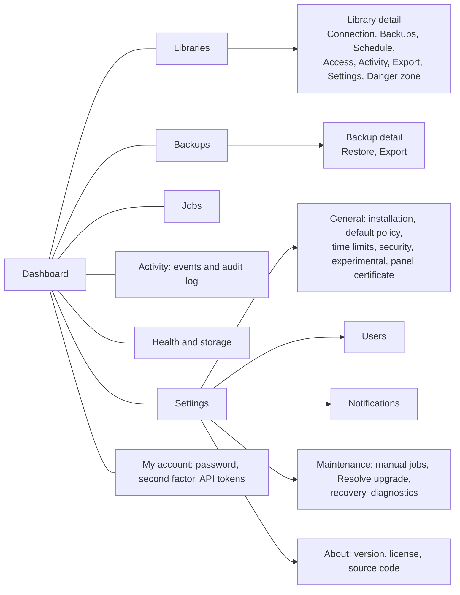

# 09. Web UI

## 1. Visual direction

Decision (reviewed against Apple's interface guidelines on 2026-10-18): **the environment of a
color grading suite.**

- **Strictly neutral grays** (R = G = B) on surfaces and text. The panel may be open next to a
  reference monitor; a tinted gray biases the colorist's perception.
- **Color appears only when a state means something:** correct (green), warning (amber),
  error (red), running (blue). There is no brand color; the primary action is an inverted button
  (light text on a dark background in dark theme, the reverse in light). Each state also carries
  text and a distinct shape (circle, diamond, square, outline), never color alone.
- **The theme follows the system** (`prefers-color-scheme`); there is no switch of its own. With
  `prefers-contrast: more` secondary text switches to the primary color.
- **Distinctive element: the protection timeline.** Each library is a track, as in an editing
  timeline. Each backup is a marker: tall and solid if it passed the test restore, medium if it
  passed checksum and index, dotted if it was not verified, a red cross if it failed. An amber
  band marks the time without a recent verified backup, except when the library has not changed
  since the last verified one (ADR 0022): then the badge says "N days ago, unchanged" and there
  is no band. The thin line on the right is "now". It appears on the dashboard and in the library
  list (14 days) and in a library's Backups tab (30 days), always with a legend and an accessible
  description.
- **System typography** for the interface and monospace for technical values (identifiers, IPs,
  hashes, track names); tabular figures across the whole panel.
- **The brand is the "Node" logotype** (ADR 0020, `docs/brand`): node and word in the text color,
  ports in the two brand colors (`--brand-in`, `--brand-out`). Those two colors appear in no
  other element except the port of each navigation icon. Until 2026-10-19 the brand was the
  miniature track.

Measured contrast (WCAG 2.x):

| Pair | Dark | Light |
|---|---|---|
| Text on card | #ececec / #242424: 13.1:1 | #1a1a1a / #ffffff: 17.4:1 |
| Secondary on card | #a8a8a8 / #242424: 6.5:1 | #5c5c5c / #ffffff: 6.7:1 |
| Error as text | #f0645a / #242424: 4.9:1 | #c0352b / #ffffff: 5.6:1 |
| Danger button | white / #c4342c: 5.4:1 | white / #b8312a: 6.0:1 |
| Control border | #6b6b6b / #161616: 3.4:1 | #8c8c8c / #ffffff: 3.4:1 |

Before this revision the amber accent measured 3.9:1 as a link in light theme and 1.07:1 against
the warning yellow: a primary button and a warning looked the same. That is why it was removed.

## 2. Navigation

Desktop: fixed sidebar with the 7 sections, each with its icon from `docs/brand/icons` (18 px,
stroke in the text color, one color port), and the account (a link to My account), role and
"Sign out" at its foot. Mobile (up to 768 px): the sidebar becomes a top bar: the brand and the
account with "Sign out" on the first line, and the 7 sections on a row below that scrolls
sideways; there is no dropdown menu and no bar of actions at the bottom: the actions of each page
stay in its header. Every link and button of the bar is at least 44 px tall. The top bar of every
page shows the running and queued jobs, and "PostgreSQL not responding" while it does not answer.

## 3. Screens

### 3.1 Setup wizard

One form in four numbered parts, then the recovery kit:

1. **Installation code** (printed in the container log; it only works until the first
   administrator exists).
2. **Administrator**: username, optional display name and the password twice (at least 8
   characters and not a common password). The second factor is enabled later in My account.
3. **Network**: the address workstations will use (sqsolve suggests the host used to open the
   panel; an IP or a DNS name) and the name of the installation. The time zone is the server's,
   shown in the next part.
4. **Default backups**: activity-based every 15 minutes (the default), daily at 02:00, every 4 h
   from 09:00 to 21:00 Monday to Saturday, or every 4 h. Retention starts at the default (last
   10, 14 daily, 8 weekly, 12 monthly) and is changed in Settings.
5. **Recovery kit**, on its own page after the account is created: download and a required
   checkbox "I saved it outside this server".

The page shows the SHA-256 fingerprint of the panel certificate. When the backups volume holds
control plane copies, it also offers "Recover an existing installation" (installation code and
master key from the kit).

### 3.2 Dashboard

A notice when the address workstations use is missing, then: **server status** (PostgreSQL
state, version, connections against the maximum and uptime; connected workstations; space of
each volume with a gauge), **attention** when something needs it (the list of `13-observability.md`
§4), **protection over the last 14 days** (one track per library), **recent jobs** (the last 6)
and **recent events** (the last 6 of warning severity or above). Each element links to its
detail; "New library" is in the header.

### 3.3 Libraries

Table (cards on mobile): display name and identifier, state and declared Resolve version, the
14-day track, last verified backup, connections now, size. Three views: In use, Trash and
Purged (with backups). "New library" button.

**Detail**: a header with the name, identifier, state and "Back up now", a notice for each job
queued or running on the library, and tabs:

- **Connection**: card with the four values for Resolve (library name, location, username, and
  the password behind a "Reveal password" button, audited), each with a copy button; the port;
  a link to the printable instructions without the password; what collaboration needs (Resolve
  Studio in the same version on every workstation, TCP 50059 to 50314 open between them); a note
  that sqsolve does not generate `.resolvedbkey` keys (PoC-05). Below, the sessions connected now
  with their encryption. While the library waits for Resolve, the tab shows the initialization
  steps with the same values, the time left in the window and a warning if Resolve created a
  database with another name; when it has no database on the server, "Recreate from the last
  backup" (typed confirmation) and, if its previous state is kept, a link to revert.
- **Backups**: the 30-day track and this library's backups (date, type, state, verification,
  size, duration, "Restore"), with an "Import" link.
- **Schedule**: automatic backups on or off; activity-based (a check every 5, 10, 15, 30 or 60
  minutes), daily at an hour, every 4 h on working days, every 4 h, every hour or a cron
  expression, and the time zone; retention (latest, daily, weekly, monthly, minimum verified).
  Beside it, the next 5 runs or checks with the last one, and the effect of the saved retention
  today (how many backups are kept and how many the next pass would delete).
- **Access**: credentials: the primary one and one per person (own user and password, revocable
  without touching the others; not validated with Resolve, PoC-01), each with "Reveal" and
  "Change password"; allowed networks (one CIDR or address per line).
- **Activity**: active sessions with a "Close" button; the library's last 20 jobs and 50 events;
  the current structure fingerprint.
- **Export** (experimental; with the setting off the tab says so and links to Settings): notice
  "Experimental" with "no guarantee" and the schema state ("Verified with Resolve 21.1.1" or
  "Not verified with Resolve"); two views with a search box: Projects (table with thumbnail,
  name, folder, modified, still count linking to the project's stills, and "Download .drp") and
  Stills (PowerGrade albums and each project's albums, collapsed, with thumbnails, ".drx" per
  still and "Download album (.zip)"). See `22` §7.
- **Settings**: display name, Resolve version the studio uses, connection limit, notes (free
  text for media paths, client, etc.); identifier, database, creation and size.
- **Danger zone**: put in maintenance (optionally closing open sessions) or reopen, revert the
  last restore while the previous state is kept, delete, and purge now from the trash.
  Differentiated background and an explanation of each action.

### 3.4 Backups

Global catalog with filters by library and state (available and failed, available, failed,
deleted), the space used by the listed backups and an "Import" action that counts the files
waiting in the import folder. Files missing from the volume or not in the catalog are reported by
the catalog check (`backup.catalog_mismatch`), not on this page.

A backup's **detail** shows size, duration, SHA-256, file, PostgreSQL and `pg_dump` versions,
structure, declared Resolve version and its job; its verification with "Test restore", "Pin" and
"Delete"; the row count per table; and "Restore", "Download" and "Export .drp and .drx". The
export from a backup (experimental) first restores it into a temporary database ("Prepare the
export", a job), then shows the same views as a library's Export tab; the temporary database is
dropped when it is closed or two hours after its last use. **Import** links a `pg_dump` file in
custom format to a library, from the import folder or uploaded from the browser.

### 3.5 Jobs

Two sections: running and queued, and history filterable by state (all, succeeded, failed,
interrupted, cancelled); each row shows the job, its state (with the percentage while it runs),
when it started, its duration and who started it. A job's detail shows the progress bar and the
current step, live over Server-Sent Events, the steps with timings and the full log, with a
"Cancel" button if applicable and "Retry" for failed, cancelled or interrupted jobs of
idempotent types (docs 11 §11). Both buttons appear only to whoever may start that operation.
Destructive jobs (restores, deletion, purge, library creation) and jobs the viewer may not retry
show "Start again" instead, a link to the page where the operation starts and asks for its
confirmation.

### 3.6 Activity: events and audit log

Two tabs, each with the latest 300 entries. Events: date, severity, message (with links to its
job and library) and type, filtered by minimum severity. Audit log (operators and
administrators): date, actor with IP, action, target, result; chain integrity indicator; export
JSON Lines.

### 3.7 Health and storage

PostgreSQL (version, up since, connections against the maximum, data checksums, TLS), storage
(gauge, free space and path of each volume, with its error), the doctor checks
(`13-observability.md` §7), databases (owner, size, sessions, access, invalid ones and changed
collation), certificates (expiry and fingerprint) and the system schedules with their next run.
sqsolve does not measure media volumes.

### 3.8 Settings

Tabs: **General** (installation name and the address workstations use; default policy for new
libraries: cron and retention; time limits: initialization window, days in the trash and days
the previous state is kept, each between 1 and 3650, hours without a backup before the warning,
maximum upload; security: library users in the `postgres` database, TLS only, second factor
required for administrators; Experimental: "Export of projects (.drp) and grades (.drx) from the
panel", off by default, ADR 0019; and the upload of your own panel certificate), **Users**
(panel accounts, role, second factor, disable; administrators only), **Notifications**
(webhook, ntfy and email channels with minimum severity, event patterns and a "Test" button),
**Maintenance** (manual jobs: verify the latest backups, apply retention, optimize libraries,
back up the control plane, check and rebuild the catalog, regenerate `pg_hba.conf`; the Resolve
upgrade window; the recovery kit; the diagnostic bundle) and **About** (version, commit,
PostgreSQL, license, source code, visual identity; the compatibility matrix is in
`14-compatibility.md`, not in the panel).

### 3.9 My account

Password, second factor (enable with an authenticator app and recovery codes, or remove), "Close
my other sessions" and API tokens (name, scopes, validity of 30, 90 or 365 days, revoke; the
token is shown once).

## 4. Key flows

### 4.1 New library

1. Form: display name; identifier suggested from the name as it is typed, editable (validated
   by the browser pattern and by the server); how it is initialized: "From Resolve"
   (recommended, E1) or "Empty database" (for testing only: Resolve 21.1 marks it incompatible,
   PoC-01); notes. The backup policy is the installation's default (Settings).
2. The library page, which says "Preparing the library" and refreshes itself while the
   `library.create` job runs.
3. With E1: card "Initialize the library from Resolve" with the values to copy and the time
   left in the window; the page polls the state and reloads when it detects the initialization.
4. End: state active, a first backup queued, and the Connection tab with the values for the
   other workstations.

### 4.2 Connect a workstation

Connection tab. The "Instructions to share" link opens a printable page without the password, to
send to an editor. sqsolve has no connection portal for collaborators (`20-roadmap.md` §2).

### 4.3 Restore

1. From a backup: "Restore" button. The page shows side by side **As a new library**
   (recommended) and, to whoever may replace, **Replace** the current library. A notice warns
   when the backup's structure differs from the current library's (probably another Resolve
   version, with the declared one).
2. As new: name and identifier, with the suggestion "open the copy in Resolve, export the
   project (.drp) and import it into the original library"; the job page ends with "Go to the
   library".
3. Replace: consequences with real data: the backup's age ("changes made since 26 h ago are lost"), that a backup of the current state is taken, that the backup is restored apart and
   checked against its manifest before the swap, that the current state is kept for the days of
   Settings (7 by default) to revert, the open connections (user and address) and the warning to
   close the project in Resolve on every workstation first. Asks to type the slug; there is no
   reauthentication (ADR 0021): whoever has the permission confirms, and the request is in the
   audit log. Option "Close open sessions" unchecked by default; if there are sessions and it is
   not checked, the job waits up to 10 min for them to close and then fails without touching
   anything.
4. Progress with visible steps on the job page. While the previous state is kept, the Danger zone
   offers "Revert the last restore", which asks to type the slug again.

### 4.4 Delete

Consequences (a verified final backup first, open sessions closed and listed, days in the
trash, size, backups kept by their retention) and typed confirmation; no reauthentication
(ADR 0021). The library goes to the trash; it is purged after the days in the trash (30 by
default, Settings). From the trash: "Recover" or "Purge now" (on its own page, typing the slug
again).

### 4.5 Resolve upgrade window

In Settings, Maintenance, "Upgrade DaVinci Resolve": type the target version and "Prepare
upgrade". The `system.upgrade_window` job backs up with kind `pre_upgrade` and verifies (level 2)
every active library and every library in maintenance, and stops with `SQS-B060` if one fails;
its result records each library's fingerprint before the upgrade. The card lists the steps for
the studio once the job ends (everyone closes Resolve, upgrade one workstation, open each library
and accept the upgrade if offered, check a project, upgrade the other workstations). There is no
closing step: a changed fingerprint shows up later as `library.schema_changed`
(`14-compatibility.md` §5). The window has not been exercised with a real Resolve upgrade
(PoC-03).

## 5. Interaction patterns

- **Long operations**: always a job; its page shows progress over Server-Sent Events and you can
  leave and come back. Never a button that blocks waiting.
- **Danger**: error color only on the final button, consequences with real data, typed
  confirmation for irreversible actions; no reauthentication (ADR 0021).
- **Forms**: server-side validation always; the error comes back as a notice at the top of the
  page with its code. The setup and new library forms keep what was typed, passwords aside.
- **Empty states**: each empty list says in a short sentence what is missing ("No events.");
  with no libraries yet, the dashboard and the library list explain what a library is and offer
  to create the first one.
- **Errors**: human message with its `SQS-` code and a link back to the dashboard; a failed job
  offers "Retry" or "Start again" (§3.5).
- **Copy**: button with the visual confirmation "Copied"; in browsers without the clipboard API,
  it selects the text. Pages waiting for Resolve poll the state through the API and reload only
  when it changes, so as not to interrupt a copy.
- **Notices**: each notice carries text and the same shape as the badges (circle, diamond,
  square, outline), never color alone.
- **Times**: relative ("3 h ago") with the absolute date in the server's time zone on hover or
  tap.

## 6. Accessibility and adaptability

- WCAG 2.2 AA: 4.5:1 contrast on text, visible focus (`--focus`), 44 px touch targets at
  every width (controls drawn smaller keep their look and take taps on an invisible 44 px area),
  full keyboard navigation, `aria-live="polite"` for progress and notices, labels on all fields,
  tables with real headers.
- Breakpoints: 1000 px (the dashboard's status strip stacks) and 768 px (the sidebar becomes the
  top bar). Tables marked `cards-on-mobile` turn into cards under 768 px.
- `prefers-reduced-motion` disables animations.

## 7. Language

English only. Strings are written inline in the templates and handlers; there is no translation
layer. Dates and numbers use English formatting. `SQS-` codes are stable identifiers.

## 8. Implementation

- Templates in `internal/web/templates`: `layout.html`, `partials.html` (flash, badge, csrf,
  copy, empty, jobstate, librarystate, jobtable, joblist, track, trackrow, tracklegend, libhead,
  libtabs, exportcatalog, stillgrid, sslbadge) and one template per screen. Styles in
  `internal/web/static/app.css`, JavaScript in `app.js`.
- No inline styles or scripts (strict CSP). Gauges with `<meter>`, progress with `<progress>`,
  the track with SVG.
- `docs/ui/checklist.md`, from the patterns phase of `ui-consistency`, lists the components,
  tokens and patterns that every page reuses. Each new page is checked against that list.
