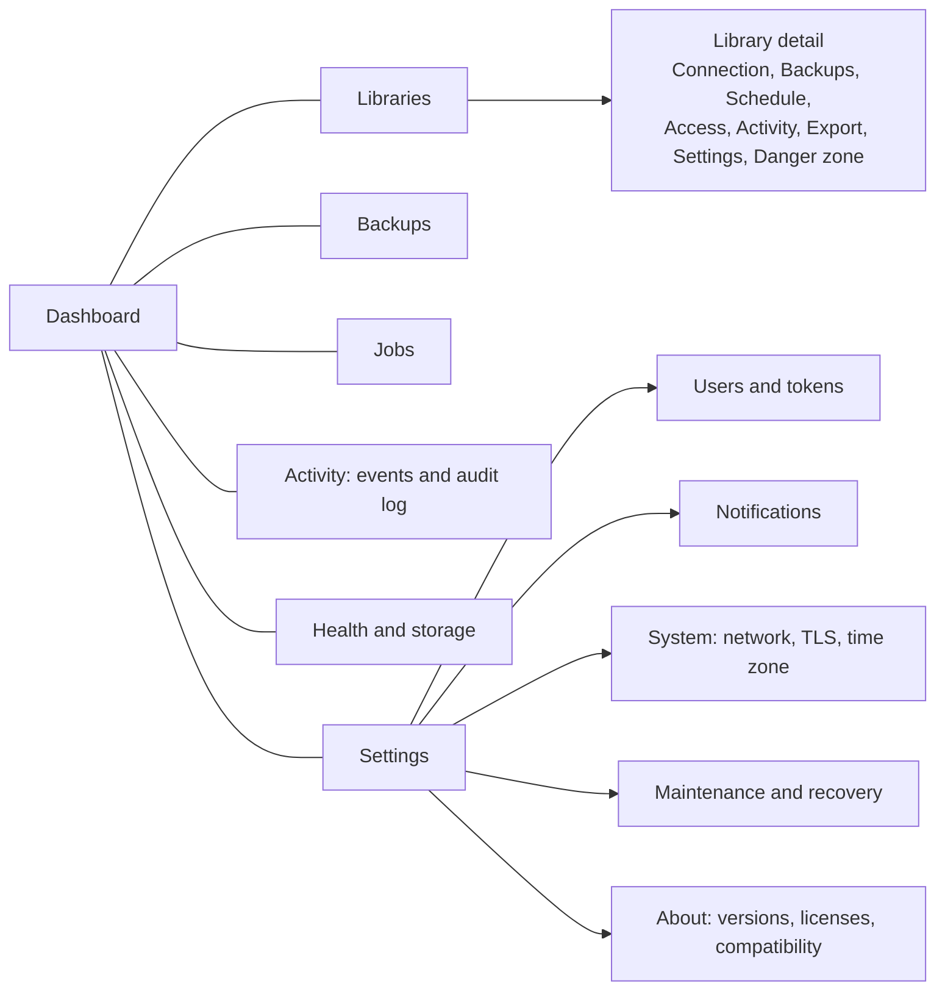

# 09. Web UI

## 1. Visual direction

Decision (reviewed against Apple's interface guidelines on 2026-10-18): **the environment of a
color grading suite.**

- **Strictly neutral grays** (R = G = B) on surfaces and text. The panel may be open next to a
  reference monitor; a tinted gray biases the colorist's perception.
- **Color appears only when a state means something:** correct (green), warning (amber),
  error (red), running (blue). There is no brand color; the primary action is an inverted button
  (light text on a dark background in dark theme, the reverse in light). Each state also carries
  text and a distinct shape (circle, diamond, square, outline), never color alone.
- **The theme follows the system** (`prefers-color-scheme`); there is no switch of its own. With
  `prefers-contrast: more` secondary text switches to the primary color.
- **Distinctive element: the protection timeline.** Each library is a track, as in an editing
  timeline. Each backup is a marker: tall and solid if it passed the test restore, medium if it
  passed checksum and index, dotted if it was not verified, a red cross if it failed. An amber
  band marks the time without a recent verified backup, except when the library has not changed
  since the last verified one (ADR 0022): then the badge says "N days ago, unchanged" and there
  is no band. The thin line on the right is "now". It appears on the dashboard (14 days), in the
  library list and in the Backups tab (30 days), always with a legend and an accessible
  description.
- **System typography** for the interface and monospace for technical values (identifiers, IPs,
  hashes, track names); tabular figures across the whole panel.
- **The brand is the "Node" logotype** (ADR 0020, `docs/brand`): node and word in the text color,
  ports in the two brand colors (`--brand-in`, `--brand-out`). Those two colors appear in no
  other element except the port of each navigation icon. Until 2026-10-19 the brand was the
  miniature track.

Measured contrast (WCAG 2.x):

| Pair | Dark | Light |
|---|---|---|
| Text on card | #ececec / #242424: 13.1:1 | #1a1a1a / #ffffff: 17.4:1 |
| Secondary on card | #a8a8a8 / #242424: 6.5:1 | #5c5c5c / #ffffff: 6.7:1 |
| Error as text | #f0645a / #242424: 4.9:1 | #c0352b / #ffffff: 5.6:1 |
| Danger button | white / #c4342c: 5.4:1 | white / #b8312a: 6.0:1 |
| Control border | #6b6b6b / #161616: 3.4:1 | #8c8c8c / #ffffff: 3.4:1 |

Before this revision the amber accent measured 3.9:1 as a link in light theme and 1.07:1 against
the warning yellow: a primary button and a warning looked the same. That is why it was removed.

## 2. Navigation

Desktop: fixed sidebar with the 7 sections, each with its icon from `docs/brand/icons` (18 px,
stroke in the text color, one color port), and the account, role and "Sign out" at its foot.
Mobile (up to 768 px): the sidebar becomes a top bar: the brand and the account with "Sign out"
on the first line, and the 7 sections on a row below that scrolls sideways; there is no
dropdown menu and no bar of actions at the bottom: the actions of each page stay in its header.
Every link and button of the bar is at least 44 px tall. A global status bar shows running jobs
and open alerts on every page.

## 3. Screens

### 3.1 Setup wizard

Five steps, with a progress bar and the ability to go back:

1. **Installation code** (printed in the container log).
2. **Administrator account** (username, password with strength meter, optional TOTP with a
   QR generated on the server).
3. **Network**: the address workstations will see (sqsolve suggests the container and host IPs
   it detects, and allows a DNS name), time zone.
4. **Default backups**: preset (daily 02:00, every 4 h during working hours, custom) and
   retention (default: last 10, 14 daily, 8 weekly, 12 monthly).
5. **Recovery kit**: mandatory download and a checkbox "I saved it outside this server".
   Shows the SHA-256 fingerprint of the panel certificate.

### 3.2 Dashboard

Four blocks: **server status** (PostgreSQL, version, total connections, data and backup space
with bars), **attention required** (failed backups, failed verifications, libraries without a
verified backup for more than 48 h, low space, certificates about to expire), **libraries** (the
5 with the most recent activity), **jobs** (running and the last 5). Each element links to its
detail.

### 3.3 Libraries

Table (cards on mobile): display name and slug, state, connections now, size, last backup with
its verification, detected version. Filters by state. "New library" button.

**Detail**, tabs:

- **Connection**: card with the four values for Resolve (suggested name, location, username,
  password hidden with a "Reveal" button, audited), each with a copy button; step-by-step
  instructions per system (Windows, macOS, Linux) with our own reference screenshots; ports
  workstations must open to collaborate; download of `.resolvedbkey` if the module is active,
  marked "Experimental".
- **Backups**: list of this library's backups with actions; "Back up now" button.
- **Schedule**: preset or cron with a preview of the next 5 runs; retention with a preview of
  what would be kept today.
- **Access**: credentials (1.0: the owner's, with rotation; 1.1: per person), network rules,
  connection limit.
- **Activity**: active sessions with a terminate button; library events; fingerprint history.
- **Export** (experimental, only if the setting is on): notice "Experimental: no guarantee" and
  the fingerprint state ("verified with Resolve 21.1.1" or "not verified"); two views with a
  search box: Projects (table with thumbnail, name, folder, modified, still count linking to
  the project's stills, and "Download .drp") and Stills (PowerGrade albums and each project's
  albums, collapsed, with thumbnails, ".drx" per still and "Download album (.zip)"). See `22`
  §7.
- **Settings**: display name, notes (free text for media paths, client, etc.), declared Resolve
  version, save as template.
- **Danger zone**: maintenance, delete. Differentiated background and an explanation of each
  action.

### 3.4 Backups

Global catalog with filters (library, kind, state, verification, date), space totals per
library, an "Import backup" action and a notice for orphan backups (file without catalog entry
or the reverse).

### 3.5 Jobs

Three views: running (with a bar and the current step live), queued (with the expected time) and
history (filterable by state and kind). A job's detail shows steps with timings and the full
log, with a "Cancel" button if applicable and "Retry" for failed, cancelled or interrupted jobs of
idempotent types (docs 11 §11). Both buttons appear only to whoever may start that operation.
Destructive jobs (restores, deletion, purge, library creation) and jobs the viewer may not retry
show "Start again" instead, a link to the page where the operation starts and asks for its
confirmation.

### 3.6 Activity: events and audit log

Two tabs. Events: severity, kind, library, message. Audit log: actor, action, target, result,
IP; chain integrity indicator; export JSON Lines.

### 3.7 Health and storage

Volumes (path, file system, space, valid marker), PostgreSQL (version, uptime, connections per
database, size per database, collation version, data checksums enabled), certificates (expiry),
sqsolve (version, commit, memory, jobs). In 1.2, space of media volumes mounted read-only.

### 3.8 Settings

Users and tokens; notifications (channels with a "Test" button, and rules); system (advertised
address, panel TLS with upload of your own certificate, time zone, trusted proxies, days in the
trash and days the previous state is kept, each between 1 and 3650);
maintenance and recovery (rebuild catalog, import, regenerate `pg_hba.conf`, diagnostic bundle,
recovery kit, Resolve upgrade window); about (versions, third-party licenses, SBOM,
compatibility matrix). In General > Experimental: "Experimental export of projects and grades",
off by default (ADR 0019).

## 4. Key flows

### 4.1 New library

1. Form: display name; slug suggested from the name, editable and validated live; template (if
   any) or "initialize with Resolve"; backup policy (the default or a custom one).
2. Progress screen for the `library.create` job.
3. With E1: card "Open Resolve on a workstation and choose Create" with the values to copy and a
   countdown for the window; the page refreshes itself when it detects the initialization.
4. End: state active, first backup running, link to "Connect more workstations".

### 4.2 Connect a workstation

Connection tab. A "Share instructions" link generates a printable page without the password, to
send to an editor, and in 1.1 a link to the connection portal.

### 4.3 Restore

1. From a backup: "Restore" button. Explicit choice between **As a new library** (default and
   recommended) and **Replace the current library**.
2. As new: ask for slug and name; job; end with the connection data of the copy and the
   suggestion "export the project you need (.drp) from Resolve and import it into the original
   library".
3. Replace: consequences screen with real data: active connections now (who and from where),
   backup date and age ("changes from the last 26 hours will be lost"), the backup's Resolve
   version against the current one if it differs, that a pre-restore backup will be made and that
   the current state will be kept for 7 days to revert. Asks to type the slug; there is no
   reauthentication (ADR 0021): whoever has the permission confirms, and the request is in the
   audit log. Option "terminate active sessions" unchecked by default; if there are sessions and
   it is not checked, the job waits up to 10 min for them to drain and then fails without
   touching anything.
4. Progress with visible steps. End with a "Revert" button available during the grace period.

### 4.4 Delete

Consequences (connections, size, remaining backups and their retention) and typed confirmation;
no reauthentication (ADR 0021). The library goes to the trash with a verified final backup; it is
purged after 30 days. From the trash: untrash or purge now (with a second confirmation).

### 4.5 Resolve upgrade window

Wizard in Maintenance: choose the target version; sqsolve backs up and verifies (level 2) all
active libraries with kind `pre_upgrade`; list of steps for the studio (everyone closes Resolve,
upgrade one workstation, open each library and accept the upgrade if offered, upgrade the other
workstations); when the window closes, comparison of fingerprints before and after per library.

## 5. Interaction patterns

- **Long operations**: always a job; the page shows progress over SSE and you can leave and come
  back. Never a button that blocks waiting.
- **Danger**: error color only on the final button, consequences with real data, typed
  confirmation for irreversible actions; no reauthentication (ADR 0021).
- **Forms**: server-side validation always; the error comes back as a notice at the top of the
  page with its code and submitting does not erase what was typed.
- **Empty states**: each empty list explains what it is and offers the primary action ("There
  are no libraries yet. Create the first one").
- **Errors**: human message, `SQS-` code, link to help and, if applicable, a retry button.
- **Copy**: button with the visual confirmation "Copied"; in browsers without the clipboard API,
  it selects the text. Pages waiting for Resolve poll the state through the API and reload only
  when it changes, so as not to interrupt a copy.
- **Notices**: each notice carries text and the same shape as the badges (circle, diamond,
  square, outline), never color alone.
- **Times**: relative ("3 h ago") with the absolute date in the server's time zone on hover or
  tap.

## 6. Accessibility and adaptability

- WCAG 2.2 AA: 4.5:1 contrast on text, focus visible with the accent, 44 px touch targets,
  full keyboard navigation, `aria-live="polite"` for progress and notices, labels on all fields,
  tables with real headers.
- Breakpoints: 360, 768, 1200 px. Tables turn into cards under 768 px.
- `prefers-reduced-motion` disables animations.

## 7. Language

English only. Strings are written inline in the templates and handlers; there is no translation
layer. Dates and numbers use English formatting. `SQS-` codes are stable identifiers.

## 8. Implementation

- Templates in `internal/web/templates`: `layout.html`, `partials.html` (badge, copy, empty,
  jobstate, librarystate, jobtable, joblist, track, trackrow, tracklegend) and one template per
  screen. Styles in `internal/web/static/app.css`, JavaScript in `app.js`.
- No inline styles or scripts (strict CSP). Gauges with `<meter>`, progress with `<progress>`,
  the track with SVG.
- Before the first interface task (SQS-500), the agent runs `ui-consistency` (finding-patterns,
  then planning) and documents in `docs/ui/checklist.md` the components, tokens and patterns that
  every page must reuse. Each new page is checked against that list.
