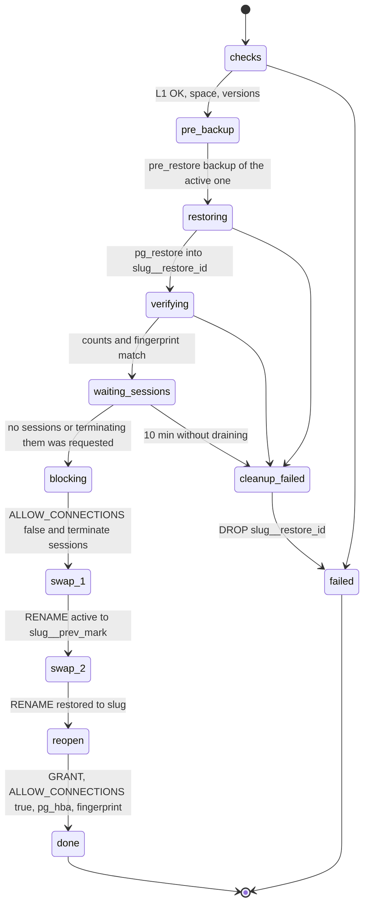
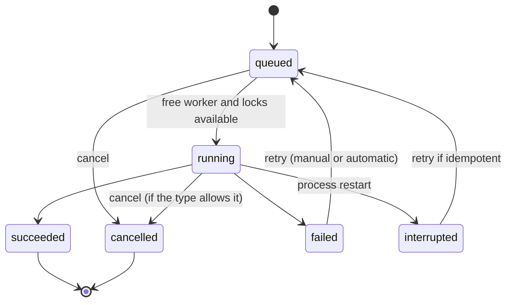

# 11. Backups, recovery and automation

## 1. Objectives

| Objective | Default value | Configurable |
|---|---|---|
| RPO (maximum loss) | 24 h with the daily schedule; 4 h with the "working hours" preset | Yes, per library |
| RTO (restoring a library) | Duration of `pg_restore` plus under 1 min of swap | Measured in PoC-10 and published by size |
| Verification | Level 1 on every backup; level 2 weekly on the latest of each library | Yes |
| Most recent verified backup | Never older than 48 h on active libraries (otherwise the `backup.stale` alert) | Yes |

## 2. Protection layers

| Layer | What it protects | Version |
|---|---|---|
| L1. Logical backups per library on the `backups` volume | Human error, logical corruption, granular restore | 1.0 |
| L2. Encrypted offsite copy with restic | Loss of the server or of the backups disk | 1.1 |
| L3. PITR with pgBackRest (continuous WAL) | Loss of minutes, not hours | 2.0 |
| L4. Host file system snapshots (ZFS, Btrfs) | The whole host, at block level | Operational recommendation; outside sqsolve |
| L5. Recovery kit and control plane backup | Rebuild sqsolve on another server | 1.0 |

Documented recommendation: the `backups` volume on a different disk or pool than `pgdata`, and
at least one copy outside the building (L2 or NAS replication).

## 3. Backups volume layout

```
/backups/
  .sqsolve-volume                    marker: {"instance_id": "...", "created_at": "..."}
  libraries/
    client_x/
      2026/10/
        client_x_20261018T070000Z_01JB....backup
        client_x_20261018T070000Z_01JB....manifest.json
  _system/
    sqsolve-state-20261018T040000Z.db    daily SQLite copy (VACUUM INTO)
    audit-202610.jsonl                    monthly audit log export
  _import/                                folder for importing external files
```

Permissions: directories 0700 and files 0600 for the sqsolve UID. The marker is created in the
wizard and checked before every write (RNF-FIA-04): if the volume is not mounted, the path
exists empty inside the container and writing there would fill the container layer or the wrong
disk.

## 4. Backup procedure

Job `backup.create`. Steps (each is recorded in `job_steps`):

1. **preflight**: library in `active` or `maintenance`; valid marker; free space greater than or
   equal to `max(1.5 × size of the last backup, 0.5 × pg_database_size)` (if there is no
   history, `pg_database_size`); no restore of that library in progress.
2. **snapshot**: control connection in `BEGIN ISOLATION LEVEL REPEATABLE READ, READ ONLY`;
   `SELECT pg_export_snapshot()`; the database's activity mark is read (`07` §7) and stored with
   the backup (`activity_mark`) and in the manifest.
3. **dump**: `pg_dump --dbname=<slug> --format=custom --quote-all-identifiers --snapshot=<id>
   --lock-wait-timeout=60s --file=<path>.partial` (default `pg_dump` compression; `zstd`
   optional if PoC-04 confirms it does not affect restoring from Resolve). Credentials through a
   temporary 0600 `PGPASSFILE` in the container's `/tmp` (tmpfs), deleted when finished.
4. **counts**: in the same transaction as step 2, `SELECT count(*)` for each `public` table
   listed in the catalog (sanitized identifiers). For libraries with more than 10 million
   estimated rows, estimates from `pg_class.reltuples` are used and the manifest says so.
   `COMMIT`.
5. **fingerprint**: schema fingerprint (`07` §9).
6. **seal**: `fsync` the file, `rename` to `.backup`, `fsync` the directory; SHA-256 of the
   file; write the manifest with the same atomic pattern; record in the catalog with state
   `ok`.
7. **verify_l1**: recompute SHA-256 reading from disk and `pg_restore --list` without errors;
   `verify_status = l1_ok`. If it fails: state `failed`, delete file and manifest, event
   `backup.verify_failed`.
8. **post**: event `backup.succeeded`, notifications, enqueue retention and offsite copy if
   applicable.

Impact on Resolve: `pg_dump` takes `ACCESS SHARE` locks, which only conflict with DDL (`ALTER`,
`DROP`, `TRUNCATE`). If Resolve requests an exclusive lock during the backup, it waits, and so
do the queries that arrive behind it. PoC-10 measures whether this happens in practice; the
guide recommends scheduling backups outside Resolve version upgrade hours.

## 5. Verification

| Level | What it does | When |
|---|---|---|
| L1 | SHA-256 matches the manifest; `pg_restore --list` reads the index | After every backup and before every restore |
| L2 | Restores into `sqsolve_verify_<id8>` with `--no-owner --no-privileges --exit-on-error`; compares per-table counts and fingerprint with the manifest; drops the database | Weekly (Sunday 05:00) for the latest backup of each active library; manual on any backup |
| L3 | Drill with Resolve: a human opens a restored copy in Resolve and checks a project | Quarterly, guided by the documentation checklist; recorded by hand in the interface |

L2 needs free space in `pgdata` equal to the library size; if there is none, it is skipped with
a notice. The verification database has `CONNECTION LIMIT 1` and no library role can enter (it
is not in `pg_hba.conf`).

## 6. Retention

Per-library policy:

```
keep_last      = 10   # the N most recent with state ok
keep_daily     = 14   # the most recent of each of the last N days
keep_weekly    = 8    # the most recent of each of the last N ISO weeks
keep_monthly   = 12   # the most recent of each of the last N months
min_verified   = 1    # never end up with fewer than N backups with a correct L1 or L2 verification
```

Algorithm (in `internal/backup/retention.go`, a pure function with property tests):

1. Candidates: `ok` backups of the library, sorted by `started_at` descending.
2. Keep: pinned ones; those of kind `pre_restore`, `pre_delete` and `pre_upgrade` under 30 days
   old; those that satisfy some `keep_*` rule (days, weeks and months are computed in the
   policy's time zone).
3. If after that fewer than `min_verified` verified ones remain, keep the most recent verified
   ones until it is met.
4. The rest become `expired`. Deletion in two phases: first the file, then the manifest, then
   the row becomes `deleted` (the record is kept for the audit log).
5. `failed` and `interrupted` backups: their leftovers are deleted immediately; the row stays
   30 days.

The preview (`GET .../backup-policy/preview`) uses the same function with the proposed policy.

## 7. Restore

### 7.1 Modes

| Mode | Risk | Typical use |
|---|---|---|
| As a new library | None to the active one | Recover a project: open the copy in Resolve, export `.drp` and import it into the original |
| Replace | Changes after the backup are lost (reversible for 7 days) | The active library is damaged or everything must go back |
| Download | None | Restore from Resolve somewhere else |

### 7.2 Replacement by swap



SQL steps of the swap (as `sqsolve_admin`, owner of the databases according to PoC-01; if not,
with the superuser):

```sql
ALTER DATABASE client_x ALLOW_CONNECTIONS false;
SELECT pg_terminate_backend(pid) FROM pg_stat_activity WHERE datname = 'client_x';
ALTER DATABASE client_x RENAME TO client_x__prev_202610181930;
ALTER DATABASE client_x__restore_7f3a91c2 RENAME TO client_x;
REVOKE CONNECT ON DATABASE client_x FROM PUBLIC;
GRANT CONNECT, TEMP ON DATABASE client_x TO client_x;
ALTER DATABASE client_x ALLOW_CONNECTIONS true;
```

`ALTER DATABASE ... RENAME` cannot be run inside a transaction together with the other rename,
which is why the journal exists.

Verified on 2026-10-19 (PoC-09, `docs/poc/poc-09-forced-disconnect.md`): with "terminate
sessions", Resolve 21.1.1 reconnects on its own to the restored database and keeps saving the
project it had in memory. That is why the guide asks to close the project before replacing and
reopen it afterwards; a technical safeguard is left for 1.1.

### 7.3 Recovery after a cut during the swap

On startup, for each interrupted `restore.replace`, the databases that exist are observed:

| `slug` exists | `slug__prev_mark` exists | `slug__restore_id` exists | Action |
|---|---|---|---|
| Yes | No | Yes | No rename happened: drop `__restore`, reopen `slug`, mark failed |
| No | Yes | Yes | Cut between renames: complete the rename of `__restore` to `slug`, reopen, mark succeeded with a notice |
| Yes | Yes | No | Swap done: ensure `GRANT` and `ALLOW_CONNECTIONS`, mark succeeded |
| No | Yes | No | Anomalous: rename `__prev` to `slug`, reopen, mark failed and critical alert |

No case drops `slug` or `slug__prev_mark`.

### 7.4 Revert

For 7 days (configurable), "Revert" performs the inverse swap: the current active one becomes
`slug__prev_<new mark>` and the previous `__prev` goes back to `slug`. It also leaves a prior
`pre_restore` backup. When the period expires, the `__prev` is dropped by a job that first
confirms a verified `pre_restore` backup of it exists.

### 7.5 Backup compatibility

Before restoring, the manifest is compared with the server:

| Situation | Result |
|---|---|
| Backup's `pg_dump` of a higher major version than `pg_restore` | Rejected with `SQS-R004` (cannot be read) |
| Backup's PostgreSQL older than the current one | Allowed |
| Backup fingerprint differs from the active library's | Notice: "This backup is from another Resolve version (declared: 20.3.2). Workstations on 21.x will upgrade it when opening it and 20.3.2 will no longer open projects that are opened in 21" |
| Backup imported without a manifest | A manifest is generated with `pg_restore --list` and SHA-256; without counts, so L2 only compares the fingerprint and it is marked "partial verification" |

## 8. Failures and interruptions

| Failure | Detection | Handling |
|---|---|---|
| Power cut during `pg_dump` | On startup: job `running`, `.partial` file | Job `interrupted`, delete `.partial`, event; the next schedule runs normally or by the missed-runs policy |
| Cut during L2 verification | `sqsolve_verify_*` database without a live job | `DROP DATABASE ... WITH (FORCE)` |
| Cut during restore before the swap | `__restore_*` without a live job | Drop it; the active one was not touched |
| Cut during the swap | Journal | Table in §7.3 |
| Disk full | Preflight or `pg_dump` write error | Delete `.partial`, `SQS-B012`, alert; backups outside retention are never deleted to make room |
| Backups volume missing | Marker | Do not write; critical `storage.volume_missing`; backup jobs fail with `SQS-S001` |
| PostgreSQL down | Connection fails | Retries waiting 30 s, 2 min, 5 min; then `failed` with `SQS-P001` |
| `pg_dump` waits for a lock for more than 60 s | Exit code and message | `failed` with `SQS-B020`; one automatic retry after 15 min |
| Incompatible restore | §7.5 | Rejected before touching anything |
| Tampered backup file | SHA-256 | `verify_failed`; never used to restore without an explicit, audited force |

## 9. Offsite copies with restic (1.1)

- Destinations: local path (another disk), SFTP, restic REST server, S3-compatible (including
  self-hosted services such as Garage).
- After every successful backup (or on its own schedule): `restic backup` of the file and its
  manifest with tags `library:<slug>`, `kind:<kind>`.
- Remote retention with `restic forget --prune` and its own policy (by default the same as the
  local one).
- Weekly `restic check --read-data-subset=5%`; a failure generates `offsite.check_failed`.
- Restore from remote: `restic restore` into `_import/` and the normal import flow.

## 10. Scheduler

- Two modes per library (ADR 0022). **Activity-based**, the default mode on new installations:
  the scheduler wakes every 5, 10, 15, 30 or 60 minutes and backs up only if the activity mark
  changed since the last successful backup; the check is stored in the policy
  (`last_check_at`, `last_check_same`) and produces no job or event. **Cron**: 5-field
  expressions in the policy's time zone, plus presets: "daily at HH:MM", "every N hours between
  HH and HH, workdays", "every 4 hours", "every hour".
- A verified backup whose mark matches the current one remains valid even if old: it does not
  trigger `backup.stale` or paint an amber band on the protection timeline.
- Fixed random offset per library of 0 to 5 min (derived from the ID) so everything does not
  launch at once.
- Missed runs: if at startup the last scheduled run was left unrun and was less than
  `misfire_window_minutes` ago (default 12 h for backups), it is enqueued once. If it was
  earlier, `backup.missed` is recorded.
- Daylight saving changes: Go's `time.Location` is used; a time that does not exist is skipped
  and one that repeats runs once.

## 11. Job queue



- Priority: `restore.*` 100, manual `backup.create` 80, scheduled 50, `backup.verify` 30,
  maintenance 10.
- Per-library locks: write mode (restore, delete, maintenance) excludes everything; read mode
  (backup, verification) admits other reads.
- Cancellable: `backup.create`, `backup.verify`, `restore.new`, `restore.replace` before the
  `blocking` step. Not cancellable: a swap in progress, purge.
- Job and log history: 90 days by default.

## 12. Default maintenance jobs

| Job | Default schedule |
|---|---|
| Retention for all libraries | Daily 04:00 and after every backup |
| L2 verification of the latest backup of each library | Sunday 05:00 |
| `VACUUM (ANALYZE)` per library | Sunday 03:00 |
| Schema fingerprint | Every 5 min |
| Volume space | Every 5 min |
| Catalog and file consistency | Daily 04:30 |
| Control plane backup | Daily 04:15 |
| Monthly audit log export | Day 1, 04:45 |
| Purge of expired trash and `__prev` | Daily 04:20 |
| Certificates about to expire | Daily 06:00 |
| Rotation of the `sqsolve_admin` password | Every 90 days |

## 13. Notifications

- Channels: webhook (1.0), SMTP and ntfy (1.1).
- Rules: event type pattern (`backup.*`, `storage.low`) and minimum severity.
- By default, when the first channel is created: `error` and `critical` of everything, plus
  `backup.stale`.
- Grouping: the same event type for the same library is not repeated within 30 min; the next
  delivery says "and 4 more".
- Email: subject `[sqsolve] <severity>: <message>`, plain text body with a link.
- ntfy: priority according to severity, tag with the library.
