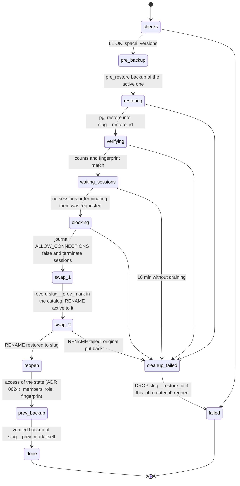
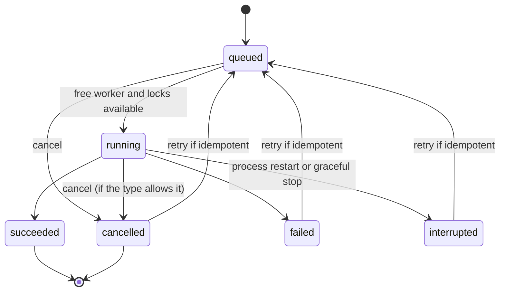

# 11. Backups, recovery and automation

## 1. Objectives

| Objective | Default value | Configurable |
|---|---|---|
| RPO (maximum loss) | 24 h with the daily schedule; 4 h with the "working hours" preset | Yes, per library |
| RTO (restoring a library) | Duration of `pg_restore` plus under 1 min of swap | Measured in PoC-10 and published by size |
| Verification | Level 1 on every backup; level 2 weekly on the latest of each library | Yes |
| Most recent verified backup | Never older than 48 h on active libraries (otherwise the `backup.stale` alert) | Yes |

## 2. Protection layers

| Layer | What it protects | Version |
|---|---|---|
| L1. Logical backups per library on the `backups` volume | Human error, logical corruption, granular restore | 1.0 |
| L2. Encrypted offsite copy with restic | Loss of the server or of the backups disk | 1.1 |
| L3. PITR with pgBackRest (continuous WAL) | Loss of minutes, not hours | 2.0 |
| L4. Host file system snapshots (ZFS, Btrfs) | The whole host, at block level | Operational recommendation; outside sqsolve |
| L5. Recovery kit and control plane backup | Rebuild sqsolve on another server | 1.0 |

Documented recommendation: the `backups` volume on a different disk or pool than `pgdata`, and
at least one copy outside the building (L2 or NAS replication).

## 3. Backups volume layout

```
/backups/
  .sqsolve-volume                    marker: {"instance_id": "...", "volume": "backups", "created_at": "..."}
  libraries/
    client_x/
      2026/10/
        client_x_20261018T070000Z_01JB....backup
        client_x_20261018T070000Z_01JB....manifest.json
  _system/
    sqsolve-state-20261018T040000Z.db    daily SQLite copy (VACUUM INTO)
    audit-202610.jsonl                    monthly audit log export
  _import/                                folder for importing external files
```

Every path in the catalog is relative to the volume and names a `.backup` file under
`libraries/`, with its manifest next to it under the same name (`<name>.manifest.json`). sqsolve
only reads, restores, downloads or deletes a backup whose path is clean (no `..`, not absolute)
and stays on the volume once its symlinks are resolved (`fsx.Confined`). A row that does not
meet that is never rewritten or deleted automatically: it is blocked (`SQS-B043`), reported at
every start and by the catalog check as one critical `backup.path_invalid` event, and an
administrator reviews it (`docs/runbooks/invalid-backup-path.md`).

A manifest is read only when it is a complete version 1 manifest
(`api/schemas/manifest.v1.json`): `manifest_version` 1, valid IDs, a valid slug, a known kind, a
`file` that is the base name of a `.backup` file, a size and a SHA-256; otherwise `SQS-B042`.
Rebuilding the catalog adds a manifest only when it is valid, stays on the volume and names its
own backup file (`x.manifest.json` next to `x.backup`); the rest are skipped with a warning in
the job log.

Permissions: directories 0700 and files 0600 for the sqsolve UID. The marker is created in the
wizard and checked before every write (RNF-FIA-04): if the volume is not mounted, the path
exists empty inside the container and writing there would fill the container layer or the wrong
disk.

## 4. Backup procedure

Job `backup.create`. Steps (each is recorded in `job_steps`):

1. **preflight**: library in `active` or `maintenance`; valid marker; free space greater than or
   equal to `max(1.5 × size of the last backup, 0.5 × pg_database_size)` (if there is no
   history, `pg_database_size`); no restore of that library in progress.
2. **snapshot**: on the control connection the database's activity mark is read first (`07`
   §7), outside any transaction; then `BEGIN ISOLATION LEVEL REPEATABLE READ, READ ONLY` and
   `SELECT pg_export_snapshot()`. The mark is stored with the backup (`activity_mark`) and in the
   manifest. Reading it before the snapshot means a write that lands in between is in the dump
   and not in the mark, so the activity gate (§10) backs up once more; in the other order the
   write would be counted in the mark, missing from the dump, and never backed up.
3. **dump**: `pg_dump --dbname=<slug> --format=custom --quote-all-identifiers --snapshot=<id>
   --lock-wait-timeout=60s --file=<path>.partial` (default `pg_dump` compression; `zstd`
   optional if PoC-04 confirms it does not affect restoring from Resolve). Credentials through a
   temporary 0600 `PGPASSFILE` in the container's `/tmp` (tmpfs), deleted when finished.
4. **counts**: in the same transaction as step 2, `SELECT count(*)` for each `public` table
   listed in the catalog (sanitized identifiers). For libraries with more than 10 million
   estimated rows, estimates from `pg_class.reltuples` are used and the manifest says so.
   `COMMIT`.
5. **fingerprint**: schema fingerprint (`07` §9).
6. **seal**: `fsync` the file, `rename` to `.backup`, `fsync` the directory; SHA-256 of the
   file; write the manifest with the same atomic pattern; record in the catalog with state
   `ok`.
7. **verify_l1**: recompute SHA-256 reading from disk and `pg_restore --list` without errors;
   `verify_status = l1_ok`. If it fails: state `failed`, delete file and manifest, event
   `backup.verify_failed`. A new backup whose check cannot finish (the job was cancelled) is
   discarded with its job.
8. **post**: event `backup.succeeded`, notifications, enqueue retention and offsite copy if
   applicable.

Impact on Resolve: `pg_dump` takes `ACCESS SHARE` locks, which only conflict with DDL (`ALTER`,
`DROP`, `TRUNCATE`). If Resolve requests an exclusive lock during the backup, it waits, and so
do the queries that arrive behind it. PoC-10 measures whether this happens in practice; the
guide recommends scheduling backups outside Resolve version upgrade hours.

## 5. Verification

| Level | What it does | When |
|---|---|---|
| L1 | SHA-256 matches the manifest; `pg_restore --list` reads the index | After every backup and before every restore |
| L2 | Restores into `sqsolve_verify_<id8>` with `--no-owner --no-privileges --exit-on-error`; compares per-table counts and fingerprint with the manifest; drops the database | Weekly (Sunday 05:00) for the latest backup of each active library; manual on any backup |
| L3 | Drill with Resolve: a human opens a restored copy in Resolve and checks a project | Quarterly, guided by the documentation checklist; recorded by hand in the interface |

The verification database has `CONNECTION LIMIT 2` (the restore and the comparison) and no
library role can enter (it is not in `pg_hba.conf`).

### 5.1 Outcomes

Only a **verdict** on the content of a backup sets `verify_status = failed` (which makes it
unusable for restores and drops it from "latest verified"):

- the SHA-256 or the size does not match the manifest;
- the manifest or the file is gone, or the manifest is not valid JSON or not a valid version 1
  manifest (`SQS-B042`), while the backups volume carries its marker;
- `pg_restore` starts and exits with an error reading the archive;
- the test restore fails on the content of the archive, or the restored structure or row counts
  differ from the manifest (`SQS-R011`, `SQS-R012`).

A verification that **could not run** is no verdict: not enough space on the database volume
(`SQS-B022`), the job cancelled or the container restarted, the backups volume without its
marker, PostgreSQL unreachable or refusing the session (connections, disk full, memory), or
`pg_restore` that cannot be started. Then `verify_status` stays as it was, the reason is recorded
in `verify_detail` ("The last verification could not run: ..."), a `backup.verify_skipped`
warning is emitted (never `backup.verify_failed`) and the job ends with `SQS-B070` (or as
cancelled). This holds wherever the level 1 check runs: in a verification job, before a
restore, a recreation or an export from a backup. The backup can still be restored.

### 5.2 Space on the database volume

Every operation that restores a backup into a new database checks the database volume first,
with one helper and the same estimate: the database size recorded in the manifest plus a fifth
(indexes being built, WAL), or four times the archive when the manifest has no size.

| Operation | Space required | When it is missing |
|---|---|---|
| L2 verification | Estimate | Not run, `SQS-B070` with `SQS-B022` (§5.1) |
| Restore as a new library | Estimate | `SQS-B022`; the new library is rolled back |
| Restore by replacing | Estimate (the live database is kept as the previous state by renaming it, so it keeps the space it already takes) | `SQS-B022`; the library is not touched |
| Recreate a missing library | Estimate | `SQS-B022` |
| Export from a backup (workspace) | Estimate | `SQS-B022`; the workspace is marked failed |

When the volume cannot be measured, the operation is tried anyway.

## 6. Retention

Per-library policy:

```
keep_last      = 10   # the N most recent with state ok
keep_daily     = 14   # the most recent of each of the last N days
keep_weekly    = 8    # the most recent of each of the last N ISO weeks
keep_monthly   = 12   # the most recent of each of the last N months
min_verified   = 1    # never end up with fewer than N backups with a correct L1 or L2 verification
```

Algorithm (`Retain` in `internal/core/retention.go`, a pure function with property tests):

1. Candidates: `ok` backups of the library.
2. Keep: pinned ones; those of kind `pre_restore`, `pre_delete` and `pre_upgrade` under 30 days
   old; those that satisfy some `keep_*` rule. `keep_last` counts the most recent **by
   insertion order** in the catalog (the SQLite row order), which a clock that jumps cannot
   change: after the clock goes back, the backup just taken is still among the newest. Days,
   weeks and months use `started_at` in the policy's time zone.
3. If after that fewer than `min_verified` verified ones remain, keep the most recent verified
   ones (by insertion order) until it is met. Backups of the live database count first: a
   backup of a previous state (`source_db` `<slug>__prev_*`, taken before it is dropped) holds
   an older state and only counts when the live database has too few.
4. The rest become `expired`. Deletion in two phases: first the file and the manifest are
   removed and their folder is synced (`fsx.RemoveFiles`), then the row becomes `deleted`. A
   folder that cannot be synced leaves the row as it was and the deletion fails, so a power cut
   never brings back files the catalog calls deleted; the next attempt syncs the folder again
   even if the files are already gone. Housekeeping removes `deleted` rows after 365 days (the
   audit log keeps the history), except rows an export workspace or a previous state still uses.
5. `failed` and `interrupted` backups: their leftovers are deleted immediately; the row stays
   30 days, and goes only once the removal of its leftovers is durable.

Retention takes no library lock. Instead, an expired backup that a queued or running restore
(new, replace, recreate), verification or export from a backup is going to read is kept until
the next run, so a job never finds its backup deleted under it.

The preview (`GET .../backup-policy/preview`) uses the same function with the proposed policy.

The **newest verified backup** of a library (the one Recreate uses by default, the weekly
verification checks, the panel shows and the manual-delete guard protects) is the newest usable
verified backup of its live database. A backup of one of its auxiliary databases (`<slug>__...`:
previous state, trash) only counts when there is no other; imported backups count normally.

Deleting a backup by hand follows the same idea: the newest verified backup of a library cannot
be deleted in any state from which it can still be restored or recreated, that is, every state
except `purged` (a `missing` library needs it to be recreated).

## 7. Restore

### 7.1 Modes

| Mode | Risk | Typical use |
|---|---|---|
| As a new library | None to the active one | Recover a project: open the copy in Resolve, export `.drp` and import it into the original |
| Replace | Changes after the backup are lost (reversible for 7 days) | The active library is damaged or everything must go back |
| Download | None | Restore from Resolve somewhere else |

### 7.2 Replacement by swap



Safety rules of the swap (audit findings C1, M, M2 and M3, ADR 0024):

- The job re-validates at run time what the request checked (state `active` or `maintenance`);
  a stale job fails with `SQS-R003` and touches nothing. Every failure path drops only the
  `__restore` database this job created.
- The lock is never taken without its journal: if the journal cannot be written, the job fails
  with `SQS-R057` before locking anything (the same applies to revert).
- Every step of a job is stored before it runs, and a journal must land on the row of its step
  (PLAN P0.2): a step row that cannot be stored stops the job with `SQS-J040` before the step
  does anything, and a journal that changes no row or fails is `SQS-J041`. The journal of the
  copy being restored is required before the copy is created (`SQS-R059`), and so is the one
  written between the two renames: without it the original goes back under its name and the
  job fails with `SQS-R059`. Only the note that both renames are done is not required, because
  the journal of the second rename already describes that state to reconciliation.
- Before the first rename the catalog already points `prev_db_name` at the name the original
  is about to take, so a swap that stops halfway never leaves the original untracked. If the
  second rename fails the original goes back under its name and the catalog gets its earlier
  previous state back. If putting it back fails too, the library is marked `missing`, the error
  is `SQS-R053` naming the database that holds the original, and **Revert** puts it back (§7.4).
- If the renames succeeded but reopening fails, the job fails with `SQS-R054`: the catalog has
  the library back in its usable state and the previous state recorded, and the access is
  applied again by reconciliation at the next start or by turning maintenance on and off.
- A library in maintenance stays in maintenance after the swap: the restored database accepts
  `sqsolve_admin` and the library roles stay `NOLOGIN`.
- The members' per-database role (`ALTER ROLE ... IN DATABASE ... SET role`) belongs to the old
  database's identity, so it is set again on the new one after every swap, revert and recreate.
- **Backup of the previous state.** The `pre_restore` backup is taken before the lock, so it
  misses what editors saved while the restore ran; those edits exist only in `slug__prev_mark`.
  Right after the swap, when nobody can write to it any more, sqsolve takes a verified backup of
  `slug__prev_mark` itself (it opens that database only for the dump: `pg_hba.conf` has no line
  for it, so only `sqsolve_admin` reaches it through the local socket) and records it as the
  backup that covers the previous state. Taking the `pre_restore` backup after the lock instead
  would keep the library closed for the whole dump; this way there is no extra downtime, only a
  longer job. If this backup fails the job still succeeds with a warning, and the previous state
  is kept until a backup of it succeeds.

SQL steps of the swap (as `sqsolve_admin`, owner of the databases according to PoC-01; if not,
with the superuser):

```sql
ALTER DATABASE client_x ALLOW_CONNECTIONS false;
SELECT pg_terminate_backend(pid) FROM pg_stat_activity WHERE datname = 'client_x';
ALTER DATABASE client_x RENAME TO client_x__prev_202610181930;
ALTER DATABASE client_x__restore_7f3a91c2 RENAME TO client_x;
REVOKE CONNECT ON DATABASE client_x FROM PUBLIC;
GRANT CONNECT, TEMP ON DATABASE client_x TO client_x;
ALTER DATABASE client_x ALLOW_CONNECTIONS true;
```

`ALTER DATABASE ... RENAME` cannot be run inside a transaction together with the other rename,
which is why the journal exists.

Verified on 2026-10-19 (PoC-09, `docs/poc/poc-09-forced-disconnect.md`): with "terminate
sessions", Resolve 21.1.1 reconnects on its own to the restored database and keeps saving the
project it had in memory. That is why the guide asks to close the project before replacing and
reopen it afterwards; a technical safeguard is left for 1.1.

### 7.3 Recovery after a cut during the swap

On startup, for each interrupted `restore.replace` or `restore.revert` (the journal is written
before the lock and before each rename), the databases that exist are observed:

| `slug` exists | `slug__prev_mark` exists | `slug__restore_id` exists | Action |
|---|---|---|---|
| Yes | No | Yes | No rename happened (the cut may have been during the lock): drop `__restore`, give back the earlier previous state in the catalog, reopen `slug` with the access of its state, mark failed |
| No | Yes | Yes | Cut between renames: complete the rename of `__restore` to `slug`, reopen, mark succeeded with a notice |
| Yes | Yes | No | Swap done: apply the access of the state (grants, `LOGIN` or `NOLOGIN`, members' role), mark succeeded |
| No | Yes | No | Anomalous: rename `__prev` to `slug`, give back the earlier previous state in the catalog, reopen, mark failed and critical alert |

No case drops `slug` or `slug__prev_mark`. For a revert, the "restored" column is the `__prev`
being brought back. A swap is settled when a row of the table applied, or when `slug` and
`slug__prev_mark` are not on the server and no rename was planned yet (journaled while restoring
the copy) or none of its databases is left: the library then becomes `missing` and the copy, if
any, is a leftover the sweep drops. If the databases cannot be checked, a rename fails, or only
the database the swap was bringing in is left after a rename was planned (no row covers it), the
swap is not settled: nothing is changed and the job stays pending reconciliation (§8), so every
start tries it again. Until then:

- the library keeps its state and its access as the cut left them (usually `restoring`);
- the sweep of `__restore_*` databases keeps every database the journal names: the restored copy
  may be the half of the swap needed to finish it by hand. A `__prev` it names is never dropped
  either (`SQS-R090`, §7.4);
- every start writes a note and a `library.reconcile_pending` warning event that says why the
  swap is not settled and which databases are kept.

To settle it, fix the cause (for example close the session that refuses the rename) or bring the
databases by hand to a row of the table, and restart sqsolve.

A journal tried again at a later start (also one an earlier start settled but could not record
as settled) never undoes what was done with the library since. It is settled without changing
anything when a newer restore, revert, delete or recreate of the library succeeded or is itself
pending, and, for a swap, when the library is no longer `restoring`: a pending swap always leaves
it `restoring`, which every other operation refuses, so a library in any other state moved on
(for example it was put in maintenance or moved to the trash). A delete or a recreate tried
again only acts on the state the library has then (§7.7, §7.8). If the pending jobs themselves
cannot be read, reconciliation keeps every `__restore_*` database, leaves every library that is
`restoring` as it is, forgets no previous state, and raises a `library.reconcile_pending`
warning without a library; every start tries again.

After that, reconciliation applies to every library without a pending journal the access its
state promises (ADR 0024), so a library locked by a cut during a delete or a revert is usable
again. A library still `restoring` goes back to the state its swap journal recorded
(`maintenance` stays `maintenance`, closed to its roles; otherwise `active`), or becomes
`missing` with a `library.missing` event when its database is not on the server.

### 7.4 Revert

For 7 days (configurable), "Revert" performs the inverse swap: the current active one becomes
`slug__prev_<new mark>` and the previous `__prev` goes back to `slug`. It also leaves a prior
`pre_restore` backup and, after the swap, a verified backup of the new `__prev` itself. It is
available for libraries in `active` or `maintenance` (it keeps maintenance) and in `missing`:
there, with no database to swap with, it renames the `__prev` back to `slug` and the library
becomes active (the way out of `SQS-R053`). Otherwise it fails with `SQS-R051`. A second request
while one is queued or running returns the same job.

A `__prev` database is dropped only with a **verified backup of that database itself**: the one
taken after its swap, or one taken right then (the database is opened to `sqsolve_admin` for the
dump and closed again). If neither is possible it is kept, the job logs `SQS-R055` and a
`library.prev_kept` warning event is emitted. This applies to:

- the expiry job, for libraries in `active`, `maintenance` or `trashed` (a `missing` library's
  `__prev` may be the only copy of its latest data and is kept). It reads the library again
  before dropping and clears `prev_db_name` only if it still names the same database, so it never
  undoes a revert that ran in between;
- the `__prev` superseded by a newer restore;
- the purge of a library in the trash, which handles the `__prev` before anything else and stops
  without dropping anything if it cannot be backed up;
- orphan `__prev` databases owned by the library's role that no row points to (left by older
  versions or by a cut), once older than the retention for previous states.

None of them drops a `__prev` that the journal of a restore or revert still pending
reconciliation names (§7.3): it is kept with `SQS-R090` and a `library.prev_kept` warning until
a start settles that journal. If the pending jobs or their journals cannot be read, the `__prev`
is kept too (`SQS-R091`).

At every start, reconciliation forgets a previous state whose database is no longer on the
server (for example after a revert of a `missing` library cut after its rename, which leaves the
library adopted with its former `__prev`): it clears `prev_db_name` only if it still names that
database, with a note, so Revert is no longer offered just to fail with `SQS-R031`. An invalid
database still holds the name and keeps it; a check that fails, a library with a pending journal
(a swap records its previous state before the rename that creates it) or pending jobs that
cannot be read change nothing.

These backups are of kind `pre_restore` (protected 30 days by retention) and record the
`__prev` name as their source database, so they never count as the activity reference of the
live library (ADR 0022).

### 7.5 Backup compatibility

Before restoring, the manifest is compared with the server:

| Situation | Result |
|---|---|
| Backup's `pg_dump` of a higher major version than `pg_restore` | Rejected by the L1 check that runs before every restore: `pg_restore` cannot read the archive (`SQS-B020` with `SQS-B041` in the detail) |
| Backup's PostgreSQL older than the current one | Allowed |
| Backup fingerprint differs from the active library's | Notice: "This backup is from another Resolve version (declared: 20.3.2). Workstations on 21.x will upgrade it when opening it and 20.3.2 will no longer open projects that are opened in 21" |
| Backup imported without a manifest | A manifest is generated with `pg_restore --list` and SHA-256; without counts, so L2 only compares the fingerprint and it is marked "partial verification" |

### 7.6 Import

A file in `_import/` (copied there or uploaded) goes through these steps:

1. **read**: its size and modification time must stay the same for 3 seconds (a file still
   being copied grows: `SQS-B071`); then `pg_restore --list` reads its index.
2. **copy**: the file is placed in the library folder as `.partial` and sealed (`fsync`,
   `rename`). The source in `_import/` is never moved: until the backup is in the catalog it may
   be the only copy, and recovery after a cut deletes every `.partial` in the library folders.
   With "delete the original" a hard link (same volume) replaces the copy, so no data is written
   twice; when the link is not possible the file is copied.
3. **full_read**: `pg_restore --file=/dev/null` reads every block of the copy, data included, so
   a file cut short or damaged after its index is refused (`SQS-B072`) and nothing is
   catalogued. A read that cannot run (cancelled, tool missing) is `SQS-B073`.
4. With a hard link the copy shares the source's data, so before cataloguing it must still be
   the file that settled in step 1 (same file, size and modification time); a write into the
   source during the import refuses it (`SQS-B074`), removes the link and leaves the file in
   `_import/`.
5. The manifest is written and the backup catalogued as `ok` with `verify_status = l1_ok`
   (checksum and a full read; L2 is still needed for `l2_ok`). Only then, with "delete the
   original", the name in `_import/` is removed, and only if it is still the file that was
   imported (`os.SameFile`, same size and modification time). A file the user replaced or wrote
   to during the import is kept, with a warning in the job log and a
   `backup.import_source_kept` warning event.

### 7.7 Recreate a missing library

A library is `missing` when its database is not on the server (another server, a volume not
mounted). "Recreate from the last backup" asks for the identifier like the other destructive
actions. A second request with the same backup while one is queued or running returns the same
job; one with another backup is refused with `SQS-J005`, which names the job that holds the
library (ADR 0028). The job
re-validates that the library is still `missing` (`SQS-R040`) and that no database has its name
(`SQS-R052`, left untouched); it drops on failure only the database it created, and if that drop
fails the job error says so after the cause (check that database before recreating again). It
recreates the roles of active credentials that are gone with the library's connection limit,
restores, applies the access of `active` (including the members' per-database role) and keeps
tracking a `__prev` that is still on the server (a check of the `__prev` that fails keeps it
tracked, with a warning in the job log).

At every start, reconciliation looks at a database with the name of a `missing` library and the
library's role as owner before adopting it: it connects and reads its structure. A database that
does not accept connections (a `__prev`, which sqsolve closes, put back under the name by a revert
cut after its rename; or one closed by a version before ADR 0024) is opened for this check only,
like the backup of a closed previous state: a `missing` library has no lines in `pg_hba.conf`, so
only `sqsolve_admin` reaches it. A database that is not adopted always ends closed to connections,
also when the check is cut by an error, and one found open (a check cut by a hard kill leaves it
open, or it was opened by hand) is closed again after its check at every start; this is reversible
and harmless, because a `missing` library has no lines in `pg_hba.conf`. Only a database with
tables, or an empty one of a library that never had tables (not used by Resolve yet), returns the
library to `active` with its normal access, a `library.found` event and its lines in `pg_hba.conf`.
A database that is empty while the library had tables (for example a recreate cut during
`pg_restore` whose drop also failed), or that cannot be inspected, is neither adopted nor dropped:
it is kept, because it may hold data of the library, and the library stays `missing`, with a note in
the reconciliation log and a warning `library.missing` event that says why. An invalid database (a
`DROP DATABASE` cut halfway) counts as no database, with a note: PostgreSQL can no longer open it
and only allows dropping it.

Recreate refuses a name that is taken (`SQS-R052`), so look at a database that was kept before
doing anything with it. Its size is on the Health page. From the server console,
`docker compose exec postgres psql -U postgres -d postgres` asks for the superuser password (the
file `db/sqsolve/superuser_password` on the host); `\l+ <slug>` shows its size and
`SELECT datname, datallowconn FROM pg_database WHERE datname = '<slug>';` shows whether it
accepts connections. If it does not, `ALTER DATABASE <slug> ALLOW_CONNECTIONS true;` opens it,
then `\c <slug>` and `\dt+` list its tables and their sizes; close it again afterwards with
`ALTER DATABASE <slug> ALLOW_CONNECTIONS false;` (workstations cannot reach it while the library
is `missing`, because it has no `pg_hba.conf` lines; if you forget, sqsolve closes it at its next
start). sqsolve checks it again at every start.

Right before creating the database the job checks again that the name is free and journals
that it is about to create it; after the comparison it journals that the database is verified.
If a cut interrupts a recreate before that, reconciliation drops the database only if it is
the one journaled, owned by the library's role and empty (`pg_restore` runs in a single
transaction, so a cut during the restore leaves no tables); the library stays `missing` and can
be recreated again. Without this, the empty database would be adopted as an active library. If
the cut came after `pg_restore` committed but before the comparison, the database has tables: it
is kept and adopted as active without the comparison (it is the restored backup; a test restore
of that backup can be run by hand). If the check cannot finish (the database cannot be reached
or inspected, or the drop fails), the database is kept, the library is left as it is (`missing`)
with a note and a `library.reconcile_pending` warning, and the job stays pending reconciliation:
every start runs the same check again until it finishes (§8). If the journal itself cannot be
written, the job stops with `SQS-R058` before creating anything.

Every lookup and write of a recreate is checked (PLAN P0.4): a role lookup, the storage of a
new password or a member's grant that fails stops the job with `SQS-R061` before the database is
created. Once the database is restored, a failure while activating the library (its access, its
state, its policy, `pg_hba.conf`) never ends as success: the job fails with `SQS-R060`, stays
pending reconciliation, and the next start adopts the restored database as described above.

### 7.8 Delete, recover and purge

Delete (`library.delete`) re-validates the state at run time (`SQS-L041`); for a `missing`
library whose own database came back it stops with `SQS-L050`. It writes its journal before the
lock and stops with `SQS-L053` without locking anything if it cannot (and with `SQS-L055`, lock
undone, if the journal of the move cannot be written); until the rename to
`slug__trash_<mark>` (the point of no return), any failure gives the library back the access of
its state (`LOGIN` for active credentials, database open; `NOLOGIN` in maintenance). Sessions of
a superuser cannot be closed by `sqsolve_admin`: that is logged, and if one is still connected
the rename fails with `SQS-L052` and the lock is undone. After a cut, reconciliation undoes the
lock only when it could check that the database was not moved, and completes the move to the
trash when it finds the database under its trash name. If the check fails, or the move it finds
cannot be recorded in the catalog, nothing is changed and the job stays pending reconciliation:
the library keeps its state and its lock (it is not reported `missing` while its data sits under
the trash name), a `library.reconcile_pending` warning says so, and every start tries again until
the library ends `trashed` with its trash database or gets its access back (§8). Recover from the
trash re-validates the state (`SQS-L042`), the identifier (`SQS-L043`) and that the trash
database still exists (`SQS-L051`).

Purge (`library.purge`) journals what it is about to drop before dropping anything (`SQS-L047`
without the journal), then drops the previous state, the trash database and the roles, and
records the library `purged` (credentials revoked, state and schedules) in one transaction.
Every lookup and write is checked; a role that still owns another database stops it with
`SQS-L046`. A failure after a drop never ends as success: the job fails with `SQS-L047` and stays
pending reconciliation, and the next start finishes it from its journal (the roles are dropped and
the library is recorded `purged`; a purge cut before it dropped the trash database leaves the
library in the trash, where it can be purged again). The backups are always kept. Running the
purge again also finishes it.

## 8. Failures and interruptions

| Failure | Detection | Handling |
|---|---|---|
| Power cut during `pg_dump` | On startup: job `running`, `.partial` file | Job `interrupted`, delete `.partial`, event; the next schedule runs normally or by the missed-runs policy |
| Cancel or graceful stop during a backup | The job's context | Leftovers deleted, backup `interrupted`; no `backup.failed` event (the job ends `cancelled` or `interrupted`) |
| Cut during L2 verification | `sqsolve_verify_*` database without a live job | `DROP DATABASE ... WITH (FORCE)`; the backup keeps its verification status (§5.1) |
| Verification that cannot run (no space, cancelled, server or tool unavailable) | Error class (§5.1) | `verify_status` unchanged, reason in `verify_detail`, `backup.verify_skipped` warning, job `SQS-B070` |
| Cut during an import | `.partial` in a library folder | Deleted; the source in `_import/` was never moved (§7.6) |
| Cut during restore before the swap | `__restore_*` without a live job | Drop it; the active one was not touched |
| Cut during the swap | Journal | Table in §7.3 |
| Cut during the lock of a delete or a revert | Journal written before the lock | The lock is undone; reconciliation applies to every library the access of its state (ADR 0024) |
| Cut during a recreate before its comparison | Journal written before creating the database | Cut during `pg_restore`: the empty database it created is dropped and the library stays `missing`. Cut after `pg_restore` committed: the database has tables and is kept and adopted without the comparison. Check not finished: kept, library left `missing`, tried again at every start (§7.7) |
| A recreate or a purge that fails after its irreversible step | The job fails (`SQS-R060`, `SQS-L047`) and stays pending reconciliation | The next start adopts the restored database, or finishes the purge from its journal (§7.7, §7.8) |
| A journal that reconciliation cannot settle (a check fails, a rename or a catalog write is refused, a swap state no rule covers) | The interrupted restore, revert, delete, recreate or purge stays pending reconciliation; the 90-day job purge keeps it | Nothing is changed: the library keeps its state and access, the databases its journal names are kept (the `__restore_*` sweep skips them, a `__prev` is kept with `SQS-R090`, or `SQS-R091` when the pending jobs cannot be read), note and warning `library.reconcile_pending` at every start; every start tries again until it is settled, and a journal whose library moved on since is settled without changes (§7.3, §7.7, §7.8) |
| The jobs pending reconciliation cannot be read | Reading them at a start fails | Every `__restore_*` database is kept, libraries left `restoring` stay so, no previous state is forgotten; warning `library.reconcile_pending` without a library; tried again at every start (§7.3) |
| A database with the name of a `missing` library is on the server | Reconciliation at every start connects and reads its structure (a database closed to connections is opened for the check) | Adopted (`active`, `library.found`) only when it has tables or the library never had any; otherwise kept, neither adopted nor dropped, closed to connections (also when found open), warning `library.missing` (§7.7) |
| The previous state of a library is no longer on the server | Reconciliation at every start | `prev_db_name` cleared with a note, unless an invalid database holds the name, the check fails or the library has a pending journal (§7.4) |
| Disk full | Preflight or `pg_dump` write error | Delete `.partial`, `SQS-B012`, alert; backups outside retention are never deleted to make room |
| Backups volume missing | Marker | Do not write; critical `storage.volume_missing`; backup jobs fail with `SQS-S001` |
| PostgreSQL down | Connection fails | Retries waiting 30 s, 2 min, 5 min; then `failed` with `SQS-P001` |
| `pg_dump` waits for a lock for more than 60 s | Exit code and message | `failed` with `SQS-B010`; there is no automatic retry: the next scheduled run or Retry backs it up |
| Incompatible restore | §7.5 | Rejected before touching anything |
| Tampered backup file | SHA-256 | `verify_failed`; never used to restore without an explicit, audited force |

## 9. Offsite copies with restic (1.1)

- Destinations: local path (another disk), SFTP, restic REST server, S3-compatible (including
  self-hosted services such as Garage).
- After every successful backup (or on its own schedule): `restic backup` of the file and its
  manifest with tags `library:<slug>`, `kind:<kind>`.
- Remote retention with `restic forget --prune` and its own policy (by default the same as the
  local one).
- Weekly `restic check --read-data-subset=5%`; a failure generates `offsite.check_failed`.
- Restore from remote: `restic restore` into `_import/` and the normal import flow.

## 10. Scheduler

- Two modes per library (ADR 0022). **Activity-based**, the default mode on new installations:
  the scheduler wakes every 5, 10, 15, 30 or 60 minutes and backs up only if the activity mark
  changed since the newest usable verified backup (`ok` and `l1_ok`, `l2_ok` or `partial`): a
  backup that failed its verification, or was never verified, does not close the gate, so an
  unchanged library still gets a good backup. The check is stored in the policy
  (`last_check_at`, `last_check_same`) and produces no job or event. **Cron**: 5-field
  expressions in the policy's time zone, plus presets: "daily at HH:MM", "every N hours between
  HH and HH, workdays", "every 4 hours", "every hour".
- A verified backup whose mark matches the current one remains valid even if old: it does not
  trigger `backup.stale` or paint an amber band on the protection timeline.
- `backup.stale` only counts as recent a verified backup dated up to now (5 minutes of
  tolerance): one dated in the future, left by a clock that went back, says nothing about its
  real age, and the warning then says to check the server clock.
- Fixed random offset per library of 0 to 5 min (derived from the ID) so everything does not
  launch at once.
- Missed runs: if at startup the last scheduled run was left unrun and was less than
  `misfire_window_minutes` ago (default 12 h for backups), it is enqueued once. If it was
  earlier, `backup.missed` is recorded.
- Daylight saving changes: Go's `time.Location` is used; a time that does not exist is skipped
  and one that repeats runs once.

## 11. Job queue



- Priority: `restore.*` 100, manual `backup.create` 80, scheduled 50, `backup.verify` 30,
  maintenance 10.
- Per-library locks: write mode (restore, delete, maintenance) excludes everything; read mode
  (backup, verification) admits other reads.
- Cancellable: `backup.create`, `backup.verify`, `backup.export`, `backup.import`, `restore.new`
  and `system.vacuum`. Not cancellable: `restore.replace`, `restore.revert`, `restore.recreate`,
  the library jobs (create, delete, recover, purge) and the other system jobs. A backup cut by a
  cancel or a graceful stop ends `interrupted`, without a `backup.failed` event.
- Who may cancel or retry: whoever may start the operation of the job's type (its `Action`):
  `backup.create` for a backup, `restore.replace` for a restore by replacing, `library.delete`
  for trash and purge, administrators for system jobs. The panel and the API refuse the rest
  with `SQS-A030` and record a `denied` entry; `job.cancel` and `job.retry` (old and new job)
  are audited.
- Retry policy: only idempotent, non-destructive types are queued again with their original
  parameters: `backup.create`, `backup.verify`, `backup.export`, `backup.import`, and the system
  jobs retention, verification of the latest backups, optimization, control plane backup,
  catalog check and rebuild, purge of expired items and housekeeping. `library.create`,
  `library.delete`, `library.untrash`, `library.purge`, `restore.new`, `restore.replace`,
  `restore.revert`, `restore.recreate` and the upgrade window are refused with `SQS-J030`: the
  job page links to the page where the operation starts, which asks for its confirmation
  again. Stored parameters that do not decode give `SQS-J031`.
- Graceful stop (`SIGTERM`): the panel stops (up to 10 s), then the jobs (cancellable ones are
  cancelled and end as `interrupted` with `SQS-J010`, like after a crash, so they can be
  retried), then the notifications, so the `job.interrupted` events go out. The jobs and the
  notifications share 100 s; the notifications keep at least 10 s of it. All of it fits in the
  120 s `stop_grace_period` of the compose file.
- The final state of a job is written with up to 5 attempts (0.1 s, 0.5 s, 2 s and 5 s apart),
  never on the cancelled job context. If it still fails, the row stays `running` until the next
  start marks it `interrupted`; meanwhile it does not hold back new runs of the same type and
  library (schedules keep creating jobs).
- The dispatcher reads the queue 50 rows at a time and skips blocked jobs (library locked, heavy
  slot taken), so a full page of blocked jobs does not starve runnable ones further down. A
  panic in the dispatcher or the scheduler is logged, recorded as a critical
  `system.internal_error` event and the loop goes on; a schedule that panics moves on to its
  next run.
- Job and log history: 90 days by default. An interrupted restore, revert, delete or recreate
  that reconciliation has not settled yet is kept past that until it is settled (§8).

## 12. Default maintenance jobs

| Job | Default schedule |
|---|---|
| Retention for all libraries | Daily 04:00 and after every backup |
| L2 verification of the latest backup of each library | Sunday 05:00 |
| `VACUUM (ANALYZE)` per library | Sunday 03:00 |
| Schema fingerprint | Every 5 min |
| Volume space | Every 5 min |
| Catalog and file consistency | Daily 04:30 |
| Control plane backup | Daily 04:15 |
| Monthly audit log export | Day 1, 04:45 |
| Purge of expired trash and `__prev` | Daily 04:20 |
| Certificates about to expire (the self-generated panel certificate is renewed first) | At start and every 24 hours |
| Rotation of the `sqsolve_admin` password | Not implemented (docs 08 §6) |

## 13. Notifications

- Channels: webhook (1.0), SMTP and ntfy (1.1).
- Rules: event type pattern (`backup.*`, `storage.low`) and minimum severity.
- By default, when the first channel is created: `error` and `critical` of everything, plus
  `backup.stale`.
- Grouping, per channel: events with the same type, library and discriminator (the job type of
  `job.*` events, the volume of space events, the account and address of `auth.*` events, the
  certificate of `tls.expiring`, when the event carries them) are delivered once per 30 min
  window. Within the window an event more severe than any delivered in it (a space warning that
  becomes an error) is always delivered. `postgres.up` ends the window of `postgres.down` (even
  on a channel that does not send info events), so a new outage is delivered at once; the
  summary of `postgres.down` events held in that window goes out before `postgres.up`. When a
  window ends with held events, a summary goes out: the latest one with "N more like this". A
  graceful stop sends the summaries of open windows.
- Webhook and ntfy URLs that point to loopback, private or link-local addresses are saved with a
  warning (`SQS-N042`, docs 08 T-16).
- Email: subject `[sqsolve] <severity>: <message>`, plain text body with a link.
- ntfy: priority according to severity, tag with the library.
