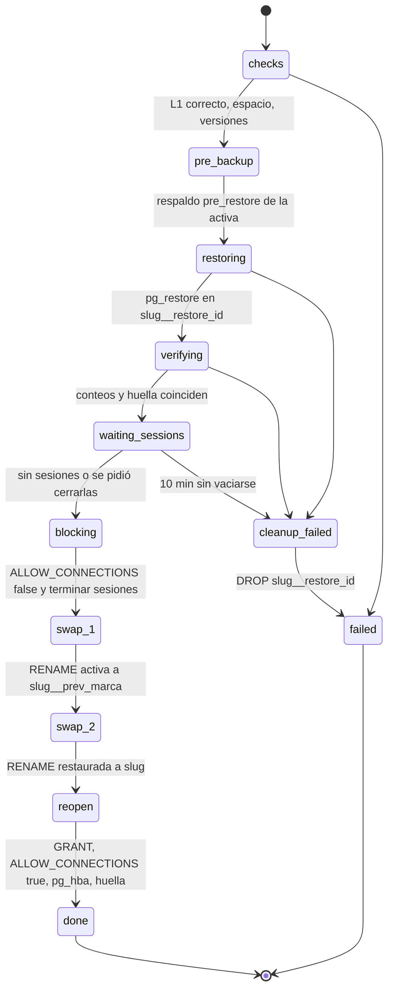
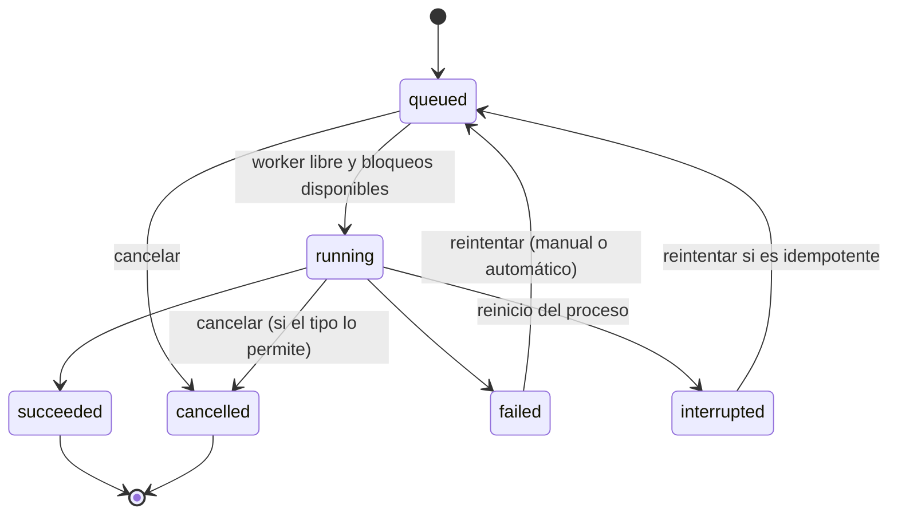

# 11. Respaldos, recuperación y automatización

## 1. Objetivos

| Objetivo | Valor por defecto | Configurable |
|---|---|---|
| RPO (pérdida máxima) | 24 h con la programación diaria; 4 h con el preset "horario laboral" | Sí, por biblioteca |
| RTO (restaurar una biblioteca) | Duración de `pg_restore` más menos de 1 min de intercambio | Se mide en PoC-10 y se publica por tamaño |
| Verificación | Nivel 1 en cada respaldo; nivel 2 semanal del último de cada biblioteca | Sí |
| Respaldo verificado más reciente | Nunca más de 48 h en bibliotecas activas (si no, alerta `backup.stale`) | Sí |

## 2. Capas de protección

| Capa | Qué protege | Versión |
|---|---|---|
| L1. Respaldos lógicos por biblioteca en el volumen `backups` | Errores humanos, corrupción lógica, restauración granular | 1.0 |
| L2. Copia externa cifrada con restic | Pérdida del servidor o del disco de respaldos | 1.1 |
| L3. PITR con pgBackRest (WAL continuo) | Pérdida de minutos, no de horas | 2.0 |
| L4. Instantáneas del sistema de archivos del host (ZFS, Btrfs) | Todo el host, a nivel de bloques | Recomendación operativa; fuera de sqsolve |
| L5. Kit de recuperación y respaldo del plano de control | Reconstruir sqsolve en otro servidor | 1.0 |

Recomendación documentada: el volumen `backups` en un disco o pool distinto del de `pgdata`, y
al menos una copia fuera del edificio (L2 o la replicación del NAS).

## 3. Disposición del volumen de respaldos

```
/backups/
  .sqsolve-volume                    marcador: {"instance_id": "...", "created_at": "..."}
  libraries/
    cliente_x/
      2026/10/
        cliente_x_20261018T070000Z_01JB....backup
        cliente_x_20261018T070000Z_01JB....manifest.json
  _system/
    sqsolve-state-20261018T040000Z.db    copia diaria de SQLite (VACUUM INTO)
    audit-202610.jsonl                    exportación mensual de la auditoría
  _import/                                carpeta para importar archivos externos
```

Permisos: directorios 0700 y archivos 0600 del UID de sqsolve. El marcador se crea en el asistente
y se comprueba antes de cada escritura (RNF-FIA-04): si el volumen no está montado, la ruta
existe vacía dentro del contenedor y escribir ahí llenaría la capa del contenedor o el disco
equivocado.

## 4. Procedimiento de respaldo

Tarea `backup.create`. Pasos (cada uno se registra en `job_steps`):

1. **preflight**: biblioteca en `active` o `maintenance`; marcador válido; espacio libre mayor o
   igual a `max(1.5 × tamaño del último respaldo, 0.5 × pg_database_size)` (si no hay historial,
   `pg_database_size`); no hay restauración de esa biblioteca en curso.
2. **snapshot**: conexión de control en `BEGIN ISOLATION LEVEL REPEATABLE READ, READ ONLY`;
   `SELECT pg_export_snapshot()`; se lee la marca de actividad de la base (`07` §7) y se guarda
   con el respaldo (`activity_mark`) y en el manifiesto.
3. **dump**: `pg_dump --dbname=<slug> --format=custom --quote-all-identifiers --snapshot=<id>
   --lock-wait-timeout=60s --file=<ruta>.partial` (compresión por defecto de `pg_dump`; `zstd`
   opcional si PoC-04 confirma que no afecta la restauración desde Resolve). Credenciales por
   `PGPASSFILE` temporal 0600 en `/tmp` del contenedor (tmpfs), borrado al terminar.
4. **counts**: en la misma transacción del paso 2, `SELECT count(*)` por cada tabla de `public`
   listada en el catálogo (identificadores saneados). Para bibliotecas con más de 10 millones de
   filas estimadas, se usan estimaciones de `pg_class.reltuples` y el manifiesto lo indica.
   `COMMIT`.
5. **fingerprint**: huella de esquema (`07` §9).
6. **seal**: `fsync` del archivo, `rename` a `.backup`, `fsync` del directorio; SHA-256 del
   archivo; escribir manifiesto con el mismo patrón atómico; registrar en catálogo con estado
   `ok`.
7. **verify_l1**: recalcular SHA-256 leyendo del disco y `pg_restore --list` sin errores;
   `verify_status = l1_ok`. Si falla: estado `failed`, borrar archivo y manifiesto, evento
   `backup.verify_failed`.
8. **post**: evento `backup.succeeded`, notificaciones, encolar retención y copia externa si
   corresponden.

Impacto en Resolve: `pg_dump` toma bloqueos `ACCESS SHARE`, que solo chocan con DDL (`ALTER`,
`DROP`, `TRUNCATE`). Si Resolve pide un bloqueo exclusivo durante el respaldo, espera, y las
consultas que llegan detrás también. PoC-10 mide si esto pasa en la práctica; la guía recomienda
programar respaldos fuera de horas de actualización de versión de Resolve.

## 5. Verificación

| Nivel | Qué hace | Cuándo |
|---|---|---|
| L1 | SHA-256 coincide con el manifiesto; `pg_restore --list` lee el índice | Tras cada respaldo y antes de cada restauración |
| L2 | Restaura en `sqsolve_verify_<id8>` con `--no-owner --no-privileges --exit-on-error`; compara conteos por tabla y huella con el manifiesto; borra la base | Semanal (domingo 05:00) para el último respaldo de cada biblioteca activa; manual en cualquier respaldo |
| L3 | Simulacro con Resolve: un humano abre en Resolve una copia restaurada y revisa un proyecto | Trimestral, guiado por la checklist de la documentación; se registra a mano en la interfaz |

L2 necesita espacio libre en `pgdata` igual al tamaño de la biblioteca; si no lo hay, se omite
con aviso. La base de verificación tiene `CONNECTION LIMIT 1` y ningún rol de biblioteca puede
entrar (no está en `pg_hba.conf`).

## 6. Retención

Política por biblioteca:

```
keep_last      = 10   # los N más recientes con estado ok
keep_daily     = 14   # el más reciente de cada uno de los últimos N días
keep_weekly    = 8    # el más reciente de cada una de las últimas N semanas ISO
keep_monthly   = 12   # el más reciente de cada uno de los últimos N meses
min_verified   = 1    # nunca quedar con menos de N respaldos con verificación L1 o L2 correcta
```

Algoritmo (en `internal/backup/retention.go`, función pura con pruebas de propiedades):

1. Candidatos: respaldos `ok` de la biblioteca, ordenados por `started_at` descendente.
2. Conservar: los fijados; los de tipo `pre_restore`, `pre_delete` y `pre_upgrade` con menos de
   30 días; los que cumplen alguna regla `keep_*` (los días, semanas y meses se calculan en la
   zona horaria de la política).
3. Si tras eso quedan menos de `min_verified` verificados, conservar los verificados más
   recientes hasta cumplirlo.
4. El resto pasa a `expired`. Borrado en dos fases: primero el archivo, luego el manifiesto, luego
   la fila pasa a `deleted` (se conserva el registro para la auditoría).
5. Respaldos `failed` e `interrupted`: se borran sus restos al momento; la fila queda 30 días.

La vista previa (`GET .../backup-policy/preview`) usa la misma función con la política propuesta.

## 7. Restauración

### 7.1 Modos

| Modo | Riesgo | Uso típico |
|---|---|---|
| Como biblioteca nueva | Ninguno sobre la activa | Recuperar un proyecto: abrir la copia en Resolve, exportar `.drp` e importarlo en la original |
| Reemplazar | Se pierden los cambios posteriores al respaldo (reversible durante 7 días) | La biblioteca activa está dañada o hay que volver atrás todo |
| Descargar | Ninguno | Restaurar desde Resolve en otro lugar |

### 7.2 Reemplazo por intercambio



Pasos de SQL del intercambio (como `sqsolve_admin`, dueño de las bases según PoC-01; si no, con
el superusuario):

```sql
ALTER DATABASE cliente_x ALLOW_CONNECTIONS false;
SELECT pg_terminate_backend(pid) FROM pg_stat_activity WHERE datname = 'cliente_x';
ALTER DATABASE cliente_x RENAME TO cliente_x__prev_202610181930;
ALTER DATABASE cliente_x__restore_7f3a91c2 RENAME TO cliente_x;
REVOKE CONNECT ON DATABASE cliente_x FROM PUBLIC;
GRANT CONNECT, TEMP ON DATABASE cliente_x TO cliente_x;
ALTER DATABASE cliente_x ALLOW_CONNECTIONS true;
```

`ALTER DATABASE ... RENAME` no se puede ejecutar dentro de una transacción junto con el otro
renombre, por eso existe el diario.

### 7.3 Recuperación tras un corte durante el intercambio

Al arrancar, para cada `restore.replace` interrumpida se observa qué bases existen:

| Existe `slug` | Existe `slug__prev_marca` | Existe `slug__restore_id` | Acción |
|---|---|---|---|
| Sí | No | Sí | No hubo renombre: borrar `__restore`, reabrir `slug`, marcar fallida |
| No | Sí | Sí | Se cortó entre renombres: completar renombre de `__restore` a `slug`, reabrir, marcar correcta con aviso |
| Sí | Sí | No | Intercambio hecho: asegurar `GRANT` y `ALLOW_CONNECTIONS`, marcar correcta |
| No | Sí | No | Anómalo: renombrar `__prev` a `slug`, reabrir, marcar fallida y alerta crítica |

Ningún caso borra `slug` ni `slug__prev_marca`.

### 7.4 Reversión

Durante 7 días (configurable), "Revertir" hace el intercambio inverso: la activa actual pasa a
`slug__prev_<marca nueva>` y la `__prev` anterior vuelve a `slug`. También deja un respaldo
`pre_restore` previo. Al vencer el plazo, la `__prev` se borra con una tarea que antes confirma
que existe un respaldo `pre_restore` verificado de ella.

### 7.5 Compatibilidad del respaldo

Antes de restaurar se compara el manifiesto con el servidor:

| Situación | Resultado |
|---|---|
| `pg_dump` del respaldo de versión mayor a la de `pg_restore` | Rechazo `SQS-R004` (no se puede leer) |
| PostgreSQL del respaldo anterior al actual | Permitido |
| Huella del respaldo distinta a la de la biblioteca activa | Aviso: "Este respaldo es de otra versión de Resolve (declarada: 20.3.2). Las estaciones con 21.x lo actualizarán al abrirlo y 20.3.2 dejará de abrir los proyectos que se abran en 21" |
| Respaldo importado sin manifiesto | Se genera manifiesto con `pg_restore --list` y SHA-256; sin conteos, así que L2 solo compara huella y se marca "verificación parcial" |

## 8. Fallos e interrupciones

| Fallo | Detección | Manejo |
|---|---|---|
| Corte de energía durante `pg_dump` | Al arrancar: tarea `running`, archivo `.partial` | Tarea `interrupted`, borrar `.partial`, evento; la siguiente programación corre normal o por la política de ejecuciones perdidas |
| Corte durante verificación L2 | Base `sqsolve_verify_*` sin tarea viva | `DROP DATABASE ... WITH (FORCE)` |
| Corte durante restauración antes del intercambio | `__restore_*` sin tarea viva | Borrarla; la activa no se tocó |
| Corte durante el intercambio | Diario | Tabla de §7.3 |
| Disco lleno | Preflight o error de escritura de `pg_dump` | Borrar `.partial`, `SQS-B012`, alerta; nunca se borran respaldos fuera de la retención para hacer lugar |
| Volumen de respaldos ausente | Marcador | No escribir; `storage.volume_missing` crítico; tareas de respaldo fallan con `SQS-S001` |
| PostgreSQL caído | Conexión falla | Reintentos con espera 30 s, 2 min, 5 min; luego `failed` con `SQS-P001` |
| `pg_dump` espera bloqueo más de 60 s | Código de salida y mensaje | `failed` con `SQS-B020`; reintento automático una vez a los 15 min |
| Restauración incompatible | §7.5 | Rechazo antes de tocar nada |
| Archivo de respaldo alterado | SHA-256 | `verify_failed`; nunca se usa para restaurar sin forzar explícito y auditado |

## 9. Copias externas con restic (1.1)

- Destinos: ruta local (otro disco), SFTP, servidor REST de restic, S3 compatible (incluidos
  servicios autohospedados como Garage).
- Tras cada respaldo correcto (o por programación propia): `restic backup` del archivo y su
  manifiesto con etiquetas `library:<slug>`, `kind:<tipo>`.
- Retención remota con `restic forget --prune` y su propia política (por defecto igual a la
  local).
- `restic check --read-data-subset=5%` semanal; fallo genera `offsite.check_failed`.
- Restaurar desde remoto: `restic restore` a `_import/` y el flujo de importación normal.

## 10. Programador

- Dos modos por biblioteca (ADR 0022). **Según actividad**, el modo por defecto en instalaciones
  nuevas: el programador despierta cada 5, 10, 15, 30 o 60 minutos y respalda solo si la marca de
  actividad cambió desde el último respaldo correcto; la revisión queda en la política
  (`last_check_at`, `last_check_same`) y no genera tarea ni evento. **Cron**: expresiones de 5
  campos en la zona horaria de la política, más presets: "diario a las HH:MM", "cada N horas
  entre HH y HH, días laborables", "cada 4 horas", "cada hora".
- Un respaldo verificado cuya marca coincide con la actual sigue vigente aunque sea viejo: no
  dispara `backup.stale` ni pinta franja ámbar en la línea de protección.
- Desplazamiento aleatorio fijo por biblioteca de 0 a 5 min (derivado del ID) para no lanzar todo
  a la vez.
- Ejecuciones perdidas: si al arrancar la última ejecución programada quedó sin correr y fue hace
  menos de `misfire_window_minutes` (por defecto 12 h para respaldos), se encola una sola vez.
  Si fue antes, se registra `backup.missed`.
- Cambio de horario de verano: se usa `time.Location` de Go; una hora que no existe se salta y una
  que se repite corre una vez.

## 11. Cola de tareas



- Prioridad: `restore.*` 100, `backup.create` manual 80, programado 50, `backup.verify` 30,
  mantenimiento 10.
- Bloqueos por biblioteca: modo escritura (restauración, eliminación, mantenimiento) excluye todo;
  modo lectura (respaldo, verificación) admite otras lecturas.
- Cancelables: `backup.create`, `backup.verify`, `restore.new`, `restore.replace` antes del paso
  `blocking`. No cancelables: intercambio en curso, purga.
- Historial de tareas y registros: 90 días por defecto.

## 12. Tareas de mantenimiento predeterminadas

| Tarea | Programación por defecto |
|---|---|
| Retención de todas las bibliotecas | Diaria 04:00 y tras cada respaldo |
| Verificación L2 del último respaldo de cada biblioteca | Domingo 05:00 |
| `VACUUM (ANALYZE)` por biblioteca | Domingo 03:00 |
| Huella de esquema | Cada 5 min |
| Espacio en volúmenes | Cada 5 min |
| Coherencia catálogo y archivos | Diaria 04:30 |
| Respaldo del plano de control | Diaria 04:15 |
| Exportación mensual de auditoría | Día 1, 04:45 |
| Purga de papelera y de `__prev` vencidas | Diaria 04:20 |
| Certificados por vencer | Diaria 06:00 |
| Rotación de la contraseña de `sqsolve_admin` | Cada 90 días |

## 13. Notificaciones

- Canales: webhook (1.0), SMTP y ntfy (1.1).
- Reglas: patrón de tipo de evento (`backup.*`, `storage.low`) y severidad mínima.
- Por defecto, al crear el primer canal: `error` y `critical` de todo, más `backup.stale`.
- Agrupación: el mismo tipo de evento de la misma biblioteca no se repite en menos de 30 min; el
  envío siguiente dice "y 4 más".
- Correo: asunto `[sqsolve] <severidad>: <mensaje>`, cuerpo de texto plano con enlace.
- ntfy: prioridad según severidad, etiqueta con la biblioteca.
