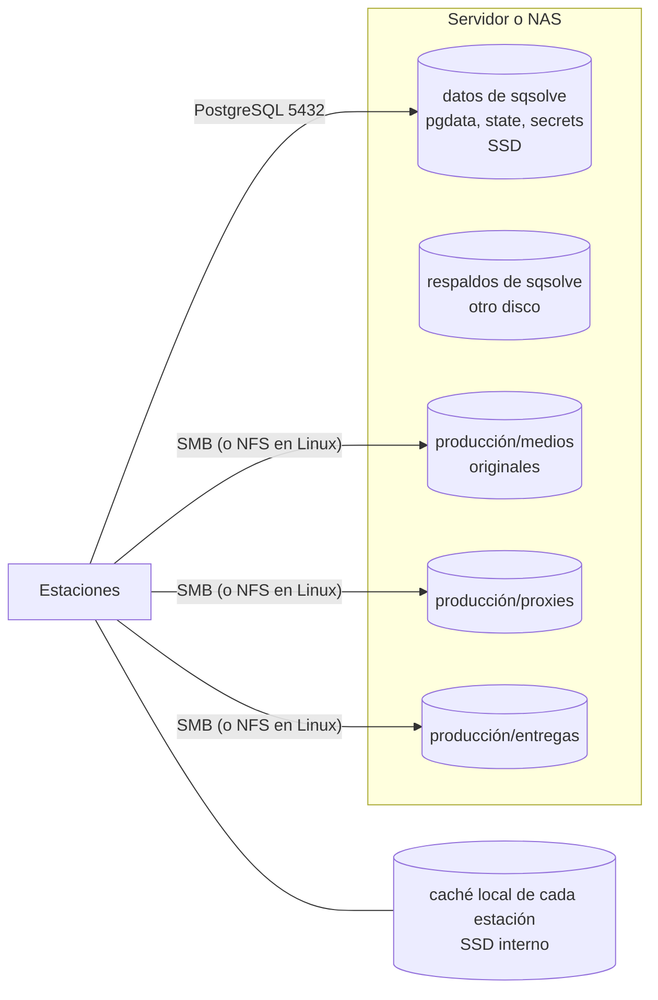

# 15. Almacenamiento de medios

## 1. Lo que es y lo que no es una biblioteca

Una biblioteca de Resolve guarda metadatos: proyectos, bins, timelines, correcciones de color,
referencias a archivos de medios por ruta. **No** guarda el video, el audio, los gráficos, los
proxies ni la caché. El propio manual de Resolve lo aclara para la colaboración: Resolve permite
colaborar, pero el acceso compartido a los medios lo resuelve otro sistema [01 ref. 5].

Consecuencia: respaldar la biblioteca no respalda los medios. Restaurar una biblioteca sin sus
medios deja clips "fuera de línea". La documentación lo dice en la pantalla de respaldos y en la
guía del administrador.

## 2. Arquitectura recomendada del almacenamiento

- **Medios originales** en un recurso compartido por SMB (Windows, macOS y Linux lo montan) o NFS
  (solo estaciones Linux). Un recurso por producción o uno general con carpetas por producción.
- **Proxies** en su propio recurso compartido para que todas las estaciones usen los mismos.
- **Caché de render y de optimizados**: local en cada estación (SSD interno); compartirla genera
  tráfico y conflictos sin beneficio para un estudio pequeño.
- **Datos de sqsolve** separados de los medios: perfil de acceso distinto (pequeño y aleatorio
  frente a grande y secuencial).

## 3. Rutas entre sistemas operativos

Resolve guarda rutas absolutas. Una misma carpeta se ve como `\\nas\produccion\...` o `P:\` en
Windows, `/Volumes/produccion/...` en macOS y `/mnt/produccion/...` en Linux. Para que un proyecto
abra en cualquier estación:

1. **Convención única por estudio**, documentada en las notas de la biblioteca (campo "Notas" de
   sqsolve): mismo nombre de recurso compartido, misma letra en Windows, mismo punto de montaje en
   Linux.
2. **Mapeo de rutas de Resolve**: las preferencias de almacenamiento de medios de Resolve permiten
   asociar rutas equivalentes entre plataformas ("mapped mount"). Estado: documentado en manuales
   anteriores, VIABLE-PENDIENTE de comprobar en 21.1 (se agrega al guion de compatibilidad).
3. **Relink** de Resolve como respaldo cuando un proyecto llega de otro estudio.

sqsolve no reescribe rutas dentro de las bibliotecas: sería modificar datos de Resolve (ADR 0007).

## 4. Disponibilidad de medios

- Antes de una sesión colaborativa, todas las estaciones deben tener montados los mismos
  recursos. Un clip fuera de línea en una estación no afecta a las demás, pero confunde.
- Permisos: lectura y escritura para editores en `medios` y `proxies`; los asistentes que
  ingieren material necesitan escritura; los coloristas pueden trabajar con lectura en
  `medios`.
- Instantáneas del sistema de archivos del NAS en los recursos de medios (frecuencia sugerida:
  cada hora en horario de trabajo, retención de 2 semanas) protegen de borrados accidentales.

## 5. Proxies

- Generados en las estaciones (Resolve o Blackmagic Proxy Generator, que instala Resolve
  [01 ref. 1]) hacia el recurso `proxies`.
- La ubicación de proxies se configura por proyecto en Resolve; la convención va en las notas de
  la biblioteca.
- sqsolve no genera proxies (fuera de alcance).

## 6. Módulo opcional: capacidad de volúmenes de medios (1.2)

Justificación: el problema más común en un estudio pequeño es quedarse sin espacio a mitad de una
ingesta; el panel de sqsolve ya es el lugar donde se mira la salud del servidor.

- El administrador monta cada recurso de medios en el contenedor de sqsolve **en solo lectura**
  (`/media/<nombre>:ro`) y lo registra en Ajustes.
- sqsolve solo llama a `statfs`: espacio total, usado y libre. No lista ni lee archivos.
- Alertas a umbrales configurables y en el panel de salud.

## 7. Lo que sqsolve no hará

- Indexar, mover, copiar, verificar o transcodificar medios.
- Relacionar bibliotecas con carpetas de medios leyendo el contenido de los proyectos.
- Servir medios por la red.

Si en el futuro se plantea un módulo de medios (por ejemplo, comprobar que las rutas de un proyecto
existen), requiere leer tablas de Resolve y por eso queda DESCARTADO mientras exista el principio
de caja negra.
