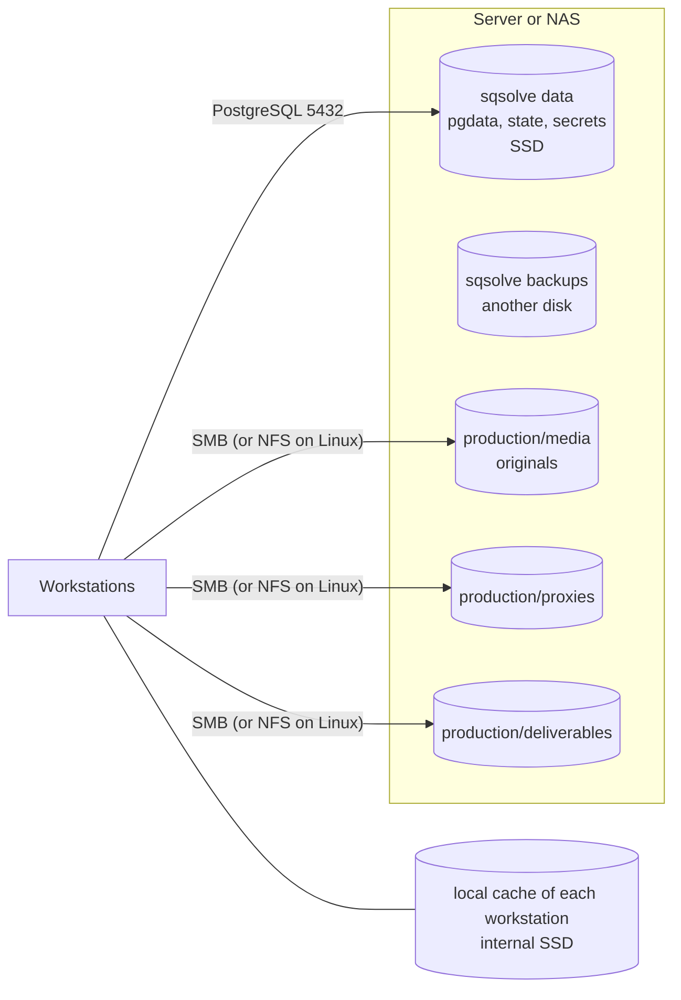

# 15. Media storage

## 1. What a library is and what it is not

A Resolve library stores metadata: projects, bins, timelines, color corrections, references to
media files by path. It does **not** store the video, the audio, the graphics, the proxies or the
cache. Resolve's own manual makes this clear for collaboration: Resolve allows collaboration, but
shared access to the media is handled by another system [01 ref. 5].

Consequence: backing up the library does not back up the media. Restoring a library without its
media leaves clips "offline". The panel says so under the backup list of each library.

## 2. Recommended storage architecture

- **Original media** on a share over SMB (Windows, macOS and Linux mount it) or NFS (Linux
  workstations only). One share per production or a general one with folders per production.
- **Proxies** on their own share so that every workstation uses the same ones.
- **Render and optimized media cache**: local on each workstation (internal SSD); sharing it
  generates traffic and conflicts with no benefit for a small studio.
- **sqsolve data** separate from the media: a different access profile (small and random versus
  large and sequential).

## 3. Paths across operating systems

Resolve stores absolute paths. The same folder appears as `\\nas\production\...` or `P:\` on
Windows, `/Volumes/production/...` on macOS and `/mnt/production/...` on Linux. For a project to
open on any workstation:

1. **One convention per studio**, documented in the library notes (the "Notes" field in sqsolve):
   same share name, same drive letter on Windows, same mount point on Linux.
2. **Resolve path mapping**: Resolve's media storage preferences allow equivalent paths to be
   associated across platforms ("mapped mount"). Status: documented in earlier manuals; not
   checked with Resolve 21.1 (To be confirmed).
3. **Resolve relink** as the fallback when a project arrives from another studio.

sqsolve does not rewrite paths inside libraries: that would mean modifying Resolve data (ADR 0007).

## 4. Media availability

- Before a collaborative session, every workstation must have the same shares mounted. An offline
  clip on one workstation does not affect the others, but it is confusing.
- Permissions: read and write for editors on `media` and `proxies`; assistants who ingest material
  need write access; colorists can work with read access on `media`.
- Filesystem snapshots on the NAS media shares (suggested frequency: hourly during working hours,
  2 weeks of retention) protect against accidental deletion.

## 5. Proxies

- Generated on the workstations (Resolve or Blackmagic Proxy Generator, which Resolve installs
  [01 ref. 1]) into the `proxies` share.
- The proxy location is configured per project in Resolve; the convention goes in the library
  notes.
- sqsolve does not generate proxies (out of scope).

## 6. Media volume capacity

sqsolve does not monitor media volumes. Its health page and its space alerts cover only its own
three volumes (database, application and backups). A capacity monitor for media shares is a
product direction in `20-roadmap.md`.

Rationale: the most common problem in a small studio is running out of space in the middle of an
ingest, and the sqsolve panel is already where the server's health is checked. The design kept
for it:

- The administrator mounts each media share into the sqsolve container **read-only**
  (`/media/<name>:ro`) and registers it in Settings.
- sqsolve only calls `statfs`: total, used and free space. It does not list or read files.
- Alerts at configurable thresholds and on the health page.

## 7. What sqsolve does not do

- Index, move, copy, verify or transcode media.
- Relate libraries to media folders by reading the contents of projects.
- Serve media over the network.

A media module that checks, for example, that the paths of a project exist would need to read
Resolve tables beyond the bounded read of ADR 0019, so it would require extending that ADR.
sqsolve does not serve still images either: the experimental export (`22`) delivers the
node tree and the thumbnail, not the DPX.
