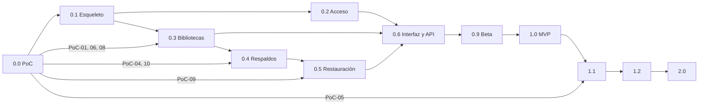

# 20. Roadmap

Sin fechas: el ritmo depende de quién implemente. El tamaño de cada fase va en tallas (S, M, L)
como orden de magnitud relativo.

## 1. Versiones

| Versión | Contenido | Talla |
|---|---|---|
| **0.0** Fase 0 | PoC-01 a PoC-10, laboratorio, ADR confirmados o corregidos | M |
| **0.1** Esqueleto | Repo, CI, binario, configuración, SQLite, secretos, Compose, arranque de PostgreSQL, rol de control, salud, `doctor` | M |
| **0.2** Acceso | Usuarios del panel, sesiones, TOTP, tokens, autorización, auditoría, asistente inicial | M |
| **0.3** Bibliotecas | Ciclo de vida completo con E1 (y E0 si aplica), credenciales, `pg_hba.conf`, sesiones, mantenimiento, papelera, huella | L |
| **0.4** Respaldos | Respaldo manual y programado, manifiesto, L1, catálogo, retención, descarga, importación, plano de control | L |
| **0.5** Restauración | Como nueva, por intercambio, reversión, L2, recuperación tras cortes | L |
| **0.6** Interfaz y API | Todas las pantallas 1.0, OpenAPI completo, SSE, webhooks | L |
| **0.9** Beta | Endurecimiento, pruebas de fallos, ZAP, documentación de usuario, runbooks, ventana de actualización de Resolve, kit y recuperación de instalación | M |
| **1.0** MVP | Guion de aceptación AC-01 a AC-11 aprobado | S |
| **1.1** Equipos | Credenciales por persona, portal de colaborador, reglas de red en la interfaz, SMTP y ntfy, restic, hooks en contenedor aparte, migración desde otro servidor, `.resolvedbkey` si PoC-05 pasa, E2 plantillas, exportación experimental de proyectos y grados (ADR 0019) | L |
| **1.2** Operación | Métricas Prometheus, capacidad de volúmenes de medios, `sqsolve-check` para estaciones, mantenimiento programable en la interfaz | M |
| **2.0** Avanzado | PITR con pgBackRest, OIDC, WebAuthn, asistente de versión mayor de PostgreSQL, modo servidor externo | L |

## 2. Dependencias entre fases

Lo que puede avanzar en paralelo: 0.2 con 0.3; la interfaz de cada área puede empezar en cuanto su
servicio tiene API interna estable (los handlers HTML se escriben junto con cada servicio y 0.6
completa y unifica).

## 3. Hitos y puertas

| Hito | Puerta para pasar |
|---|---|
| H0 Fin de PoC | Informes de PoC-01, 02, 04, 06, 08 y 09 escritos; ADR 0006, 0008, 0009 y 0010 confirmados o reemplazados; matriz de compatibilidad inicial |
| H1 Servidor vacío funcional | `docker compose up` deja PostgreSQL y sqsolve sanos; `doctor` en verde; reinicio sin pérdidas |
| H2 Primera biblioteca real | Una estación con Resolve crea y abre un proyecto en una biblioteca creada por sqsolve |
| H3 Respaldo restaurable | Respaldo programado restaurado como copia y abierto en Resolve |
| H4 Intercambio seguro | Pruebas de inyección de fallos del intercambio en verde |
| H5 Beta | Todas las tareas de 0.9 cerradas; documentación de usuario completa |
| H6 1.0 | Guion de aceptación aprobado y registrado |

## 4. Prioridades

1. Que nada pierda datos (respaldos, intercambio, retención, recuperación tras cortes).
2. Que una estación se conecte sin ayuda.
3. Que el administrador sepa siempre el estado (avisos, salud, auditoría).
4. Comodidad y funciones de equipo.

Si hay que recortar para llegar a 1.0, se recorta en este orden inverso: TOTP obligatorio
configurable, importación por subida (queda la carpeta `_import`), exportación de auditoría por la
interfaz (queda la CLI). Nunca se recorta verificación, intercambio seguro ni recuperación.
