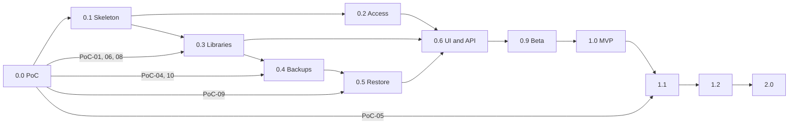

# 20. Roadmap

No dates: the pace depends on who implements. The size of each phase is given in sizes (S, M, L)
as a relative order of magnitude.

## 1. Versions

| Version | Content | Size |
|---|---|---|
| **0.0** Phase 0 | PoC-01, 03, 04, 06, 08 and 09 against mininas and Diego's workstation; PoC-02 only 21.1.x with PostgreSQL 18; ADRs confirmed or corrected (cut of 2026-10-19) | M |
| **0.1** Skeleton | Repo, CI, binary, configuration, SQLite, secrets, Compose, PostgreSQL start, control role, health, `doctor` | M |
| **0.2** Access | Panel users, sessions, TOTP, tokens, authorization, audit log, setup wizard | M |
| **0.3** Libraries | Full lifecycle with E1 (and E0 if applicable), credentials, `pg_hba.conf`, sessions, maintenance, trash, fingerprint | L |
| **0.4** Backups | Manual and scheduled backup, manifest, L1, catalog, retention, download, import, control plane | L |
| **0.5** Restore | As new, by swap, revert, L2, recovery after outages | L |
| **0.6** UI and API | All 1.0 screens, JSON API, SSE, webhooks. OpenAPI and contract tests move to 1.1 | L |
| **0.9** Beta | Hardening, fault battery already running in CI, manual security review against `08` and a local ZAP run, README as manual, SECURITY, CHANGELOG, CONTRIBUTING, three runbooks, Resolve upgrade window, kit and installation recovery | M |
| **1.0** MVP | Short acceptance script (AC-01 to AC-11 in one session with two workstations, without the 72 hours) approved; release signed with keyless cosign and published on GitHub with the compose and the notes. Includes the visual identity (ADR 0020), proportionate security (ADR 0021), activity-based backups (ADR 0022) and the experimental export from a library and from a backup (ADR 0019) | S |
| **1.1** Teams | Per-person credentials, collaborator portal, network rules in the UI, SMTP and ntfy, restic, hooks in a separate container, migration from another server, `.resolvedbkey` if PoC-05 passes, E2 templates. Receives from 1.0: OpenAPI and contract, e2e with a browser, nightly ZAP, fuzz and reproducible, full PoC-02, 05, 07 and 10, remaining manuals and runbooks, registry mirror and standalone binaries | L |
| **1.2** Operations | Prometheus metrics, media volume capacity, `sqsolve-check` for workstations, schedulable maintenance in the UI | M |
| **2.0** Advanced | PITR with pgBackRest, OIDC, WebAuthn, PostgreSQL major version wizard, external server mode | L |

## 2. Dependencies between phases

What can advance in parallel: 0.2 with 0.3; the UI of each area can start as soon as its service
has a stable internal API (the HTML handlers are written together with each service and 0.6
completes and unifies them).

## 3. Milestones and gates

| Milestone | Gate to pass |
|---|---|
| H0 End of PoCs | Reports of PoC-01, 02, 04, 06, 08 and 09 written; ADR 0006, 0008, 0009 and 0010 confirmed or superseded; initial compatibility matrix |
| H1 Working empty server | `docker compose up` leaves PostgreSQL and sqsolve healthy; `doctor` green; restart without losses |
| H2 First real library | A workstation with Resolve creates and opens a project in a library created by sqsolve |
| H3 Restorable backup | Scheduled backup restored as a copy and opened in Resolve |
| H4 Safe swap | Fault injection tests of the swap green |
| H5 Beta | All 0.9 tasks closed; user documentation complete |
| H6 1.0 | Acceptance script approved and recorded |

## 4. Priorities

1. That nothing loses data (backups, swap, retention, recovery after outages).
2. That a workstation connects without help.
3. That the administrator always knows the state (notifications, health, audit log).
4. Convenience and team features.

If cuts are needed to reach 1.0, they are made in this reverse order: configurable mandatory
TOTP, import by upload (the `_import` folder remains), audit log export through the UI (the CLI
remains). Verification, safe swap and recovery are never cut.
